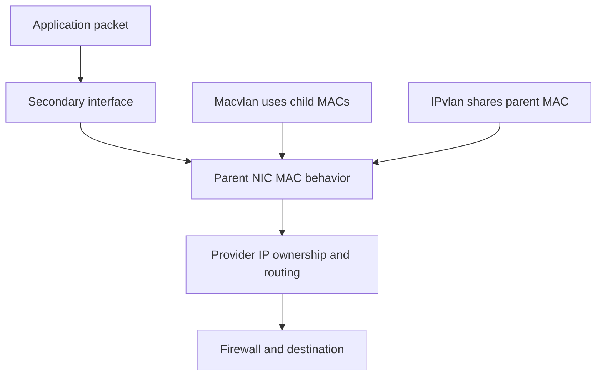

# Choose Macvlan or IPvlan for Multus on Restricted Cloud Networks

Author: [nawazdhandala](https://www.github.com/nawazdhandala)

Tags: Multus, Kubernetes, Networking

Description: Compare macvlan and ipvlan by MAC behavior, cloud IP ownership, routing, and application requirements before changing a Multus secondary network.

A Multus Pod can have a secondary interface, a valid-looking address, and no usable connection beyond its node. One possible reason is that the virtual network accepts only the node interface's registered MAC address. Macvlan introduces additional MAC addresses; the provider or virtual switch may reject their traffic.

IPvlan is worth evaluating in that situation because its child interfaces share the parent's MAC address. But replacing `macvlan` with `ipvlan` does not automatically authorize extra IP addresses, install cloud routes, or open firewall rules. Treat the change as a network design decision with a controlled test, not a universal cloud fix.

This article references **CNI plugins v1.8.0**, including its ipvlan implementation at commit `0e648479e11c2c6d9109b14fc0c9ac64c677861b`. The configuration example is an isolated lab pattern, not a cloud-provider deployment recipe. No cloud or Linux networking runtime tests were performed.

## Separate the MAC question from the IP question

A MAC address identifies an interface on an Ethernet segment. An IP address identifies a network-layer endpoint. A virtual network can enforce both: which MAC may transmit through a port, and which IP addresses belong to that port or instance.

Macvlan gives child interfaces distinct MAC addresses. IPvlan shares the parent's MAC and selects the child using IP information. That difference can address a multiple-MAC restriction, but it says nothing about whether an additional source IP is registered with the cloud. [Macvlan CNI](https://www.cni.dev/plugins/current/main/macvlan/), [IPvlan CNI](https://www.cni.dev/plugins/current/main/ipvlan/).

For example, AWS network interfaces have a MAC address, primary and secondary IP attributes, security groups, and a source/destination check setting. Secondary addresses are managed through the EC2 control plane. A local IPAM allocation is not the same operation as assigning an address to an AWS network interface. This is a distinction to verify with your provider, not a claim that an arbitrary ipvlan setup is supported on EC2. [EC2 interface attributes](https://docs.aws.amazon.com/AWSEC2/latest/UserGuide/using-eni.html), [EC2 IP address management](https://docs.aws.amazon.com/AWSEC2/latest/UserGuide/managing-network-interface-ip-addresses.html).



Changing the behavior at the third box does not remove the fourth or fifth checks.

## Choose a mode from the application's needs

| Requirement | Macvlan consideration | IPvlan consideration |
| --- | --- | --- |
| Upstream permits several MAC addresses | Often a natural fit for an Ethernet attachment | Shared MAC may still be useful |
| Upstream permits only the parent MAC | Child MACs may be rejected | Evaluate shared-MAC behavior and IP authorization |
| Application needs broadcast or multicast | Evaluate plugin mode and upstream support | L2 and L3 have different behavior |
| Application needs a separate routed subnet | Requires an explicit routing design | L3 needs upstream reachability to the routed addresses |
| Existing DHCP workflow | Distinct MACs help distinguish clients | Shared MAC requires a compatible client-identity design |

The Linux ipvlan documentation distinguishes L2 from L3: L2 supports broadcast and multicast handling, while L3 does not send or receive that traffic through the child interfaces. Therefore, moving a discovery-heavy application to L3 can change its behavior even if ordinary unicast connections work. [Linux ipvlan modes](https://docs.kernel.org/networking/ipvlan.html).

The CNI ipvlan plugin accepts `l2`, `l3`, and `l3s`, and defaults to `l2`. Specify the mode explicitly so readers and reviewers do not need to infer it. Do not confuse the CNI default with examples for the kernel's direct interface-creation command. [Pinned mode parser](https://github.com/containernetworking/plugins/blob/v1.8.0/plugins/main/ipvlan/ipvlan.go).

Also avoid assuming that the same DHCP configuration transfers unchanged. The CNI documentation warns that ipvlan's shared MAC requires ClientID support that its referenced DHCP plugin does not provide. Use an address-allocation method verified for the chosen combination.

## Build a small, explicitly bounded lab

Prerequisites are working Multus, the ipvlan and static IPAM binaries from the approved plugin release, Linux ipvlan support, and an approved parent interface. Reserve a single test address that is both unused and authorized by the upstream network. If cloud address registration is required, complete it through the provider's supported process first.

The NAD below is for **one test Pod only**. Replace every documentation address and placeholder before applying it. Static IPAM does not coordinate allocation: using this NAD unchanged for multiple Pods would request the same address repeatedly.

```yaml
apiVersion: k8s.cni.cncf.io/v1
kind: NetworkAttachmentDefinition
metadata:
  name: ipvlan-one-pod-lab
  namespace: REPLACE_NAMESPACE
spec:
  config: |-
    {
      "cniVersion": "0.3.1",
      "name": "ipvlan-one-pod-lab",
      "type": "ipvlan",
      "master": "REPLACE_PARENT_INTERFACE",
      "mode": "l2",
      "ipam": {
        "type": "static",
        "addresses": [{"address": "192.0.2.50/24"}]
      }
    }
```

The example deliberately provides only connected-subnet access. It adds no default route, so a test against an off-subnet destination would require an additional approved route. First test a known peer on the authorized secondary subnet. The address schema follows the static IPAM plugin. [Static IPAM reference](https://www.cni.dev/plugins/current/ipam/static/).

Use a separate eligible node or a separately prepared parent interface when comparing modes. The CNI documentation states that one master cannot be used by both macvlan and ipvlan simultaneously. Do not change a parent still serving production macvlan attachments merely to run a comparison.

## Verify the actual boundary that fails

Inside the disposable Pod's approved diagnostic container, inspect the requested secondary interface. These read-only commands require iproute2; replace `REPLACE_INTERFACE` with the actual name:

```bash
ip -d link show dev REPLACE_INTERFACE
ip -4 addr show dev REPLACE_INTERFACE
ip -4 route show
```

Compare the reported MAC with the parent interface through an authorized node inspection. The expected ipvlan relationship is a shared MAC, while each Pod still needs its own permitted IP. Then test a known peer on the secondary subnet and a real application transaction. A successful interface creation proves only local setup.

Use provider flow logs and narrowly scoped packet inspection where available to determine whether traffic leaves the node, reaches the destination, and returns. Record the source IP as well as the MAC; an unexpected source address can explain a rejection even when the MAC is correct. Verify security groups, network ACLs, routes, and return paths through the provider's documented controls.

Do not use reachability to the host's parent-interface address as the sole acceptance test. Host-to-child communication can have driver-specific restrictions; use an external peer to establish the upstream result, then assess host access separately. Docker's driver documentation also describes these isolation considerations, although its Docker commands are not Multus configuration. [Macvlan host access](https://docs.docker.com/engine/network/drivers/macvlan/), [IPvlan behavior](https://docs.docker.com/engine/network/drivers/ipvlan/).

## Promote only the supported design

Before scaling beyond one Pod, replace static test addressing with an allocation design that coordinates both Kubernetes placement and provider-owned addresses. Confirm cross-node behavior, Pod recreation, cleanup, and application-specific multicast or broadcast needs. Keep cluster DNS and primary-network connectivity in the acceptance checks.

If the provider's supported model is a cloud-native CNI, delegated interface, or overlay network, use that model. IPvlan is a useful tool when its MAC and routing properties match the environment; it is not a mechanism for bypassing the provider's network ownership rules.
