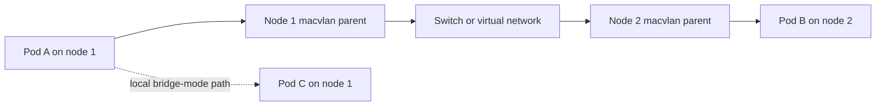

# Debug Multus Macvlan Traffic That Fails Between Nodes

Author: [nawazdhandala](https://www.github.com/nawazdhandala)

Tags: Multus, Kubernetes, Troubleshooting

Description: Trace a same-node-only macvlan failure through interface selection, address allocation, neighbor discovery, VLANs, and upstream MAC restrictions.

Two Pods on one node communicate through a Multus macvlan network. Move one Pod to another node and the connection fails. It is tempting to conclude that Kubernetes inter-node routing is broken, but the successful test may never have exercised the physical network.

In macvlan bridge mode, local child interfaces can communicate directly. Cross-node traffic must also traverse the parent interfaces, virtual or physical switches, and any relevant VLAN configuration. Same-node success therefore narrows the problem without proving the external path.

This guide references the **CNI macvlan plugin v1.8.0** and its documented bridge mode. It assumes an IPv4 secondary network intended to share one Layer 2 segment. Layer 2 means the Ethernet domain where hosts resolve each other's MAC addresses. Routed or cloud-specific networks require their own supported design. No live cluster or packet capture was used in preparing this article.

## Confirm that both tests use the secondary network

Write down four facts for each Pod: node, secondary interface name, secondary IP address, and MAC address. Do not use `status.podIP` as a substitute for the secondary address. The Multus network-status annotation reports attachment results, but inspect the running interface too.

Inside each approved diagnostic container, run these read-only commands with the real interface and peer address:

```bash
ip -d link show dev REPLACE_SECONDARY_INTERFACE
ip -4 addr show dev REPLACE_SECONDARY_INTERFACE
ip -4 route get REPLACE_PEER_SECONDARY_IP
```

The route lookup should select the intended secondary interface and source address. If it selects the primary interface, fix the test or routing design before diagnosing the physical network. A Service name may resolve to a cluster Service IP and exercise a different path from the peer's secondary address. [iproute2 route lookup](https://man7.org/linux/man-pages/man8/ip-route.8.html).

Check the actual mode as well. Macvlan supports bridge, private, VEPA, and passthrough modes; their local forwarding behavior differs. Do not infer bridge mode solely from the fact that the NAD says `type: macvlan`. [Pinned macvlan implementation](https://github.com/containernetworking/plugins/blob/v1.8.0/plugins/main/macvlan/macvlan.go), [link mode reference](https://man7.org/linux/man-pages/man8/ip-link.8.html).



The dotted local path explains why the first test can pass while the cross-node path fails.

## Compare the two node configurations

Retrieve the effective NAD and compare its parent interface, mode, subnet, routes, and allocator with the observed interfaces. The `master` field names a node interface. The same interface name on two nodes does not prove that both interfaces connect to the same VLAN or network segment.

Through approved node access, inspect the chosen parent:

```bash
ip -d link show dev REPLACE_PARENT_INTERFACE
ip -s link show dev REPLACE_PARENT_INTERFACE
```

Confirm link state, VLAN details where applicable, and counters before and after a small test. Compare switch-port configuration or virtual-network attachment with the network owner. A node's primary management link being healthy does not validate the secondary parent.

Macvlan's default parent, when `master` is omitted, follows the default-route interface. That may select different hardware across node groups. Prefer an explicit, verified parent for this investigation. [Macvlan configuration](https://www.cni.dev/plugins/current/main/macvlan/).

Also check address ownership before following packets. Two independent host-local allocators using the same pool can issue duplicates on different nodes. Verify the actual IPAM records and external static assignments. Distinct Pod names or MACs do not establish distinct IPs. Use a cluster-aware allocation design or deliberately non-overlapping per-node ranges where supported; do not clear lease directories as a diagnostic shortcut. [Host-local allocation scope](https://www.cni.dev/plugins/current/ipam/host-local/).

## Use neighbor discovery to locate the break

For IPv4 peers believed to be on the same subnet, Address Resolution Protocol, or ARP, resolves the peer IP to a MAC address. After attempting a small connection, inspect the relevant neighbor entry inside the source Pod:

```bash
ip -4 neigh show to REPLACE_PEER_SECONDARY_IP \
  dev REPLACE_SECONDARY_INTERFACE
```

`INCOMPLETE` or `FAILED` points toward unsuccessful resolution, although it does not identify the exact cause. `STALE` by itself is not proof of failure; an entry can remain usable while awaiting reachability confirmation. A resolved MAC also does not prove that the application port is reachable. [Neighbor-state definitions](https://man7.org/linux/man-pages/man8/ip-neighbour.8.html).

If a gateway is used instead of direct on-link delivery, inspect the gateway's neighbor entry. A mismatched subnet mask can make one Pod ARP directly for its peer while the other tries to route the reply.

## Capture one exchange at both boundaries

With authorization to inspect traffic on the affected nodes, capture only ARP involving the test peer. The following uses a documentation address; replace it and the parent interface. It avoids requesting promiscuous mode, limits captured bytes, and stops after thirty matching packets:

```bash
tcpdump -p -n -e -i REPLACE_PARENT_INTERFACE -s 96 -c 30 \
  'arp and host 192.0.2.20'
```

Run it on both relevant node interfaces while issuing one controlled test. If no matching traffic arrives, stop the command manually after a short observation window; `-c` is a packet-count limit, not a time limit. Capture permissions are required. The command displays packet summaries and does not write a capture file. [tcpdump option reference](https://github.com/the-tcpdump-group/tcpdump/blob/tcpdump-4.99.5/tcpdump.1.in).

Interpret the paired observations carefully:

| Observation | Investigate next |
| --- | --- |
| Request absent from source parent | Wrong route, wrong interface, or local forwarding path |
| Request leaves source but is absent at destination | VLAN mismatch, virtual-switch policy, port security, or physical path |
| Request reaches destination but no reply appears | Destination interface/address, local filtering, or duplicate ownership |
| Reply leaves destination but does not return | Reverse path and upstream MAC handling |
| ARP completes but application fails | Application binding, port filtering, routing, and larger-packet behavior |

An absent packet is only useful evidence if the capture point and filter match the actual path. VLAN offload and capture placement can affect what is visible. Confirm the method with the network owner rather than declaring a switch fault from one empty capture.

## Repair the narrowest confirmed cause

Common corrections include aligning VLAN membership, fixing a wrongly selected parent, eliminating duplicate allocation, or using a networking model supported by the virtual infrastructure. Macvlan introduces child MAC addresses; a virtual switch that permits only the registered parent MAC may reject them. Do not disable port security globally to make a test pass.

If neighbor discovery works but large transfers stall, investigate MTU separately. If traffic reaches the Pod but not its service, inspect the application's listening address and protocol. Do not add host routes or disable reverse-path filtering without evidence that those mechanisms are involved.

Retest both directions across nodes, a local pair, and the actual application protocol. Then recreate a disposable Pod and confirm the same result with a fresh address allocation. A durable fix explains both observations: why local traffic worked, and which additional cross-node boundary was failing.
