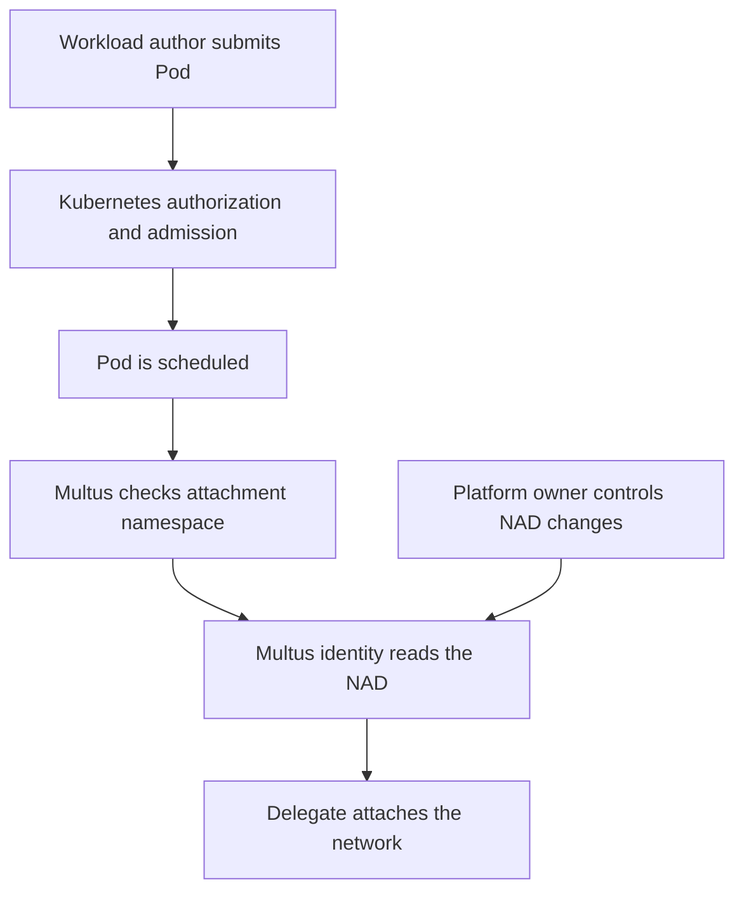

# Share Multus Network Attachments Across Namespaces Safely

Author: [nawazdhandala](https://www.github.com/nawazdhandala)

Tags: Multus, Kubernetes, Security

Description: Reference shared Multus networks explicitly, understand namespace isolation and global exceptions, and separate NAD ownership from workload attachment permission.

A platform team may want one centrally managed network definition that several application namespaces can use. Copying the definition into every namespace creates maintenance work, but making a network globally available can expose more connectivity than intended.

The important distinction is between owning a network definition and being allowed to attach a workload to it. Kubernetes permissions on the definition and Multus attachment rules solve different parts of that problem. A user who cannot read a NetworkAttachmentDefinition directly may still be able to create a Pod that asks Multus to use it, depending on the installed controls.

This guide examines **Multus v4.3.1**, using its tagged configuration and implementation. It provides configuration fragments and a review process, not a complete tenant-isolation policy. No live cluster authorization or network attachment tests were performed.

## Name the shared attachment explicitly

A NetworkAttachmentDefinition, or NAD, is a namespaced Kubernetes object containing delegated network configuration. Suppose the platform team owns `network-catalog/metrics-net`, and an application runs in `payments`. Its Pod annotation can select the NAD explicitly:

```yaml
metadata:
  annotations:
    k8s.v1.cni.cncf.io/networks: >-
      [{"name":"metrics-net","namespace":"network-catalog",
        "interface":"metrics0"}]
```

This is a metadata fragment. Put it under `spec.template.metadata` in a Deployment, or at the top level in a Pod. Replace the names with approved resources that already exist. It requests the interface name `metrics0`; it does not create the NAD or provision the physical network.

Multus also supports the text form `network-catalog/metrics-net`. An unqualified name resolves in the Pod's namespace, so `metrics-net` inside `payments` refers to a different object. Prefer the explicit namespace for centrally owned attachments. [Pinned network-selection examples](https://github.com/k8snetworkplumbingwg/multus-cni/blob/v4.3.1/docs/how-to-use.md).

## Understand the three separate decisions



First, Kubernetes decides whether the requester may create or update the workload and whether admission rules accept its configuration. Second, Multus evaluates its namespace-isolation setting. Third, Multus retrieves the NAD using its configured Kubernetes client and calls the delegate.

These checks are not interchangeable. The v4.3.1 namespace check compares the Pod namespace with the requested NAD namespace and the configured global exceptions. That code path does not turn the workload's ServiceAccount permission to `get` the NAD into a per-attachment authorization decision. [Network delegate lookup](https://github.com/k8snetworkplumbingwg/multus-cni/blob/v4.3.1/pkg/k8sclient/k8sclient.go).

Consequently, a successful `kubectl auth can-i get` check establishes one API permission. It does not prove that a particular Pod may attach the network. Conversely, denying application identities direct NAD reads is not a complete network-use restriction.

## Configure global exceptions deliberately

Multus v4.3.1 disables namespace isolation by default. When enabling it, an explicit shared namespace can be configured with these fields in the effective Multus network configuration:

```json
{
  "namespaceIsolation": true,
  "globalNamespaces": "network-catalog"
}
```

This is a fragment to merge into the existing configuration through the installation's supported management method. Do not replace the complete Multus configuration with it. Thin and thick deployments, generated configuration, and distribution operators may have different authoritative configuration locations. Verify the resulting configuration on every eligible node.

The exact `globalNamespaces` value is a comma-separated **string**, not a JSON array. The exception makes that target namespace available across Pod namespaces; it does not mean “only payments may use metrics-net.” Every NAD placed there must be evaluated as potentially globally referencable unless additional admission controls restrict its use. [Configuration reference](https://github.com/k8snetworkplumbingwg/multus-cni/blob/v4.3.1/docs/configuration.md).

There is also a default worth checking carefully: when the global namespace setting is omitted or empty, the tagged loader starts with `default` as the non-isolated namespace. A nonempty explicit value replaces that list. The example above therefore does not implicitly add `default`. Do not assume an empty string means there are no exceptions. [Configuration loading](https://github.com/k8snetworkplumbingwg/multus-cni/blob/v4.3.1/pkg/types/conf.go).

| Requested NAD | Pod in payments, with the fragment above |
| --- | --- |
| payments/local-net | Passes the namespace check |
| network-catalog/metrics-net | Passes the global-namespace check |
| finance/private-net | Rejected by the namespace check |
| default/example-net | Not included in the explicit exception list |

Passing this check does not establish successful allocation or connectivity. Those are later steps.

## Protect definition ownership and workload intent

Give the platform's approved deployment identity the necessary NAD management rights in `network-catalog`. Application teams usually do not need to modify those definitions. For an existing NAD, a narrowly scoped read-only Role could look like this:

```yaml
apiVersion: rbac.authorization.k8s.io/v1
kind: Role
metadata:
  name: inspect-metrics-network
  namespace: network-catalog
rules:
  - apiGroups: ["k8s.cni.cncf.io"]
    resources: ["network-attachment-definitions"]
    resourceNames: ["metrics-net"]
    verbs: ["get"]
```

A separately reviewed RoleBinding would grant this Role to the intended identity. The Role alone grants nobody access. It deliberately grants neither modification nor broad listing, and it is an inspection permission, not permission to attach a network. Kubernetes RBAC uses resource names to restrict supported named operations. [RBAC reference](https://kubernetes.io/docs/reference/access-authn-authz/rbac/).

For selective sharing, enforce a separate admission rule that permits approved workload namespaces or identities to request approved attachments. The rule must understand every annotation format you allow. Checking only for a literal JSON substring can miss text-format selections, alternate JSON spacing, or extra attachments. One practical design is to require a canonical format and reject unsupported forms before evaluating the allowlist.

Cover direct Pods and the Pods created by workload controllers. Protect updates and other attachment-selection mechanisms enabled by your distribution as well. Use an admission mechanism whose parser and policy can express those rules; do not assume a generic string match is a security boundary. Kubernetes documents admission validation as a separate layer from RBAC. [Admission validation](https://kubernetes.io/docs/reference/access-authn-authz/validating-admission-policy/).

## Prove the allowed and denied paths

In staging, test an approved `payments` workload requesting `network-catalog/metrics-net`. Verify that it receives the intended interface and can reach only the expected destinations. Then test an unapproved namespace requesting the same global NAD: the selective admission policy should reject it before attachment.

Also test a disallowed non-global namespace, an unqualified same-name NAD, an extra unauthorized attachment, and both supported annotation formats. Record whether rejection happened during admission or during sandbox creation. Multus namespace isolation runs in networking setup; it is not evidence that the API server rejected Pod creation.

Finally, test a replacement Pod after the configuration rollout. Existing connected Pods do not demonstrate that every node has the new policy. Keep sensitive network definitions out of globally shared namespaces until both the ownership controls and attachment-use controls have passed their negative tests.
