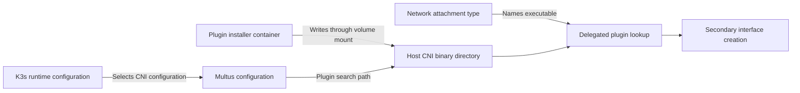

# Resolve Multus Plugin Not Found Errors on K3s

Author: [nawazdhandala](https://www.github.com/nawazdhandala)

Tags: Multus, Kubernetes, Troubleshooting

Description: Align K3s CNI binary paths, Multus configuration, and installer mounts to resolve plugin lookup failures without replacing the primary network or deleting allocation state.

A Multus error saying that it cannot find `macvlan` does not always mean the plugin was never installed. It can mean the installer copied it into one directory while the process creating the Pod searches another. K3s makes this especially easy to encounter when instructions assume `/opt/cni/bin` or predate its stable CNI binary directory.

Treat this as a path tracing problem. Identify the requested plugin, the process looking for it, and the directory that process can see. Then repair the installation configuration so the fix survives a node restart or K3s upgrade.

## Know which K3s layout applies

K3s documents `$DATA_DIR/data/cni` as its CNI binary directory, normally `/var/lib/rancher/k3s/data/cni`. Before the October 2024 releases, binaries lived in a release-specific userspace bundle. The documented compatibility path for those older releases is `/var/lib/rancher/k3s/data/current/bin/`, with additional plugins needing redeployment after upgrades. Confirm your installed version and data directory instead of copying a path from an unrelated cluster. See the [K3s Multus guide](https://docs.k3s.io/networking/multus-ipams).

The examples below target the newer stable layout with the default data directory. The rendered example uses **rke2-multus chart 4.3.203**, whose chart metadata reports Multus 4.3.2. This is a pinned configuration example, not an instruction to upgrade an existing deployment merely to resolve a missing file.

## Trace all three path relationships



The host directory is the shared point. A container mount can have a different path from the host directory it exposes. Therefore, seeing `/host/opt/cni/bin` inside an installer is not automatically wrong: inspect the volume's `hostPath` before deciding where the files actually land.

CNI means Container Network Interface. The `type` value in a CNI configuration names the plugin executable. An `ipam.type` names a separate address-management helper. A successful lookup of `macvlan` does not prove that its `whereabouts` or `host-local` helper can also be found. The [CNI specification](https://github.com/containernetworking/cni/blob/v1.3.0/SPEC.md) defines the configuration and executable relationship.

## Preserve the failing path before changing it

Start with the Pod's events and stored object:

```bash
kubectl -n REPLACE_NAMESPACE describe pod REPLACE_POD
kubectl -n REPLACE_NAMESPACE get pod REPLACE_POD -o yaml
kubectl -n kube-system get daemonsets
```

Record the node, complete nested error, missing executable, and any search directories printed in the message. Locate the Multus installer or daemon on that node. Do not assume a name copied from an upstream manifest matches your Helm release.

On the affected host, inspect the known layout without modifying it:

```bash
k3s --version
sudo ls -ld /var/lib/rancher/k3s/data/cni
sudo ls -l /var/lib/rancher/k3s/data/cni/macvlan
sudo ls -l /var/lib/rancher/k3s/agent/etc/cni/net.d
```

Replace these paths if the data directory is customized. A missing file is useful evidence. A present file requires a second check: is it visible at the path used by the failing process? For thick Multus, that may be inside its daemon container. For a host-executed plugin, inspect the host namespace.

Review the installed DaemonSet's volume mounts, host paths, arguments, and init-container logs. Inspect Multus's generated configuration locally, taking care not to publish kubeconfig credentials. Multus documents `binDir` as an additional plugin directory in its [configuration reference](https://github.com/k8snetworkplumbingwg/multus-cni/blob/v4.3.1/docs/configuration.md).

## Render a consistent installation before applying it

Save this as `values-k3s.yaml`. It explicitly selects thin Multus for this example. Do not switch a working thick deployment to thin as an incidental part of a path repair; review its own template and mounts instead.

```yaml
thickPlugin:
  enabled: false
config:
  fullnameOverride: multus
  cni_conf:
    confDir: /var/lib/rancher/k3s/agent/etc/cni/net.d
    binDir: /var/lib/rancher/k3s/data/cni/
    kubeconfig: /var/lib/rancher/k3s/agent/etc/cni/net.d/multus.d/multus.kubeconfig
    multusAutoconfigDir: /var/lib/rancher/k3s/agent/etc/cni/net.d
```

The paths follow the official K3s example. `confDir` locates CNI configuration; `binDir` locates executables; `kubeconfig` names the client configuration used by Multus; `multusAutoconfigDir` identifies the directory involved in automatic primary-network configuration. These are different responsibilities, even when several files share a parent directory.

On a workstation with Helm 3 and access to the official chart repository, render without contacting the Kubernetes API:

```bash
helm template multus rke2-multus \
  --repo https://rke2-charts.rancher.io \
  --version 4.3.203 \
  --namespace kube-system \
  -f values-k3s.yaml > rendered-multus.yaml
```

Inspect the resulting ConfigMap and DaemonSet. The [official chart repository](https://github.com/rancher/rke2-charts) is the source for this packaged chart. In the reviewed render, the binary host path is `/var/lib/rancher/k3s/data/cni/`, the main container's installation argument points through `/host` to that path, and the CNI installer mounts the same volume at `/host/opt/cni/bin`. Those differing container paths refer to the same host directory.

Rendering succeeded locally. Helm 3.12.3 lint additionally reported an upstream chart metadata issue: `type` is present with chart `apiVersion: v1`. That lint result is recorded rather than hidden; this article does not claim every chart check passed. No cluster installation was performed.

## Correct the owner, not a temporary symptom

Apply the reviewed change through whichever system owns the installation: a K3s HelmChart resource, a Helm release, or your deployment repository. Do not create a second installation alongside the first. Preserve existing image policies, IPAM options, scheduling constraints, and primary-network settings when updating values.

K3s generates its containerd configuration. If the runtime path itself is wrong, investigate the supported configuration or template rather than editing a generated file that will be rewritten. The [K3s advanced configuration guide](https://docs.k3s.io/advanced#configuring-containerd) explains containerd configuration generation and templates.

Avoid copying binaries into several directories until the error disappears. That leaves ambiguous versions and makes the next upgrade unpredictable. Also avoid deleting CNI allocation caches: a lookup error does not establish that allocation state is stale.

## Prove the repair on a new sandbox

After the intended installer completes, verify the executable at the real target path and inspect its permissions and architecture. Then create one controlled staging Pod using the affected attachment. It must get past plugin lookup, create the expected interface, obtain an address if configured, and reach its approved test peer.

Delete that test Pod and check cleanup as well. Existing workloads continuing to send traffic do not exercise a fresh CNI ADD operation. Repeat the test after an installer restart in staging to confirm that the installation source, rather than a manual copy, preserves the repair.

If the error changes to permission denied or executable format failure, follow that new evidence. If it still reports a different directory, return to the process and mount mapping. A durable fix makes the requested filename, installed file, and effective search path agree on every eligible node.
