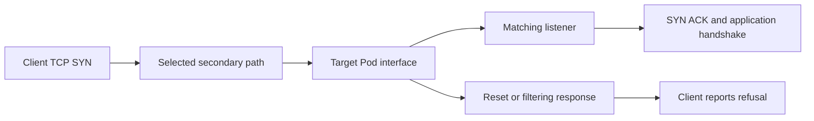

# Debug a Multus Pod That Answers Ping but Refuses TCP

Author: [nawazdhandala](https://www.github.com/nawazdhandala)

Tags: Multus, Kubernetes, Troubleshooting

Description: Trace TCP refusal on a Multus secondary address through the exact destination, listener binding, packet response, and return route without confusing ping with application health.

Ping succeeds against a Pod's secondary address, but the application client immediately reports “connection refused.” That result is useful: it narrows the investigation. ICMP echo replies show that one kind of traffic reaches an answering endpoint. They do not establish that the desired TCP port has a listener.

Start by preserving the exact error. A refusal, a timeout, a TLS certificate failure, and an HTTP error describe different stages of a connection. Changing Multus or disabling policy before identifying the stage can make the evidence harder to interpret.

This guide uses Linux iproute2 inspection, Python 3 socket calls, and curl examples. The connection probe was exercised locally against a loopback listener and a closed port. No Multus cluster, Linux packet path, or production service was tested.

## Record the connection the client actually attempts

Write down the source workload, destination name, resolved IP, destination port, protocol, and time. If a hostname resolves to the primary Pod address while your ping uses a secondary address, the two tests do not cover the same path. The same problem occurs when a Service port is confused with the application's direct listening port.

Use the intended numeric address and actual application port for a bounded TCP-only check. Save this as `tcp_probe.py` in an approved diagnostic environment:

```python
import socket
import sys

if len(sys.argv) != 3:
    raise SystemExit("usage: tcp_probe.py ADDRESS PORT")
try:
    port = int(sys.argv[2])
    if not 1 <= port <= 65535:
        raise ValueError("port outside 1..65535")
    with socket.create_connection((sys.argv[1], port), timeout=3) as conn:
        print(f"connected local={conn.getsockname()} peer={conn.getpeername()}")
except (OSError, ValueError) as exc:
    raise SystemExit(f"{type(exc).__name__}: {exc}")
```

Run it once against an approved destination:

```bash
python3 tcp_probe.py REPLACE_SECONDARY_IP REPLACE_TCP_PORT
```

The script opens and closes a TCP connection without sending application data. The server can still log the connection. A successful result prints the selected local and peer endpoints. A refused result prints the actual exception instead of reducing every failure to “network unavailable.” [Python socket connection API](https://docs.python.org/3/library/socket.html).

On Linux, `ECONNREFUSED` commonly indicates that no listener accepted the connection at the remote address. It is not conclusive evidence that the intended application host generated the rejection; filtering devices and address mistakes must still be considered. [connect error semantics](https://man7.org/linux/man-pages/man2/connect.2.html).

## Inspect the listener inside the target Pod

On the target Pod, use the application container or an approved diagnostic environment sharing its network namespace:

```bash
ip -4 address show
ss -lnt
```

`ss -lnt` lists listening TCP sockets with numeric addresses and ports. Add process inspection only when you have the necessary permissions and a reason to identify ownership. Compare the listener with the exact secondary destination. [ss options](https://man7.org/linux/man-pages/man8/ss.8.html).

| Listener address | What it suggests |
| --- | --- |
| `127.0.0.1:8080` | IPv4 loopback only |
| Primary Pod IP on port 8080 | That address is bound; secondary address is not implied |
| Secondary Pod IP on port 8080 | Intended IPv4 address is bound |
| `0.0.0.0:8080` | IPv4 wildcard listener; review intended exposure |
| IPv6 wildcard listener | Check dual-stack behavior rather than assuming IPv4 acceptance |

Containers in the same Pod normally share networking. A successful localhost request from a sidecar can therefore coexist with external refusal when the service binds only loopback. Declaring `containerPort` does not start a server or change its bind address. [Kubernetes Pod networking](https://kubernetes.io/docs/concepts/workloads/pods/).

Correct the application's supported bind-address configuration and restart it through its normal owner. Binding every address may be appropriate for some services, but it can also expose the service on networks that were not intended to carry it. Keep authentication and policy requirements intact.

## Locate the response in the packet path



TCP begins with a handshake. A reset in response to the initial connection attempt is different from silent loss. Capture only an approved, bounded diagnostic sample at the client and target to establish where the response appears. [TCP connection behavior](https://www.rfc-editor.org/rfc/rfc9293).

For a concrete staging flow to documentation address `192.0.2.50` on port 8080, replace the address, port, and interface with the actual values:

```bash
tcpdump -p -n -i REPLACE_INTERFACE -s 96 -c 20 \
  'tcp and host 192.0.2.50 and port 8080'
```

Stop manually if twenty packets are not reached. Capture permissions are required, and the snapshot can still contain some application bytes. The example filter was compiled offline; no live capture was performed. [tcpdump reference](https://github.com/the-tcpdump-group/tcpdump/blob/tcpdump-4.99.5/tcpdump.1.in).

If the target receives the SYN and sends a reset, revisit the local listener and rejection rules. If the client sees a reset that never appears at the target capture point, investigate intermediate policy, address translation, stale discovery, or a different machine answering the address. A duplicate address can make a convincing ping result belong to the wrong endpoint.

## Check routing when the response is missing

Inside the target Pod, inspect the return path using the secondary source address:

```bash
ip -4 route get REPLACE_CLIENT_IP from REPLACE_SECONDARY_IP
```

A secondary request can arrive while its response selects an unsuitable primary route. This more often resembles a timeout than an immediate refusal, but packet evidence should decide the next step. Inspect source-based rules and the actual network design before changing the default route. [iproute2 route lookup](https://man7.org/linux/man-pages/man8/ip-route.8.html).

Also verify which component enforces policy on the secondary attachment. A Kubernetes NetworkPolicy object does not by itself prove that this particular interface is covered. Review the installed enforcer and its rules rather than removing all policy to test a theory.

## Separate TCP success from TLS and application success

Once TCP connects, test the service's real protocol. For HTTPS, preserve the hostname while directing curl to the intended IP:

```bash
curl --resolve 'service.example.internal:8443:192.0.2.50' \
  --cacert /path/to/approved-ca.pem \
  --connect-timeout 3 --max-time 10 \
  https://service.example.internal:8443/health
```

Replace the service name, port, address, CA path, and safe health endpoint. This keeps hostname-based certificate verification while testing a particular backend. Confirm proxy settings match the intended direct or proxied test path. Do not use disabled verification to turn a trust failure into a misleading success. [curl resolve option](https://curl.se/docs/manpage.html#--resolve).

An HTTP 401, 403, or 503 means the investigation has advanced beyond a simple TCP refusal. Examine application authentication, readiness, dependencies, and request handling at that point.

Finish by repeating the same source, destination, and port after the fix, then test from another relevant node. Record the before-and-after listener and connection results. The useful conclusion is specific: which address and port were wrong, which component rejected the connection, or which route prevented the response.
