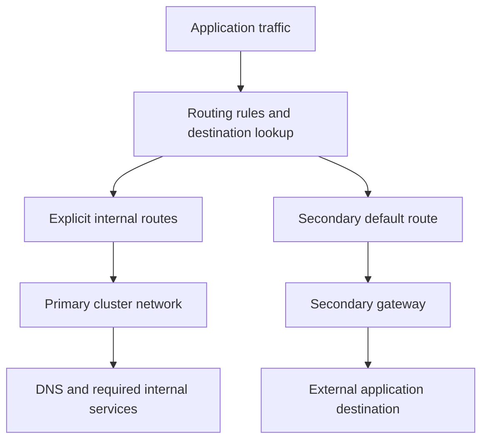

# Keep Cluster DNS Working with a Multus Secondary Default Route

Author: [nawazdhandala](https://www.github.com/nawazdhandala)

Tags: Multus, Kubernetes, DNS

Description: Move a Pod's default route to a Multus attachment while preserving the primary paths needed for cluster DNS, Services, and application dependencies.

A secondary network is working: the Pod receives an address, reaches its gateway, and connects to an external system. Then you make that network the default route and Kubernetes service names stop resolving. The DNS configuration may be unchanged. The route to the DNS server may have changed instead.

A default route handles destinations that do not match a more specific route in the selected routing table. Moving it changes more than internet access. It can move DNS, Kubernetes API access, and application dependency traffic onto a network that cannot reach those destinations.

This walkthrough references **Multus v4.3.1**. It uses an existing, working secondary attachment and a disposable test workload. The examples were reviewed against source and checked locally for syntax; they were not executed in a Kubernetes cluster.

## Record the primary network before changing it

Use a baseline Pod with the intended secondary attachment but without a default-route override. Its approved diagnostic container needs `ip` from iproute2 and a DNS query tool. Replace the context, namespace, Pod, and container names:

```bash
kubectl --context REPLACE_CONTEXT -n REPLACE_NAMESPACE \
  exec REPLACE_BASELINE_POD -c REPLACE_CONTAINER -- cat /etc/resolv.conf
kubectl --context REPLACE_CONTEXT -n REPLACE_NAMESPACE \
  exec REPLACE_BASELINE_POD -c REPLACE_CONTAINER -- ip -4 route show table all
kubectl --context REPLACE_CONTEXT -n REPLACE_NAMESPACE \
  exec REPLACE_BASELINE_POD -c REPLACE_CONTAINER -- ip rule show
```

Record the actual nameserver address, primary interface, primary gateway where applicable, and routes to required internal destinations. Do not assume that `10.96.0.10` is your DNS server or that `eth0` has a conventional subnet gateway.

Kubernetes normally supplies cluster DNS configuration through the Pod's DNS policy. A `ClusterFirst` policy controls resolver configuration; it does not create a missing network route. With NodeLocal DNSCache, the nameserver may instead be a node-local address, requiring a different path from the cluster DNS Service IP. [Pod DNS policies](https://kubernetes.io/docs/concepts/services-networking/dns-pod-service/), [NodeLocal DNSCache](https://kubernetes.io/docs/tasks/administer-cluster/nodelocaldns/).

Build a short destination inventory before editing the workload:

| Destination | Why it matters | Required evidence |
| --- | --- | --- |
| Actual resolver IP | All name lookups start here | DNS query succeeds over the intended path |
| Required cluster Services | DNS success alone does not make Services reachable | Application connection to each dependency works |
| Pod destinations used directly | Some applications bypass Services | Representative peer connection succeeds |
| Kubernetes API endpoint | Controllers and API clients need it | Approved API-dependent workload still functions |
| External application endpoint | Reason for the secondary default | Connection leaves through the secondary network |

## Request the secondary default explicitly

Multus accepts `default-route` in its JSON-formatted network selection annotation. This example assumes an existing NAD named `external-egress` in the workload's namespace. The documentation address below is illustrative; replace it with the real gateway reachable through that attachment:

```yaml
metadata:
  annotations:
    k8s.v1.cni.cncf.io/networks: >-
      [{"name":"external-egress","interface":"net1",
        "default-route":["192.0.2.1"]}]
```

This is a metadata fragment, not a complete Pod manifest. For a Deployment, place it under `spec.template.metadata`; for a Pod, use its top-level metadata. Retain any other required attachments in the annotation array. The NAD must already provide a compatible interface and address allocation configuration. An annotation cannot make an unreachable gateway usable.

The version-pinned Multus example demonstrates the resulting secondary default and warns that cluster-network functionality can be affected. Its implementation changes default-gateway handling; it does not discover every internal destination your application needs. Create a new canary Pod to test the changed network setup rather than assuming an annotation edit rewires an existing sandbox. [Multus v4.3.1 usage](https://github.com/k8snetworkplumbingwg/multus-cni/blob/v4.3.1/docs/how-to-use.md), [gateway handling](https://github.com/k8snetworkplumbingwg/multus-cni/blob/v4.3.1/pkg/multus/multus.go).



This diagram describes the intended result. Your primary CNI may implement Services using mechanisms beyond ordinary Linux routes, so prove connectivity rather than treating the diagram as a universal implementation.

## Preserve the internal paths deliberately

For a conventional Linux routing setup, more-specific internal routes can keep DNS and required cluster traffic on the primary interface. Preserve routes installed by the primary CNI and use its supported configuration mechanism to make any additional routes persistent. Do not put a cluster DNS route in the secondary NAD merely because that is the configuration you are editing; that normally associates the route with the wrong interface.

For a narrowly scoped diagnostic experiment, the following command can add or replace a single IPv4 resolver route **inside a disposable canary Pod's network namespace**:

```bash
ip -4 route replace REPLACE_RESOLVER_IP/32 \
  via REPLACE_VERIFIED_PRIMARY_GATEWAY dev REPLACE_PRIMARY_INTERFACE
```

Run this only through an approved administrative method that has network-administration permission in that namespace. Never run it in the node's namespace by accident. The gateway must already be reachable on the primary interface and supported by that CNI's routing model. The `/32` limits the experiment to one resolver address. Discard the canary after the experiment; this command is not durable workload configuration. [iproute2 route commands](https://man7.org/linux/man-pages/man8/ip-route.8.html).

If this restores DNS, you have evidence of a routing problem, not a complete fix. Required Service, Pod, or API destinations may still need their own supported paths. If the primary network uses point-to-point links, policy routing, or specialized Service handling, consult that CNI's configuration instead of forcing a guessed gateway. Avoid granting every application `NET_ADMIN` simply to repair routes at startup.

## Test routes and actual requests separately

Inside the canary's diagnostic container, inspect the selected route to the exact resolver and an approved external destination:

```bash
ip -4 route get REPLACE_RESOLVER_IP
ip -4 route get REPLACE_EXTERNAL_IP
```

The first should select the preserved cluster path; the second should select the intended secondary path. `ip route get` reports a routing decision, not a successful packet exchange. If source-based rules are present, also evaluate the source address the application actually uses.

Then query a known cluster service name using the configured resolver, connect to a required internal application, and perform the real external transaction. Test fresh connections so an existing connection does not hide a broken path. DNS over UDP and TCP should both be permitted where required; a successful small query alone does not cover every response.

For dual-stack Pods, assess IPv6 separately. An IPv4 annotation example and IPv4 route tests say nothing about IPv6 reachability or which address family an application will select.

## Decide whether changing the default is necessary

If only a few external subnets need the secondary network, destination-specific routes may express the requirement more safely. If the application explicitly binds traffic to a secondary address, source-based routing may be appropriate. The CNI `sbr` plugin is a chained plugin designed for that pattern; it is not automatically enabled by a Multus default-route annotation. [Source-based routing plugin](https://www.cni.dev/plugins/current/meta/sbr/).

Promote the change only after the canary passes DNS, internal dependency, external connectivity, and fresh-Pod recreation checks. Keep the previous workload template available for rollout recovery. The goal is a predictable traffic path with documented internal exceptions, not merely a route table that contains the desired gateway.
