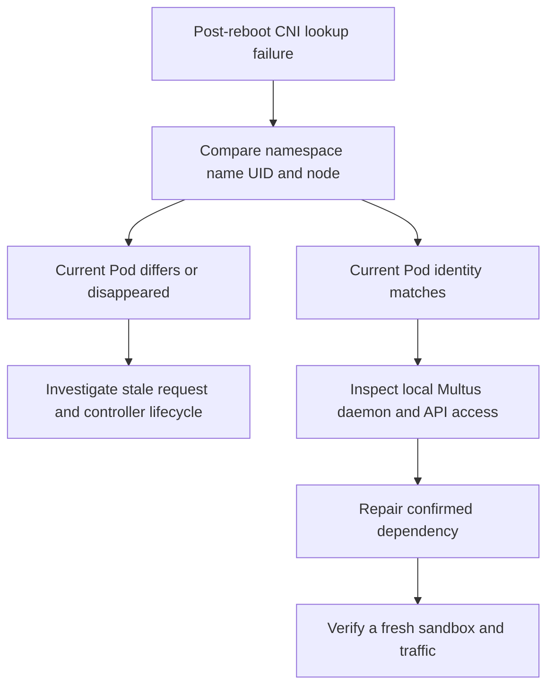

# Recover Multus After a Reboot When the Shim Cannot Find the Pod

Author: [nawazdhandala](https://www.github.com/nawazdhandala)

Tags: Multus, Kubernetes, Troubleshooting

Description: Diagnose post-reboot Multus Pod lookup failures by comparing Pod identity, node-local daemon state, API access, and runtime sandbox evidence before recovery.

After a node reboots, an application may remain in `ContainerCreating` while its events show `multus-shim`, a failed CNI ADD, and a Pod-not-found message. The name in the error may look exactly like the Pod you can see with kubectl. That does not establish that both references describe the same Pod instance.

A useful recovery sequence compares identities first, then checks the Multus daemon's view of Kubernetes, then repairs the confirmed dependency. Deleting CNI state or repeatedly restarting every networking component can remove the evidence and create additional allocation problems.

This guide examines the thick-plugin architecture in **Multus v4.3.1**, commit `d61706810cc8be60381dcb66e6a2428d5eb2795a`. The commands are bounded inspections. No reboot or live cluster failure was reproduced.

## Preserve the exact failed request

The upstream project has a report of post-reboot sandbox creation failing with `multus-shim` and a Pod lookup error. Treat it as an example of the symptom, not proof that every matching message has the same cause or requires the same workaround. [Upstream issue 1361](https://github.com/k8snetworkplumbingwg/multus-cni/issues/1361).

From the failed event, retain the timestamp, Pod namespace, name, UID, node, and sandbox or container identifier. A UID is Kubernetes' unique identifier for one object lifetime. A controller can replace a Pod while retaining a familiar name; the replacement has a different UID.

```bash
kubectl --context REPLACE_CONTEXT -n REPLACE_NAMESPACE \
  get pod REPLACE_POD \
  -o 'jsonpath={.metadata.uid}{"\t"}{.spec.nodeName}{"\t"}{.metadata.deletionTimestamp}{"\n"}'
kubectl --context REPLACE_CONTEXT -n REPLACE_NAMESPACE \
  describe pod REPLACE_POD
kubectl --context REPLACE_CONTEXT describe node REPLACE_NODE
```

Compare the returned UID with `K8S_POD_UID` in the failed CNI request. An empty deletion timestamp means no deletion timestamp is set; it does not prove the application or sandbox is healthy. If the Pod no longer exists, inspect its controller and current replacement instead of recreating an object merely to satisfy an old request. [Pod lifecycle and identity](https://kubernetes.io/docs/concepts/workloads/pods/pod-lifecycle/).



## Distinguish shim transport from daemon lookup

In a thick-plugin installation, the shim forwards requests to the Multus daemon. A connection failure to its Unix socket is different from an HTTP response containing an error about a Pod lookup. The latter indicates that the request reached a responding component; restarting an application container is unlikely to fix its Kubernetes client.

Locate the Multus Pod on the affected node. The upstream manifest uses `kube-system`, label `app=multus`, and container `kube-multus`. Adapt those names if your distribution differs:

```bash
kubectl --context REPLACE_CONTEXT -n kube-system get pods \
  -l app=multus --field-selector spec.nodeName=REPLACE_NODE -o wide
kubectl --context REPLACE_CONTEXT -n kube-system \
  logs REPLACE_MULTUS_POD -c kube-multus --since=20m --tail=200
```

If the container restarted, retrieve its previous logs as well, where available:

```bash
kubectl --context REPLACE_CONTEXT -n kube-system \
  logs REPLACE_MULTUS_POD -c kube-multus --previous --tail=100
```

The upstream deployment uses host networking and supplies `MULTUS_NODE_NAME` from the node assignment. Check the effective node name, socket configuration and mounts, image identity, and installed shim together. A healthy daemon on another node does not establish recovery here. [Pinned thick-plugin deployment](https://github.com/k8snetworkplumbingwg/multus-cni/blob/v4.3.1/deployments/multus-daemonset-thick.yml).

## Understand the daemon's Kubernetes view

The v4.3.1 server can filter its Pod informer to the local node. An informer maintains a local cache of API objects through list and watch operations. The startup code waits for cache synchronization with bounded timeouts and logs synchronization failures. Seeing a running daemon is therefore not enough; inspect its synchronization and API errors. [Server implementation](https://github.com/k8snetworkplumbingwg/multus-cni/blob/v4.3.1/pkg/server/server.go).

A wrong configured node name can exclude the workload from that local watch. API connectivity, authentication, authorization, or certificate problems can prevent the cache from becoming useful. Compare those conditions with the reboot timeline. Do not change certificates or credentials unless their errors identify them as the failing dependency.

Your administrative kubectl session and Multus may use different credentials and network paths. A successful administrator read demonstrates that the API object exists for that client; it does not prove that the daemon can retrieve it.

The tagged `GetPod` implementation retries cache misses during ADD and can make a direct API query after a failed wait. It also checks the requested UID against the returned object, with a special case for static Pods. For a genuinely missing Pod, `CmdAdd` can return an empty result to handle deletion races. Consequently, an old Pod-not-found report should not be applied uncritically to a newer binary. [Pod lookup and ADD handling](https://github.com/k8snetworkplumbingwg/multus-cni/blob/v4.3.1/pkg/multus/multus.go).

## Compare runtime evidence without deleting it

If the API identity and failed request disagree, inspect the affected node's container runtime. Use an approved node administration session, a compatible `crictl`, and the runtime endpoint already configured by your platform:

```bash
crictl pods --name REPLACE_POD
crictl inspectp REPLACE_SANDBOX_ID
```

Choose the sandbox identifier from the listing and compare its metadata with the event. More than one attempt may exist. These commands inspect the Container Runtime Interface, or CRI; they do not remove sandboxes. Do not guess a socket endpoint or switch to a different runtime just because the default command cannot connect. [Official crictl debugging guide](https://kubernetes.io/docs/tasks/debug/debug-cluster/crictl/).

| Evidence | Recovery direction |
| --- | --- |
| Failed request belongs to an old UID | Allow supported runtime/controller reconciliation; investigate repeated stale attempts |
| Matching UID, daemon cannot list or watch Pods | Repair its API path or authorization |
| Wrong node identity in daemon configuration | Correct the managed deployment configuration |
| Shim cannot reach daemon socket | Repair daemon readiness or matching socket mounts |
| Pod lookup succeeds, delegate now fails | Investigate the new inner error separately |

## Recover one node and prove the result

Use the platform's maintenance procedure to control new workload placement while the node is unhealthy. Repair the confirmed configuration or dependency, then observe a fresh sandbox attempt. If a daemon restart is warranted after preserving evidence, scope it to the affected node and the approved rollout procedure. Avoid an unrelated cluster-wide restart.

Do not delete `/var/lib/cni`, remove all runtime sandboxes, or force-delete stateful workloads as a generic repair. Those actions can discard live allocation state or complicate workload recovery. A workload controller's normal recreation path is preferable once the networking dependency is healthy.

Accept recovery only after a fresh Pod instance on that node obtains its primary and required secondary networks, completes a real connectivity check, and tears down normally in a disposable test. Finally, rehearse a controlled node reboot in staging with the approved versions. Capture ordering and synchronization evidence so the next reboot verifies the fix rather than relying on a one-time restart workaround.
