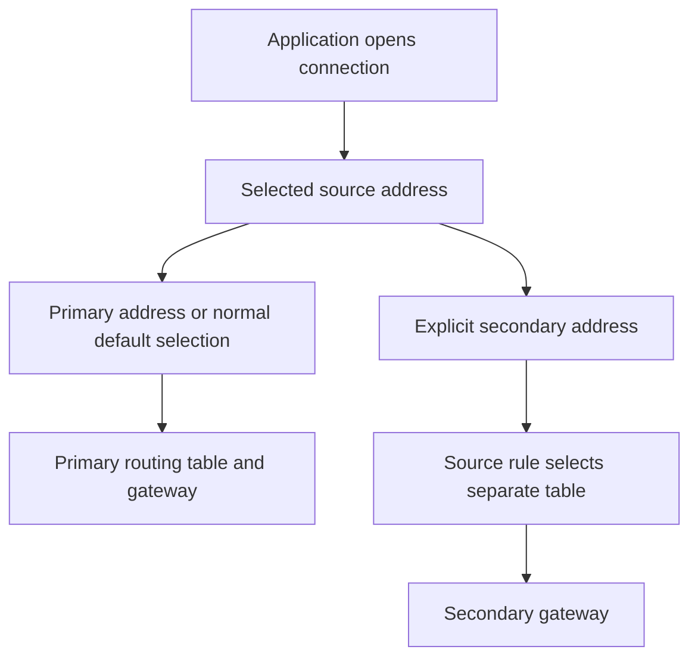

# Configure Source-Based Routing for Multus Pods with Two Gateways

Author: [nawazdhandala](https://www.github.com/nawazdhandala)

Tags: Multus, Kubernetes, Networking

Description: Keep the primary default route while routing traffic bound to a secondary address through its own gateway using the chained CNI sbr plugin.

A Pod can need two ways out: its primary network for cluster access and a secondary network for a separate application path. Adding two default routes to the same routing table does not tell Linux which application traffic belongs on each network.

Source-based routing selects a routing table according to the packet's source address. Traffic explicitly sourced from the secondary IP can use that network's gateway while ordinary traffic retains the primary path. This is useful when destination addresses alone cannot distinguish the required paths.

This guide uses the **CNI plugins v1.8.0 `sbr` plugin**, chained after macvlan, with Multus selecting the attachment. The configuration was checked locally against tagged source. No Linux routing rules or live Pod interfaces were created.

## Make source selection part of the application contract

The source address must be known when the routing policy makes its decision. An application that binds an outgoing socket to its secondary IP gives the source-based rule something to match. An unbound client may choose its source through the ordinary primary routing decision and never use the secondary table.

The CNI documentation describes this explicit source-binding pattern. It also requires `sbr` to run after a plugin that has created an interface and returned address information. It does not choose application traffic by process name or port automatically. [Source-based routing plugin](https://www.cni.dev/plugins/current/meta/sbr/).



Think of the two gateways as belonging to different routing decisions, not competing defaults whose ordering happens to work today. Linux policy rules can select tables by source prefix and other fields. Existing rules must be reviewed too; a new source rule is not the only possible decision in the policy database. [ip rule reference](https://man7.org/linux/man-pages/man8/ip-rule.8.html).

## Prepare a single-Pod staging attachment

Prerequisites are working Multus, the `macvlan`, `static`, and `sbr` binaries from the approved release on the selected node, and a verified secondary network. Reserve one test address, confirm the gateway is reachable, and ensure upstream routing accepts traffic from that address.

This NAD uses a `plugins` array because `sbr` is a chained plugin. Replace the namespace, parent interface, and documentation addresses before applying it. Static IPAM makes the example suitable for exactly one disposable test Pod; do not scale it with the same address.

```yaml
apiVersion: k8s.cni.cncf.io/v1
kind: NetworkAttachmentDefinition
metadata:
  name: secondary-source-route
  namespace: REPLACE_NAMESPACE
spec:
  config: |-
    {
      "cniVersion": "0.3.1",
      "name": "secondary-source-route",
      "plugins": [
        {
          "type": "macvlan",
          "master": "REPLACE_PARENT_INTERFACE",
          "mode": "bridge",
          "ipam": {
            "type": "static",
            "addresses": [
              {"address": "192.0.2.50/24", "gateway": "192.0.2.1"}
            ]
          }
        },
        {"type": "sbr"}
      ]
    }
```

The first plugin creates the interface and passes its result to `sbr`. The gateway in the IPAM result gives `sbr` the secondary next hop. Static IPAM's address/gateway schema is documented separately. [Static IPAM configuration](https://www.cni.dev/plugins/current/ipam/static/).

Request the attachment with a stable interface name:

```yaml
metadata:
  annotations:
    k8s.v1.cni.cncf.io/networks: >-
      [{"name":"secondary-source-route","interface":"data0"}]
```

This metadata fragment belongs at Pod metadata or under `spec.template.metadata` for a Deployment. It intentionally does not request Multus `default-route`: replacing the primary default is a different objective from preserving it and adding a source-specific path.

## Understand automatic and explicit table modes

With no `table` parameter, the pinned `sbr` implementation finds an unused table, adds source rules, adds a gateway default when supplied, and moves relevant interface routes out of the main table into the selected source table. It can use separate tables for multiple address configurations. Do not hardcode an observed table number into unrelated automation. [Pinned routing implementation](https://github.com/containernetworking/plugins/blob/v1.8.0/plugins/meta/sbr/main.go).

The optional `table` setting has different behavior: the implementation adds rules pointing to that table and expects its routing contents to be managed separately. Adding `"table": 100` is therefore not simply a way to make the automatic example use a preferred number. An empty or incorrectly populated table can produce a different path than intended.

This guide uses automatic table selection. If the cluster already has policy-routing requirements, review table ownership and rule ordering before deployment. Avoid manual rule edits inside application containers as a substitute for a reproducible CNI configuration.

## Inspect both route decisions

Inside an approved diagnostic container containing iproute2, inspect the rules and tables:

```bash
ip -4 rule show
ip -4 route show table all
ip -4 route get REPLACE_EXTERNAL_IP from REPLACE_SECONDARY_IP
ip -4 route get REPLACE_EXTERNAL_IP from REPLACE_PRIMARY_IP
```

Use addresses actually assigned to the Pod and an approved external destination. The secondary-source lookup should select the secondary gateway and `data0`; the primary-source lookup should retain the primary path. These commands inspect routing decisions and do not prove that packets reach the destination. [ip route lookup](https://man7.org/linux/man-pages/man8/ip-route.8.html).

Then test the application protocol with explicit source binding. For an approved HTTPS diagnostic endpoint and a curl build supporting interface selection, this example binds to the secondary IP and bounds the request:

```bash
curl --interface REPLACE_SECONDARY_IP \
  --connect-timeout 5 --max-time 15 \
  https://REPLACE_APPROVED_HOST/health
```

Use a hostname whose certificate is trusted by the container; keep TLS verification enabled. DNS resolution and proxy configuration can involve separate paths, so record those conditions rather than attributing every failure to the source rule. Confirm the observed source at the destination. [curl interface option](https://curl.se/docs/manpage.html#--interface).

## Check return traffic and cluster dependencies

An outgoing route is only half the connection. The destination or upstream router needs a valid return path to the secondary address, and firewalls must permit the exchange. If packets reach the Pod but replies leave incorrectly, inspect the actual reply source and rule selection before changing the gateway.

Source-specific routing can also send cluster-destination traffic onto the secondary path when an application binds all sockets to that address. Test cluster DNS, API access where required, and internal dependencies separately. Applications may need selective binding or additional reviewed routing policy; one broad source rule is not automatically suitable for every destination.

Do not disable reverse-path filtering or flush routing rules globally to hide an unexplained failure. Use packet and route evidence to identify the precise requirement. Repeat the tests for IPv6 if the workload uses it; this example validates neither IPv6 routing nor address-family selection.

Finally, delete the test Pod normally and recreate it. Confirm the source rules and routes are rebuilt correctly, then repeat with a production-suitable allocator and reservation workflow. The accepted result is predictable source selection, correct outbound and return paths, and preserved primary-network behavior across the Pod lifecycle.
