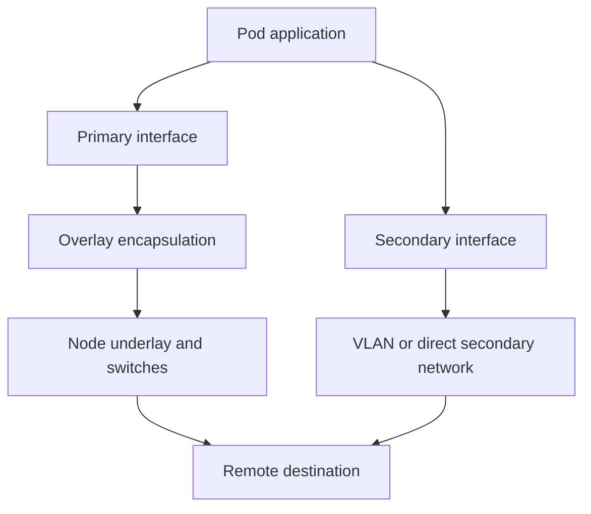

# Diagnose MTU Mismatches Across Multus, VLANs, and Overlays

Author: [nawazdhandala](https://www.github.com/nawazdhandala)

Tags: Multus, Kubernetes, Networking

Description: Measure the usable packet size on each Pod network path, account for encapsulation, and distinguish MTU failures from filtering, routing, and capture artifacts.

A small health check succeeds, but a larger response stalls. A Pod can ping its peer, yet a TLS exchange or file transfer repeatedly times out. An MTU mismatch is one possible explanation: smaller packets fit the path while larger packets cannot pass, and the sender may not receive the information needed to adjust.

MTU means maximum transmission unit. For an IP interface, it describes the largest IP packet the interface can carry without the relevant fragmentation handling. A Pod with Multus attachments can have different limits on its primary overlay and secondary VLAN or macvlan path. One successful test does not cover both.

This guide uses Linux iproute2 and iputils inspection commands and references **CNI plugins v1.8.0** for delegate MTU behavior. Command syntax and packet-size arithmetic were checked locally. No live Linux network probes or cluster tests were performed.

## Draw the path that actually carries the traffic

Start with the failing source address, destination, and interface. A request to a Service IP may follow the primary network while a request to a secondary Pod IP follows a separate network. Test the path used by the application, not whichever address is easiest to ping.



Inside an approved diagnostic container, inspect the intended route and interface. Replace the placeholders with addresses actually assigned to the Pod and a known destination:

```bash
ip -4 route get REPLACE_DESTINATION_IP from REPLACE_SOURCE_IP
ip -d link show dev REPLACE_INTERFACE
```

Record the selected interface, source address, local MTU, and any route-specific MTU information. Inspect the corresponding node parent, VLAN interface, tunnel, and remote side through approved access. A configured interface MTU is one local fact, not proof of the end-to-end path limit. [iproute2 route inspection](https://man7.org/linux/man-pages/man8/ip-route.8.html).

## Account for the right kind of overhead

An overlay adds headers around the original traffic. Cilium's routing documentation describes a 50-byte VXLAN overhead in its illustrated configuration. With a 1500-byte underlay budget, that common case suggests a 1450-byte inner IP MTU. Different outer address families, tunnel options, encryption, and stacked encapsulation can change the budget; use the actual implementation's calculation. [Cilium encapsulation overhead](https://docs.cilium.io/en/stable/network/concepts/routing/).

Do not subtract the same overhead from every Multus interface. A direct secondary network might not traverse the primary overlay at all. Conversely, a secondary network can have its own tunnel or restricted upstream segment.

Also distinguish Ethernet frame limits from IP MTU. A VLAN tag is link-layer overhead, so whether it reduces the usable IP MTU depends on the equipment's supported tagged-frame size and how that equipment reports its limit. Do not assume that every VLAN requires changing 1500 to 1496. Confirm the switch, NIC, and virtual-network definitions with their owners.

The CNI VLAN plugin has an explicit `mtu` option. In v1.8.0 its configuration loader rejects a requested MTU above the parent interface's MTU. That local check cannot discover a smaller limit elsewhere along the path. [VLAN configuration](https://www.cni.dev/plugins/current/main/vlan/), [pinned VLAN source](https://github.com/containernetworking/plugins/blob/v1.8.0/plugins/main/vlan/vlan.go).

## Probe with a known packet size

Use a staging peer that permits ICMP and a Linux **iputils** `ping`. BusyBox and macOS variants can expose different options, so check the installed tool before copying these commands. The container needs permission to send the probes.

For IPv4 without IP options, the total IP packet size is the requested ping payload plus twenty bytes of IPv4 header and eight bytes of ICMP header:

| Intended IP packet size | iputils `-s` payload |
| --- | --- |
| 1500 bytes | 1472 bytes |
| 1450 bytes | 1422 bytes |
| 1400 bytes | 1372 bytes |

Begin with a small probe, then test the intended boundary. The following sends at most three probes per command and includes a deadline. `-M do` uses the do-not-fragment PMTU strategy:

```bash
ping -4 -I REPLACE_SOURCE_IP -M do -c 3 -w 8 -s 1200 REPLACE_PEER_IP
ping -4 -I REPLACE_SOURCE_IP -M do -c 3 -w 8 -s 1422 REPLACE_PEER_IP
ping -4 -I REPLACE_SOURCE_IP -M do -c 3 -w 8 -s 1472 REPLACE_PEER_IP
```

These sizes are comparison points, not presumed requirements. Use the source assigned to the path under investigation. A local “message too long” response differs from packets leaving the host and disappearing farther away. Existing path-MTU information can also influence local rejection. [iputils ping options](https://man7.org/linux/man-pages/man8/ping.8.html).

If a boundary emerges, narrow it with a few controlled sizes rather than flooding the network. Test the reverse direction and a different node pair. Routing and encapsulation can be asymmetric, and an echo reply still needs to return successfully.

## Interpret failures with the control messages

IPv4 Path MTU Discovery uses the do-not-fragment behavior and ICMP feedback when a router cannot forward a packet of that size. If the relevant feedback is filtered, traffic can stall instead of adapting. IPv6 relies on Packet Too Big messages and does not use router fragmentation in the same way. [IPv4 PMTU discovery](https://www.rfc-editor.org/rfc/rfc1191), [IPv6 PMTU discovery](https://www.rfc-editor.org/rfc/rfc8201).

| Observation | Meaning to investigate |
| --- | --- |
| Small and large probes both fail | Reachability or ICMP filtering before concluding MTU |
| Small succeeds, larger receives an MTU error | Local or reported path limit |
| Small succeeds, larger silently disappears | Possible MTU black hole; also inspect filtering and loss |
| Probes pass, application stalls | Application path, protocol, connection state, or different packet behavior |
| Only one direction or node pair fails | Asymmetric path or inconsistent node/fabric configuration |

For IPv6, calculate probe sizes using its headers and any extension headers; do not reuse the IPv4 subtraction of twenty-eight bytes. Test the application's actual address family instead of assuming an IPv4 result covers a dual-stack workload.

## Avoid misleading captures and quick fixes

A packet capture inside a host can show packets larger than those transmitted on the wire because segmentation and receive offloads operate at different stages. Large captured packets alone do not prove that the physical link accepted oversized frames. Correlate capture placement with offload behavior and use appropriate external evidence when necessary. [Linux segmentation offloads](https://docs.kernel.org/networking/segmentation-offloads.html).

Fix the owning configuration: the delegate MTU, overlay setting, node interface preparation, or fabric limit. Do not lower every interface arbitrarily or enable jumbo frames on only one side. Recreate disposable Pods as needed to verify the setting used for new interfaces, and preserve the previous configuration for recovery.

Finally, repeat the real application transfer, not only ICMP. Include primary cluster connectivity, each required secondary path, cross-node traffic, both directions, and a replacement-node test. Record the largest verified packet size and the conditions of the test. That gives future changes a measured baseline rather than a single unexplained MTU number.
