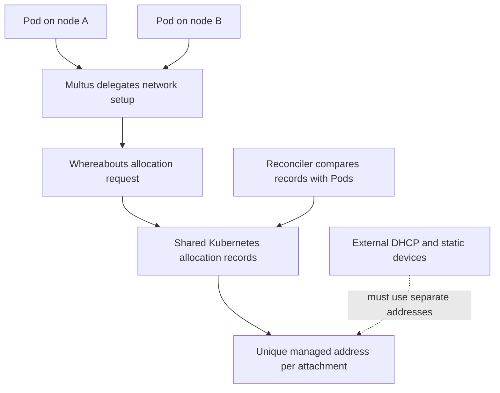

# Allocate Multus IPs with Whereabouts and Reconcile Stale Leases

Author: [nawazdhandala](https://www.github.com/nawazdhandala)

Tags: Multus, Kubernetes, Networking

Description: Use Whereabouts for shared secondary-network address allocation, inspect allocation records, and investigate stale or duplicate addresses without deleting active leases.

Two Pods on different nodes can receive the same secondary address when each node allocates independently from the same pool. That is a common surprise with host-local IP address management. Multus attaches the networks, but the selected IPAM plugin decides how addresses are allocated.

Whereabouts coordinates allocation across nodes through shared storage. That coordination solves one specific problem: competing allocation requests using the same managed network. It does not discover every statically addressed server on the VLAN, coordinate with an unrelated DHCP server, or repair a physical duplicate address automatically.

This guide uses **Whereabouts v0.9.4**, commit `3a262bd0cd873e13d9b379342f8251b852a89b8f`, and the Kubernetes storage backend. It covers ordinary shared-pool allocation, not the optional fast-IPAM node-slice design. The examples were checked locally; no cluster allocation or reconciliation was executed.

## Establish one address authority

Before creating a NetworkAttachmentDefinition, agree which addresses Whereabouts owns. Reserve gateways, routers, appliances, static assignments, and DHCP-managed ranges outside its allocation space. CIDR notation describes a network prefix, such as `/24`; exclusions remove smaller prefixes or individual `/32` IPv4 addresses from allocation.

Whereabouts supports `range`, optional `range_start` and `range_end`, and an `exclude` list. Its overlap checks are enabled by default for the Kubernetes backend. However, `network_name` creates an independent allocation scope, including for overlap detection. Two different names are appropriate for genuinely isolated networks, not two names for the same shared Ethernet segment. [Pinned configuration reference](https://github.com/k8snetworkplumbingwg/whereabouts/blob/v0.9.4/README.md).



The last relationship is an administrative requirement. Whereabouts cannot guarantee uniqueness against allocations outside its shared authority.

## Verify the installed components first

Prerequisites are a working primary CNI, Multus, the chosen secondary interface plugin on eligible nodes, and a matching Whereabouts installation with its CRDs, permissions, configuration, and reconciler. A CRD is the Kubernetes schema for a custom resource such as an IPPool.

Inspect the actual daemon and reconciler images and node CNI binary installation. Do not infer the running version from the Git tag of a manifest you downloaded: the v0.9.4 reference reconciler manifest uses `latest`, while its source-tree Helm defaults still specify `v0.8.0`. Pin approved images explicitly through your deployment process and inspect the rendered result. [Reference reconciler](https://github.com/k8snetworkplumbingwg/whereabouts/blob/v0.9.4/doc/crds/reconciler-deployment.yaml), [chart defaults](https://github.com/k8snetworkplumbingwg/whereabouts/blob/v0.9.4/deployment/whereabouts-chart/values.yaml).

Confirm that every eligible node can reach the Kubernetes API using the installed Whereabouts credentials. A healthy allocation datastore is necessary for creating new attachments; an API authorization failure should not be treated as address exhaustion.

## Define a bounded secondary pool

This sample NAD uses macvlan and reserves a small allocation window. Replace the namespace, interface, and documentation subnet with approved values before applying it. The parent interface must exist on every node eligible for this workload, and the upstream network must support the chosen plugin.

```yaml
apiVersion: k8s.cni.cncf.io/v1
kind: NetworkAttachmentDefinition
metadata:
  name: shared-secondary
  namespace: REPLACE_NAMESPACE
spec:
  config: |-
    {
      "cniVersion": "0.3.0",
      "name": "shared-secondary",
      "type": "macvlan",
      "master": "REPLACE_PARENT_INTERFACE",
      "mode": "bridge",
      "ipam": {
        "type": "whereabouts",
        "range": "192.0.2.0/24",
        "range_start": "192.0.2.100",
        "range_end": "192.0.2.120",
        "exclude": ["192.0.2.110/32"],
        "enable_overlapping_ranges": true
      }
    }
```

The intended window contains twenty usable candidate addresses after the exclusion. This example deliberately adds no default route. Address allocation and routing are separate decisions; add supported routes only when the application needs them. The configuration follows the pinned NAD and range examples. [Whereabouts NAD examples](https://github.com/k8snetworkplumbingwg/whereabouts/blob/v0.9.4/README.md).

Use two disposable Pods scheduled on different eligible nodes with the same attachment. Confirm distinct secondary addresses and the expected subnet. Then delete one normally and observe its allocation being released. A successful two-Pod test demonstrates that setup in the tested conditions; it is not proof of uniqueness against unmanaged network devices.

## Inspect records before calling them stale

Read the shared allocation objects using an identity allowed to list these resources. Replace the context and retain the JSON in a restricted diagnostic workspace:

```bash
kubectl --context REPLACE_CONTEXT \
  get ippools.whereabouts.cni.cncf.io -A -o json > ippools.json
kubectl --context REPLACE_CONTEXT \
  get overlappingrangeipreservations.whereabouts.cni.cncf.io -A \
  -o json > overlap-reservations.json
```

An IPPool stores a range and an allocation map. Allocation keys are offsets within that pool's address representation, not literal dotted-decimal addresses. Records include a container identifier and Pod reference. Use the installed version's schema and decoding behavior rather than mistaking a key such as `100` for a complete address. [IPPool schema](https://github.com/k8snetworkplumbingwg/whereabouts/blob/v0.9.4/doc/crds/whereabouts.cni.cncf.io_ippools.yaml), [storage conversion](https://github.com/k8snetworkplumbingwg/whereabouts/blob/v0.9.4/pkg/storage/kubernetes/ipam.go).

Compare suspicious records with current Pods, their Multus network-status annotations, and the affected node's sandbox state. Distinguish these cases:

| Observation | Next investigation |
| --- | --- |
| Pool contains only live allocations | Capacity and expected concurrency |
| Pod disappeared after a node failure | Whether its old sandbox can still send traffic |
| Two live Pods claim one address | Allocation scopes, backend configuration, and historical changes |
| One Pod conflicts with a physical device | External address ownership and exclusions |
| Allocation requests fail with authorization errors | API permissions and credentials |

A missing Pod object alone does not prove that an isolated node has stopped using the address. Fence or otherwise establish the old workload's termination before making its address reusable.

## Let reconciliation repair confirmed orphaned state

The v0.9.4 reconciler compares pool and overlapping-reservation records with Pod information, including reported network addresses. Its implementation includes additional handling for Pending Pods. This is more nuanced than removing every record whose Pod is not Running. [Reconciliation implementation](https://github.com/k8snetworkplumbingwg/whereabouts/blob/v0.9.4/pkg/reconciler/iploop.go).

For the upstream deployment names, inspect bounded logs:

```bash
kubectl --context REPLACE_CONTEXT -n kube-system \
  logs deployment/whereabouts-reconciler \
  -c whereabouts-reconciler --since=15m --tail=150
```

Confirm the configured schedule, successful API reads, and actual cleanup results. The pinned deployment explicitly requires one reconciler replica because it has no leader election. Do not scale it up to accelerate cleanup or launch a competing manual cleanup loop.

Do not delete whole IPPools or all overlapping reservations to free one suspected lease. That removes allocation knowledge for healthy workloads. For a confirmed orphan that reconciliation cannot resolve, preserve evidence and follow the installed distribution's supported repair procedure under controlled allocation conditions.

Finally, repeat cross-node allocation and normal deletion tests. For a genuine duplicate, verify both workload recovery and external network behavior. Reconciliation repairs stale bookkeeping; correcting conflicting address ownership requires fixing the allocation design that allowed the collision.
