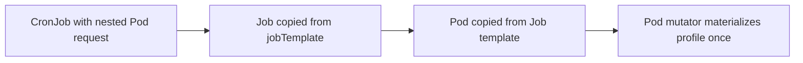

# Avoid Duplicate Mutation Across CronJobs, Jobs, and Pods

Author: [nawazdhandala](https://www.github.com/nawazdhandala)

Tags: Kubernetes, Automation, DevOps

Description: Trace CronJob-to-Job-to-Pod metadata, choose one injection stage, and verify scheduled and manual Jobs without copying generated helpers into every template layer.

A CronJob creates Jobs, and each Job creates Pods. All three are separate admission targets. If a webhook injects the same helper into the CronJob's nested template, the generated Job, and the generated Pod, one intended change can be applied repeatedly.

The solution is to assign responsibilities at each stage. Keep the user's request in the nested Pod metadata, normalize it only where necessary, and let one stage own the concrete runtime injection. Idempotence remains necessary, but it should support a clear design rather than compensate for three competing injectors.

This example targets **Kubernetes v1.35.0** with `batch/v1` CronJobs and Jobs. The profile annotation is a custom example contract, not a built-in Kubernetes feature.

## Locate the three metadata layers



The nesting is easy to misread:

| Location in the CronJob | What it describes |
|---|---|
| `metadata.annotations` | The CronJob itself |
| `spec.jobTemplate.metadata.annotations` | Metadata for generated Jobs |
| `spec.jobTemplate.spec.template.metadata.annotations` | Metadata for generated Pods |

For a Pod-level injector, the third path carries the request. A marker on the Job's metadata is not automatically a Pod annotation. The tagged [CronJob controller helper](https://github.com/kubernetes/kubernetes/blob/v1.35.0/pkg/controller/cronjob/utils.go) copies the Job template's metadata and spec into the new Job.

## Keep the request in the Pod template

This staging manifest requests a profile for each generated Pod while keeping a separate Job-level purpose annotation:

```yaml
apiVersion: batch/v1
kind: CronJob
metadata:
  name: profile-schedule
  namespace: team-canary
spec:
  schedule: "0 * * * *"
  timeZone: Etc/UTC
  suspend: true
  concurrencyPolicy: Forbid
  jobTemplate:
    metadata:
      annotations:
        batch.example.com/purpose: profile-check
    spec:
      backoffLimit: 0
      template:
        metadata:
          labels:
            app: profile-batch
          annotations:
            platform.example.com/profile: standard-v1
        spec:
          restartPolicy: Never
          containers:
            - name: task
              image: registry.example.internal/demo/batch:REPLACE_WITH_PINNED_IMAGE
```

Replace the namespace and image with approved staging values. The image placeholder is not runnable as written. `suspend: true` prevents scheduled executions while the configuration is reviewed; it does not stop Jobs that already exist. The [CronJob guide](https://kubernetes.io/docs/concepts/workloads/controllers/cron-jobs/) documents suspension, time zones, and concurrency behavior.

`Forbid` controls concurrent Jobs from this CronJob. It is not a guard against duplicate admission mutations or an exactly-once execution guarantee. The application still needs appropriate behavior for retries or repeated runs.

The manifest contains no injected helper yet. `standard-v1` is an explicit requested profile version. Your injector must define and honor that version, including its image, mounts, and completion behavior.

## Assign one stage the generated fields

A practical design is:

- CronJob admission checks or defaults the requested profile in its nested Pod template.
- Job admission handles equivalent requests for directly created Jobs, without adding the concrete helper.
- Pod CREATE admission adds the actual helper and associated fields.

Normalization must preserve an already explicit profile. A generated Job should not get a different default merely because its originating CronJob used a different nesting level.

An equally valid design can materialize injection in templates instead. If you choose it, the Pod stage must recognize the completed contract and avoid adding the same fields again. Do not mix the two designs accidentally while migrating between versions.

A useful ownership table records each generated field, the sole stage that creates it, its stable name, and its conflict behavior. For example, a Pod injector can own a helper named `platform-profile-init` and a volume named `platform-profile`; a Job normalizer should not independently append either.

## Make repeated admission safe without trusting a marker alone

A reinvoked webhook receives the current mutated object. It must inspect the actual helper, volumes, and mounts before deciding that injection is complete. If a field with the expected name belongs to the user but has different content, report the conflict rather than overwrite it.

An “injected” annotation can be useful evidence, but it is insufficient by itself. A copied template can retain the annotation after its helper was edited or removed. Conversely, an older template might contain all required fields but lack the newest marker.

Kubernetes documents the semantics of [`reinvocationPolicy`](https://kubernetes.io/docs/reference/access-authn-authz/extensible-admission-controllers/#reinvocation-policy). Reinvocation within one admission request is also distinct from encountering copied fields in later Job and Pod requests. Test both.

## Preview the Job stage separately

After the reviewed CronJob exists in staging, this command requests a dry-run Job from its stored template:

```bash
kubectl -n team-canary create job profile-preview \
  --from=cronjob/profile-schedule \
  --dry-run=server -o yaml
```

The command reads the existing CronJob, constructs a Job, and submits a server-side dry-run create. It does not wait for the schedule, and it does not persist a Job that a controller can turn into Pods. The flags are documented in [`kubectl create job`](https://kubernetes.io/docs/reference/kubectl/generated/kubectl_create/kubectl_create_job/).

Inspect `metadata.annotations` for the Job purpose and `spec.template.metadata.annotations` for the profile request. The tagged [kubectl Job creation source](https://github.com/kubernetes/kubectl/blob/v0.35.0/pkg/cmd/create/create_job.go) shows how the CronJob template is used for this manual path.

Passing this preview verifies only that request path. It does not prove that scheduled creation or Pod-level injection succeeds. A manual Job also should not be treated as a test of the CronJob scheduler's concurrency handling.

## Verify a full staging execution

Use an approved real staging execution to observe the generated Job and Pods. These inspection commands are read-only:

```bash
kubectl -n team-canary get cronjob profile-schedule -o yaml
kubectl -n team-canary get jobs -o yaml
kubectl -n team-canary get pods -l app=profile-batch -o yaml
```

Use owner references to identify the relevant Job and its Pods; a broad namespace listing can include unrelated runs. The output options come from [`kubectl get`](https://kubernetes.io/docs/reference/kubectl/generated/kubectl_get/).

For the Pod-injection design, expect a request but no helper in the CronJob and Job templates, then exactly one correctly configured helper in each admitted Pod. Test a directly created Job too, because it bypasses CronJob normalization. Test a retry or replacement Pod because the Job can create additional Pods during execution; see the [Job lifecycle guide](https://kubernetes.io/docs/concepts/workloads/controllers/job/).

The helper must also fit batch completion. An ordinary application container that runs forever can prevent successful Job completion. A Kubernetes restartable init sidecar has different completion behavior, documented in [Jobs with sidecar containers](https://kubernetes.io/docs/concepts/workloads/pods/sidecar-containers/#jobs-with-sidecar-containers). Choose deliberately rather than reusing a Deployment injection profile without review.

## Roll out changes to future runs deliberately

Changing a CronJob template affects future Jobs, not existing Jobs and their Pods. Inventory active runs before changing profile versions, and decide whether they should finish under the old contract.

For migration, compare three checkpoints: the stored CronJob template, the admitted Job template, and the admitted Pod. If a helper first appears at an unexpected checkpoint, fix that stage's ownership before widening the rollout. This makes duplicate mutation a traceable lifecycle error rather than a mystery hidden inside nested YAML.
