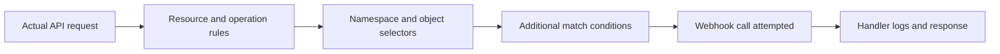

# Find Why Your Mutating Webhook Is Never Called

Author: [nawazdhandala](https://www.github.com/nawazdhandala)

Tags: Kubernetes, Troubleshooting, Testing

Description: Trace missing webhook calls through request operations, resource rules, API versions, subresources, namespace and object selectors, then verify with a scoped dry run.

An empty webhook log does not establish that the API server tried and failed to reach your service. The request may not match the registration, it may have failed before admission, or you may be inspecting the wrong replica's logs.

Start with the request you expected to trigger the webhook. Then compare it with the effective registration, one condition at a time. This walkthrough uses **Kubernetes v1.35.0** source and API definitions as a reproducible reference; it does not assume that editing a webhook configuration is safe across every namespace.

## Record the request before changing the rule

For one failed reproduction, record the resource, operation, namespace, object labels, subresource, and API version. Distinguish the operation Kubernetes admits from the command you typed.

For example, creating a Pod is a core API `v1` request for resource `pods`, operation `CREATE`, and no subresource. Changing an existing Pod is not another create. A PATCH request can result in an admission `UPDATE`, or in some cases a `CREATE`; `PATCH` is not a value for `rules.operations`. The admission request's operation field is defined in the [v1 admission types](https://github.com/kubernetes/api/blob/v0.35.0/admission/v1/types.go).

Reading an object with `kubectl get` is not a way to trigger mutation. Admission runs after authentication and authorization and does not process ordinary read requests. A request rejected earlier may never reach the webhook. See [admission control in Kubernetes](https://kubernetes.io/docs/reference/access-authn-authz/admission-controllers/).

Use these read-only commands with your intended cluster context:

```bash
kubectl get mutatingwebhookconfiguration platform-hooks -o yaml
kubectl api-resources --api-group='' -o wide
kubectl get namespace webhook-canary --show-labels
```

Replace the configuration and namespace names. The [API discovery command](https://kubernetes.io/docs/reference/kubectl/generated/kubectl_api-resources/) helps confirm plural resource names and scope. Inspect the registration stored in the cluster, not only the Helm template you believe was deployed.

## Follow the matching conditions

Conceptually, a request has to survive the configured filters before the endpoint is called:



This is a diagnostic grouping, not a promise about the API server's internal evaluation order. A mismatch is a legitimate skip; an attempted call that fails TLS or times out is a different problem.

Consider this **fragment within one existing `webhooks` entry**:

```yaml
rules:
  - operations: ["CREATE"]
    apiGroups: [""]
    apiVersions: ["v1"]
    resources: ["pods"]
    scope: Namespaced
matchPolicy: Exact
namespaceSelector:
  matchLabels:
    webhook.example.com/canary: "true"
objectSelector:
  matchLabels:
    webhook.example.com/test: "true"
```

It does not include the entry's required name, client configuration, review versions, or side-effect declaration. Do not apply it as a standalone object. Compare it with your deployed entry or use it as a reviewed canary scope while preserving the correct endpoint and trust settings.

Within this rule, the operation, API group, version, resource, and scope all have to match. Multiple rules provide alternatives; a request can match one qualifying rule. The [v1.35 rule matcher](https://github.com/kubernetes/kubernetes/blob/v1.35.0/staging/src/k8s.io/apiserver/pkg/admission/plugin/webhook/predicates/rules/rules.go) implements those checks.

## Check the easy resource mismatches

`apiGroups: [""]` means the core API group. It does not mean every group, and `core` is not the correct group string for Pods. Likewise, `resources: ["Pod"]` is not the plural API resource `pods`.

Subresources are separate matching targets. A rule for `pods` does not automatically include `pods/exec` or `pods/status`. `"*"` matches resources without matching every subresource; `"*/*"` has broader meaning. Do not replace narrow rules with wildcards merely to make a test appear in logs. The [admissionregistration API comments](https://github.com/kubernetes/api/blob/v0.35.0/admissionregistration/v1/types.go) document these distinctions.

A webhook for Deployments does not automatically see the Pods created later by their controller. Decide whether your mutation belongs in the Deployment's Pod template, the resulting Pod, or both with explicit coordination. Test the resource actually covered by the rule.

The fragment uses `matchPolicy: Exact` to make this experiment's version matching explicit. With `Equivalent`, Kubernetes can match equivalent served API versions and convert the object for the webhook. That does not turn a Pod rule into a Deployment rule. Check `kind`, `resource`, and their original-request counterparts when diagnosing conversion. See [version matching](https://kubernetes.io/docs/reference/access-authn-authz/extensible-admission-controllers/#matching-requests-matchpolicy).

## Inspect both sets of labels

`namespaceSelector` matches labels on the containing Namespace for a namespaced request. Adding the canary label only to the Pod will not satisfy it. For admission of a Namespace itself, the Namespace object's labels are used. For other cluster-scoped resources, the namespace selector does not provide that filtering. The [namespace matcher source](https://github.com/kubernetes/kubernetes/blob/v1.35.0/staging/src/k8s.io/apiserver/pkg/admission/plugin/webhook/predicates/namespace/matcher.go) makes these cases explicit.

`objectSelector` matches the admitted object's labels. On an update, either the old or new object can satisfy it. Removing the matching label therefore does not necessarily prevent that update from reaching the webhook. See the [object matcher](https://github.com/kubernetes/kubernetes/blob/v1.35.0/staging/src/k8s.io/apiserver/pkg/admission/plugin/webhook/predicates/object/matcher.go).

For the fragment above, the Namespace needs the canary label and the Pod needs the test label. Labels on a Deployment's top-level metadata are not automatically labels on its Pod template.

Object labels controlled by users are suitable for an opt-in diagnostic, not an unbypassable security boundary. Also avoid relying on this same webhook to inject the label that must already exist for its initial invocation.

## Reproduce with a server-side dry run

Use an existing, approved canary namespace carrying the required namespace label. Save this as `probe.yaml`, replacing the image placeholder with an approved image reference that meets your cluster's admission policies:

```yaml
apiVersion: v1
kind: Pod
metadata:
  name: webhook-probe-20261120
  namespace: webhook-canary
  labels:
    webhook.example.com/test: "true"
spec:
  restartPolicy: Never
  containers:
    - name: probe
      image: registry.example.internal/team/probe:approved-placeholder
```

Then submit a create that reaches the API server without persisting the Pod:

```bash
kubectl create --dry-run=server -f probe.yaml -o yaml
```

The [kubectl create reference](https://kubernetes.io/docs/reference/kubectl/generated/kubectl_create/) distinguishes client and server dry-run modes. Client-side dry run cannot establish that the webhook was called. For this server-side test, the webhook's `sideEffects` declaration must accurately support dry runs, and any external effects must be suppressed as required. A declaration alone does not make unsafe handler code safe.

Expect either a returned object, including admitted mutations, or a useful admission error. No Pod is stored or started, so this test does not verify scheduling or image pulls. Other admission policies may reject the probe; inspect that rejection before blaming the target webhook.

## Use evidence to choose the next investigation

Compare the successful canary with deliberate nonmatching cases:

| Probe change | Expected effect for this fragment |
|---|---|
| Both labels present, Pod CREATE | Eligible for this webhook |
| Pod test label absent | Object selector excludes it |
| Namespace canary label absent | Namespace selector excludes it |
| Existing Pod UPDATE | CREATE-only rule excludes it |
| Deployment CREATE | Pod resource rule excludes it |

Eligibility is not proof of a successful call. Existing `matchConditions`, written in Common Expression Language, can still skip the request. Review each condition; a false result skips the call, while expression errors follow the configured failure handling. Kubernetes describes this in [match conditions](https://kubernetes.io/docs/reference/access-authn-authz/extensible-admission-controllers/#matching-requests-matchconditions).

If matching is established, move to call evidence: all webhook replicas' logs, API-server admission metrics, and audit annotations where enabled. Record request UIDs when a handler receives a call. A mutation's absence alone is inconclusive because the handler may correctly return no change.

If the API server attempted the call but the handler never received it, investigate Service endpoints, control-plane connectivity, TLS, and timeouts. If no attempt occurred, keep examining matching and earlier rejection. Fixing the specific boundary preserves the intended admission scope and avoids turning a small diagnostic into a cluster-wide policy change.
