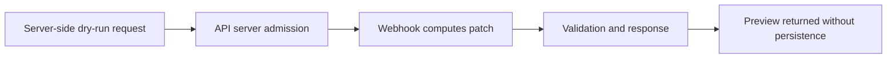

# Support Server-Side Dry Runs with Honest Webhook Side Effects

Author: [nawazdhandala](https://www.github.com/nawazdhandala)

Tags: Kubernetes, Testing, Reliability

Description: Make server-side dry runs exercise real mutation logic without external writes, and verify that webhook sideEffects declarations match the implementation.

A server-side dry run should answer a useful question: what would the API server accept and return for this request? If a webhook skips its mutation logic during the preview, the answer can be misleading. If it creates external resources while preparing the preview, the dry run is no longer safe.

The correct boundary is between planning a change to the admitted object and performing side effects elsewhere. Returning a JSON Patch is part of the admission response. Sending an email, reserving an address, writing another Kubernetes object, or creating a remote account is a separate effect that requires its own handling.

This tutorial uses **Kubernetes v1.35.0** and a **Python 3.11** local example. It assumes a working webhook with a narrowly enrolled test namespace. The commands are a canary procedure, not a claim that a cluster was tested for this article.

## Understand which dry run you are performing

`kubectl --dry-run=client` and `kubectl --dry-run=server` answer different questions. A client-side preview does not send the create request through server admission. A server-side preview sends the request to the API server, which performs admission and validation without persisting the requested change. The [kubectl create reference](https://kubernetes.io/docs/reference/kubectl/generated/kubectl_create/) documents these modes.

A dry run still needs permission to perform the requested operation. It can still fail validation or be rejected by admission. It does not prove that a Pod can start, an image can be pulled, or a later controller will successfully reconcile the result.



The API's [dry-run semantics](https://kubernetes.io/docs/reference/using-api/api-concepts/#dry-run) apply to that request. They are not a transaction that automatically rolls back arbitrary calls made by your webhook.

## Declare the behavior you actually implement

For an `admissionregistration.k8s.io/v1` webhook, use one of the supported declarations:

| Declaration | Contract |
|---|---|
| `sideEffects: None` | The webhook has no side effects beyond its admission response |
| `sideEffects: NoneOnDryRun` | It may have effects for ordinary requests, but suppresses them for dry-run requests |

The legacy `Some` and `Unknown` choices are not acceptable choices for newly created v1 webhook configurations. Check the API's [v1.35.0 validation implementation](https://github.com/kubernetes/kubernetes/blob/v1.35.0/pkg/apis/admissionregistration/validation/validation.go) rather than copying an old manifest.

For a handler that only computes a patch, the entry fragment is simply:

```yaml
sideEffects: None
```

This belongs inside the relevant entry in `webhooks`, alongside its service configuration and rules. It is not a standalone resource. Changing the declaration does not change your handler's code or suppress an external write.

Kubernetes checks the declaration before a matching dry-run call. The [mutating dispatcher](https://github.com/kubernetes/kubernetes/blob/v1.35.0/staging/src/k8s.io/apiserver/pkg/admission/plugin/webhook/mutating/dispatcher.go) permits the two dry-run-compatible classes. A truthful declaration and a matching implementation are both necessary.

## Run the same mutation planner in both modes

The most straightforward design has no external writes in admission. It computes a stable desired patch from the supplied object and returns it. A controller can perform later work after the object actually exists.

Here is a small planner for an opt-in ConfigMap CREATE handler. Your surrounding server must already have validated the AdmissionReview, selected core `v1` ConfigMaps, checked CREATE, and verified the namespace and feature scope. The example default is an annotation your own feature understands.

```python
KEY = "platform.example.com/profile"


def plan_profile(request):
    dry_run = request.get("dryRun", False)
    if dry_run is None:
        dry_run = False
    if type(dry_run) is not bool:
        raise ValueError("dryRun must be a boolean")

    obj = request["object"]
    annotations = obj["metadata"].get("annotations")
    if annotations is None:
        return [{"op": "add", "path": "/metadata/annotations",
                 "value": {KEY: "standard"}}]
    if not isinstance(annotations, dict):
        raise ValueError("annotations must be a map")
    if KEY in annotations:
        return []
    escaped = KEY.replace("~", "~0").replace("/", "~1")
    return [{"op": "add", "path": f"/metadata/annotations/{escaped}",
             "value": "standard"}]
```

The planner validates the flag but deliberately returns the same patch in both modes. It does not send requests, write files, or update external state. Existing explicit profile values are preserved because this example supplies a default rather than enforcing a particular value.

The API defines absent `dryRun` as false; a JSON null also represents an unset optional flag. That contract is recorded in the [AdmissionRequest type](https://github.com/kubernetes/kubernetes/blob/v1.35.0/staging/src/k8s.io/api/admission/v1/types.go). JSON Pointer escaping in the final path follows [RFC 6901](https://www.rfc-editor.org/rfc/rfc6901).

Do not implement dry run as an early `allowed: true` return that bypasses the planner. That hides mutations and policy errors from the preview. Your response still needs the usual copied request UID and correctly encoded patch when one exists.

## If you use NoneOnDryRun, inspect every effect

A handler that performs external actions during ordinary admission needs a complete dry-run path. Check helper functions as well as the main handler: an apparently read-only lookup can call a get-or-create helper, update a cache with externally visible state, or renew a lease.

Suppress every external mutation when `request.dryRun` is true. Keep validation and patch planning active where possible. If planning requires allocating an external identifier, redesign that dependency rather than presenting a fabricated identifier as a faithful preview.

Ordinary admission can also be rejected after your handler has run. Therefore an external action during admission needs reconciliation even outside dry run. The official [side-effect guidance](https://kubernetes.io/docs/reference/access-authn-authz/extensible-admission-controllers/#side-effects) describes that responsibility. Moving provisioning into a controller often gives it a clearer lifecycle than a synchronous admission call.

## Check the preview in an enrolled namespace

Use a pre-existing test namespace named `team-canary`, or replace that name with your own. Confirm the namespace and any object selectors actually match the webhook. Use a unique ConfigMap name that does not already exist, and save this as `dry-run-probe.yaml`:

```yaml
apiVersion: v1
kind: ConfigMap
metadata:
  name: webhook-dry-run-probe-20261120
  namespace: team-canary
data:
  purpose: admission-preview
```

Run the server preview and save its response:

```bash
kubectl create --dry-run=server -f dry-run-probe.yaml -o yaml > preview.yaml
```

Only inspect `preview.yaml` as a successful result if the command succeeded; shell redirection can create an empty file on failure. For the example handler, expect `metadata.annotations["platform.example.com/profile"]` to be `standard` unless another admission component intentionally changes it.

Then verify that the requested ConfigMap was not stored:

```bash
kubectl get configmap webhook-dry-run-probe-20261120 -n team-canary
```

Expect `NotFound`, not a connection error or an authorization denial. The latter outcomes do not establish absence. The read uses the documented [kubectl get interface](https://kubernetes.io/docs/reference/kubectl/generated/kubectl_get/).

Correlate the probe with the webhook's request records and confirm `dryRun: true`. Also inspect any external systems the handler could modify. An absent ConfigMap alone does not prove the webhook avoided outside effects.

## Test the contract below the HTTP layer too

Run identical fixture objects through the planner with true, false, and omitted flags. Assert equal patches, unchanged inputs, and no duplicate additions after applying the patch. Test an existing explicit annotation and malformed flag types as well.

For a handler with external clients, replace those clients with test doubles that fail immediately on any write during a dry run. Do not merely assert that the final response was allowed. Include denied requests and dependency failures so that error paths cannot bypass the guard.

The planner shown here was executed locally with those flag and annotation cases, and its patches were applied using `jsonpatch==1.33`. The YAML and command syntax were checked locally. No Kubernetes dry-run request or external-system audit was performed. A successful canary should establish both an accurate preview and the absence of unintended writes before you expand the webhook's scope.
