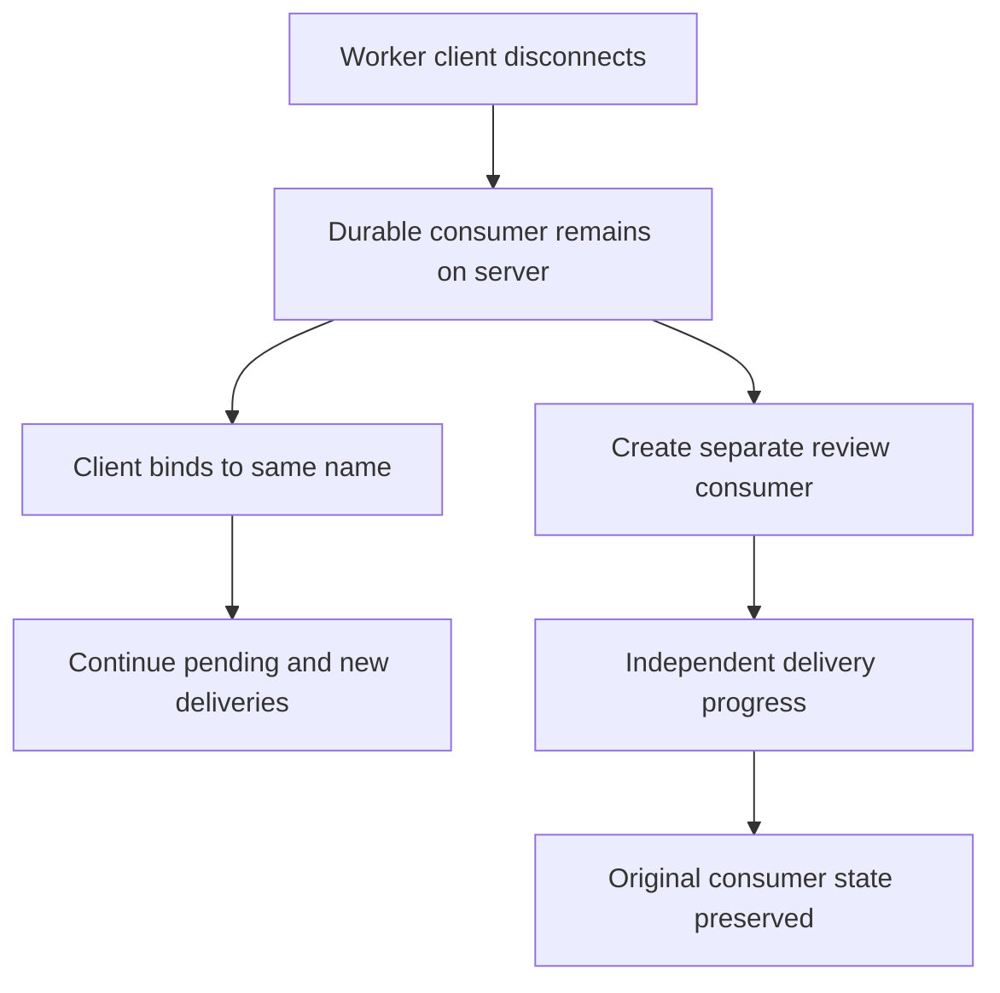

# Why JetStream Resumes After Restart and How to Reset Safely

Author: [nawazdhandala](https://www.github.com/nawazdhandala)

Tags: NATS, Messaging, Go, Troubleshooting

Description: Understand JetStream durable consumer progress, inspect pending acknowledgments, and choose a safe replay or recreation plan instead of expecting restart to rewind.

You restart a JetStream worker expecting it to read the stream again, but it continues where it stopped. Adding a “start from the beginning” option appears to do nothing, or the server rejects the update. This is usually the durable consumer doing its job.

The application process and the consumer are different objects. Restarting the application reconnects a client. The consumer's delivery and acknowledgment state lives on the server. Reusing the same consumer therefore preserves progress rather than resetting it.

This walkthrough targets **NATS Server 2.11.4** and **nats.go 1.42.0**. A local test closed and reopened a client connection, verified resumed delivery, and checked that a separate replay consumer left the original progress unchanged. It did not test server crash recovery or a production reset.

## A durable name identifies progress

A stream stores messages; a consumer describes how to deliver them and tracks what happened to those deliveries. A durable consumer's name gives returning clients a stable object to bind to. The [reading guide](https://docs.nats.io/learn/jetstream/reading-back) explains this distinction between the stream, server-side consumer, and application client.

Suppose stream messages 1, 2, and 3 exist. Your worker receives and acknowledges message 1, then disconnects. Returning to the same consumer normally makes message 2 the next new delivery. Creating a new consumer instead gives you a new delivery history, even if its subject filter is identical.

Do not confuse stream sequence with consumer sequence. Stream sequence identifies a message's position in the stream. Consumer sequence counts deliveries, including redeliveries. Use stream sequence when describing a desired starting message.



## Inspect before deciding to rewind

The following Go helper is for an existing program with a connected `jetstream.JetStream` client and a bounded `context.Context`. It requires the `context`, `fmt`, and `github.com/nats-io/nats.go/jetstream` imports. Replace the lab stream and consumer names with the objects you intend to inspect. This function reads state; it does not create or modify a consumer.

```go
func inspect(ctx context.Context, js jetstream.JetStream) error {
    consumer, err := js.Consumer(ctx, "CURSOR_LAB", "worker")
    if err != nil { return err }
    info, err := consumer.Info(ctx)
    if err != nil { return err }
    fmt.Printf("delivered_stream=%d ack_floor_stream=%d pending=%d unacked=%d\n",
        info.Delivered.Stream, info.AckFloor.Stream,
        info.NumPending, info.NumAckPending)
    return nil
}
```

For the local fixture, after two of three messages were acknowledged, it printed:

```text
delivered_stream=2 ack_floor_stream=2 pending=1 unacked=0
```

`NumPending` counts matching messages not yet delivered. `NumAckPending` counts delivered messages still awaiting acknowledgment. The acknowledgment floor describes contiguous acknowledgment progress, so it can lag behind later messages acknowledged out of order. These fields are defined in the [tagged client types](https://github.com/nats-io/nats.go/blob/v1.42.0/jetstream/consumer_config.go).

Capture the full consumer configuration too: filter subjects, acknowledgment policy, retry settings, delivery policy, and any inactivity threshold. A durable consumer normally survives client inactivity, but a configured inactivity threshold can cause cleanup. If a consumer unexpectedly starts over, verify whether it was deleted, expired, or recreated under a different name.

## A starting policy is not a rewind command

A delivery policy determines the starting point when the consumer is created. It does not run again whenever a client connects. For the pinned server, updating an existing consumer's delivery policy, starting sequence, or starting time is rejected by the [consumer configuration checks](https://github.com/nats-io/nats-server/blob/v2.11.4/server/consumer.go).

Therefore, changing application startup configuration to `DeliverAllPolicy` is not a supported way to rewind an existing durable. Treat an update error as evidence to inspect, not something to ignore and then assume the reset worked.

Likewise, an old message arriving after restart can be a redelivery, not a rewind. If its earlier acknowledgment never completed, the server may deliver it again according to the consumer's acknowledgment and retry settings. Inspect message metadata and processing records before changing the cursor.

## Prefer a separate consumer for investigation

For a retained event log, a separate consumer lets you inspect earlier messages without changing the production worker's progress. Use a review-only handler that does not repeat external effects.

This helper uses the same imports and connected-client prerequisites as the inspection helper. It deliberately requires Limits retention and creates a separately named consumer. The names and sequence are lab values; choose a new review name and an approved stream sequence for a real investigation.

```go
func createReplay(ctx context.Context, js jetstream.JetStream) (jetstream.Consumer, error) {
    stream, err := js.Stream(ctx, "CURSOR_LAB")
    if err != nil { return nil, err }
    info, err := stream.Info(ctx)
    if err != nil { return nil, err }
    if info.Config.Retention != jetstream.LimitsPolicy {
        return nil, fmt.Errorf("this example requires Limits retention")
    }
    return stream.CreateConsumer(ctx, jetstream.ConsumerConfig{
        Durable: "review_from_1",
        FilterSubject: "lab.cursor",
        DeliverPolicy: jetstream.DeliverByStartSequencePolicy,
        OptStartSeq: 1,
        AckPolicy: jetstream.AckExplicitPolicy,
    })
}
```

The function returns a consumer; it does not fetch, acknowledge, delete, or process messages. Creating the same named consumer again is not a second reset. Use your normal controlled pull-reader workflow, inspect each message's actual stream sequence, and remove the temporary consumer through your management process when the review is complete.

Retention is a hard boundary. Limits retention still permits removal by age, size, or count. Interest retention can remove messages after interested consumers acknowledge them, and WorkQueue retention removes acknowledged work and restricts overlapping consumers. A new consumer cannot recover already removed messages. Review the [retention policies](https://docs.nats.io/learn/jetstream/retention-policies) before applying a replay pattern to a stream.

## If the original durable must be recreated

Sometimes an application requires the original consumer name and must genuinely restart processing from an earlier point. That is a coordinated replacement operation, not an ordinary worker restart.

First, stop every client bound to that consumer and stop controllers that would automatically recreate it. Record the consumer configuration, acknowledgment state, retained stream range, and a business-level checkpoint. Account for work already committed outside NATS but not yet acknowledged. Do not use the last delivered sequence as proof that all earlier business operations succeeded.

Next, establish that the required messages remain available and that recreating the consumer will not trigger unwanted retention effects. Choose the new start boundary explicitly, plan how duplicate side effects will be prevented, and rehearse on a representative staging stream. Only then use your reviewed management procedure to remove and recreate the consumer with its intended filter and policies. This article intentionally provides no generic deletion one-liner: the correct operation depends on retention and active clients.

Finally, resume one controlled worker, inspect actual delivered stream sequences, and compare its results with the recorded checkpoint before restoring the rest of the worker group. Keep the old configuration as evidence, but recognize that recreating it does not automatically reconstruct the old acknowledgment state.

Most restart surprises do not need a reset. Rebinding to the durable preserves useful progress; a separate review consumer answers historical questions. Reserve recreation for cases where changing production processing history is the explicit, tested objective.
