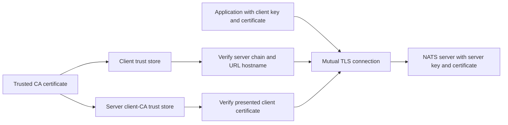

# Configure NATS Mutual TLS in Docker Without Hostname Errors

Author: [nawazdhandala](https://www.github.com/nawazdhandala)

Tags: NATS, Docker, Security, TLS

Description: Match NATS certificate names to Docker connection addresses, require trusted client certificates, and verify mutual TLS without disabling hostname checks.

A certificate can be signed by the correct certificate authority and still fail when a client connects. Trusting the issuer answers who signed it. Checking its name answers whether it belongs to the server the client intended to reach. Docker adds another detail: an application inside a Compose network and a program on your laptop often use different server addresses.

This tutorial configures client-to-server mutual TLS with NATS Server 2.11.4 and nats.go 1.42.0. Mutual TLS means both sides present certificates and verify their peer. These pinned versions define the example; select a supported release through your normal upgrade process for production.

## Decide the addresses before requesting certificates

Compose services on the same network can find one another by service name. A host program instead uses a published port. Docker documents this distinction in [Compose networking](https://docs.docker.com/compose/how-tos/networking/).

| Client location | Example URL | Required server certificate name |
| --- | --- | --- |
| Application on the same Compose network | `tls://nats:4222` | DNS SAN `nats` |
| Program on the Docker host | `tls://127.0.0.1:14232` | IP SAN `127.0.0.1` |
| Program using an internal DNS name | `tls://nats.example.internal:4222` | DNS SAN `nats.example.internal` |

SAN means Subject Alternative Name, the certificate extension containing the identities a certificate covers. A DNS SAN containing the characters `127.0.0.1` is not the same as an IP SAN. Use the SAN type that matches how the client connects.

For this lab, request a server certificate containing `DNS:nats` and `IP:127.0.0.1`, with server-authentication usage. Request a separate client certificate with client-authentication usage. Do not rely on the certificate's Common Name as a substitute for SANs.



The CA's private signing key is not part of either runtime. Keep it in your certificate issuance system. A disposable lab CA is suitable for a local test, not a replacement for your organization's production PKI, or public key infrastructure.

## Prepare separate runtime files

Place the following files beside the Compose project. They must already exist before starting the containers:

```text
compose.yaml
nats.conf
certs/
  ca.pem
  server.pem
  server-key.pem
  client.pem
  client-key.pem
```

For simplicity, this lab uses one CA for both certificate roles. Separate server and client issuers are also possible, but each side must trust the appropriate issuer. If an intermediate CA issued a leaf certificate, serve the leaf followed by its required intermediates in the certificate file. Install the intended trust anchor in the peer's trust store.

Keep private keys readable only by the process identity that needs them. Do not mount the client key into the server or the server key into application containers. The CA certificate is public trust material; the CA private key must stay outside this directory.

## Require a client certificate on the server

Create `nats.conf`:

```text
listen: "0.0.0.0:4222"

tls {
  cert_file: "/etc/nats/certs/server.pem"
  key_file: "/etc/nats/certs/server-key.pem"
  ca_file: "/etc/nats/certs/ca.pem"
  verify: true
  timeout: 2
}
```

Binding to the container's interfaces lets other containers and the published port reach the listener. Binding only to loopback inside the container would prevent those paths from working.

`verify: true` requires and verifies a client certificate. The top-level block protects NATS client connections; it does not configure cluster routes or other listeners. See the [NATS TLS guide](https://docs.nats.io/learn/security/encryption) and the [2.11.4 TLS configuration implementation](https://github.com/nats-io/nats-server/blob/v2.11.4/server/opts.go).

This minimal lab accepts client certificates from its trusted CA without defining per-user subject permissions. Before production, add your NATS authorization model, such as credentials with explicit publish and subscribe permissions. Certificate validation by itself is not tenant isolation. Certificate-to-user mapping is a separate configuration decision.

## Mount only the server's files

Create `compose.yaml`:

```yaml
services:
  nats:
    image: nats:2.11.4-alpine@sha256:b8d6a01568a7837d5186f948a3ebfae1bdf5a602268273b50704655982596b22
    command: ["nats-server", "--config", "/etc/nats/nats-server.conf"]
    ports:
      - "127.0.0.1:14232:4222"
    volumes:
      - ./nats.conf:/etc/nats/nats-server.conf:ro
      - ./certs/ca.pem:/etc/nats/certs/ca.pem:ro
      - ./certs/server.pem:/etc/nats/certs/server.pem:ro
      - ./certs/server-key.pem:/etc/nats/certs/server-key.pem:ro
```

The digest pins the inspected multi-platform image index. Its Linux ARM64 image configuration identifies Server 2.11.4 and the shown server command. The image is maintained in the [official NATS Docker repository](https://github.com/nats-io/nats-docker). The published host port is limited to loopback; other Compose services use port `4222` on `nats`.

Validate and start this isolated project with Docker Compose available:

```bash
docker compose config --quiet
docker compose run --rm nats nats-server -t -c /etc/nats/nats-server.conf
docker compose up -d nats
```

The second command starts a temporary configuration-checking container and removes it afterward. Compose's [run documentation](https://docs.docker.com/reference/cli/docker/compose/run/) explains command overrides and `--rm`; NATS's `-t` checks configuration and exits. If the key is unreadable, fix ownership or the mount source rather than making every private key world-readable.

## Inspect certificates before debugging networking

These non-destructive OpenSSL 3.6 commands inspect the local files and verify the names used in this example:

```bash
openssl x509 -in certs/server.pem -noout -subject -issuer -dates \
  -ext subjectAltName
openssl verify -CAfile certs/ca.pem -purpose sslserver \
  -verify_hostname nats certs/server.pem
openssl verify -CAfile certs/ca.pem -purpose sslserver \
  -verify_ip 127.0.0.1 certs/server.pem
openssl verify -CAfile certs/ca.pem -purpose sslclient certs/client.pem
```

Expect the SAN display to contain both names and each verification to print `OK`. For an intermediate-issued leaf, supply the intermediate certificates through `-untrusted` when verifying a standalone leaf. The [verification options](https://docs.openssl.org/3.6/man1/openssl-verification-options/) and [certificate inspection reference](https://docs.openssl.org/3.6/man1/openssl-x509/) document these flags. Successful local verification does not prove the running server mounted that same file.

## Verify a real NATS connection

Use this `main.go` in a Go module depending on `github.com/nats-io/nats.go v1.42.0`:

```go
package main

import (
	"fmt"
	"github.com/nats-io/nats.go"
	"os"
	"time"
)

func main() {
	endpoint := os.Getenv("NATS_URL")
	if endpoint == "" {
		endpoint = "tls://127.0.0.1:14232"
	}
	nc, err := nats.Connect(endpoint,
		nats.RootCAs("certs/ca.pem"),
		nats.ClientCert("certs/client.pem", "certs/client-key.pem"),
		nats.Name("mtls-check"), nats.NoReconnect(),
		nats.Timeout(2*time.Second))
	if err != nil {
		panic(err)
	}
	defer nc.Close()
	if err := nc.FlushTimeout(2 * time.Second); err != nil {
		panic(err)
	}
	fmt.Println("Verified TLS connection and NATS round trip succeeded")
}
```

The default URL uses the published host port. Inside an application container on the same Compose network, set `NATS_URL=tls://nats:4222` and mount only its CA, client certificate, and client key at the paths the program expects. The [pinned Go client's TLS options](https://github.com/nats-io/nats.go/blob/v1.42.0/nats.go) load those files and verify the server identity.

The expected output confirms a verified connection and a NATS protocol round trip. It does not prove publish permissions or JetStream storage. Use a NATS-aware client here: this configuration uses NATS's normal protocol negotiation before TLS, so a generic immediate TLS probe is not equivalent.

## Interpret failures without bypassing verification

A hostname mismatch calls for correcting the URL or reissuing a certificate with the intended SAN. An unknown-authority error calls for checking the issuer chain and the correct peer's trust store. A missing-client-certificate error means the client did not present its own certificate and key. Connection refusal instead points to the listener, container state, port mapping, or network path.

Local tests passed configuration validation, chain/purpose/name checks, and a verified NATS round trip. Negative tests rejected a wrong hostname, an untrusted server CA, and a missing client certificate. Docker was unavailable, so the Compose file received schema review and image metadata inspection; the handshake tests used the same server version directly on loopback. Before deployment, repeat the checks through the actual container network and ensure certificate renewal preserves the required SANs and trust chain.
