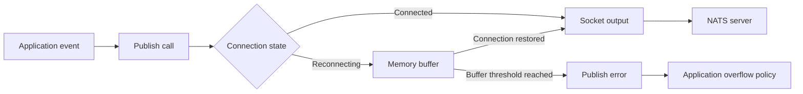

# Bound NATS Reconnect Buffers and Shut Down Without False Guarantees

Author: [nawazdhandala](https://www.github.com/nawazdhandala)

Tags: NATS, Messaging, Go, Reliability

Description: Bound offline NATS publishes, understand what flush confirms, and handle shutdown during a reconnect without mistaking memory buffering for durable delivery.

A publisher can return success while its NATS server is unreachable. That can be useful: the client keeps a small amount of outgoing work in memory and sends it after reconnecting. It becomes dangerous when the application interprets that return value as proof that an order, payment, or audit event reached durable storage.

Treat reconnect buffering as a short interruption allowance. Decide separately how much memory the application may consume, what happens when that allowance runs out, and which evidence permits deleting an event from durable local storage.

This walkthrough uses **nats.go v1.42.0** and **NATS Server 2.11.4**. The examples concern a Core NATS connection; JetStream acknowledgment tracking adds another layer. Tests used a disposable local server, not a production outage.

## Follow the message through the connection

A reconnect buffer holds outgoing protocol data while the client tries to reconnect. It is distinct from a subscriber's pending-message queue and from JetStream's stored stream. The [reconnection guide](https://docs.nats.io/learn/resilient-clients/reconnection) describes the connection transitions and retry behavior.



The diagram deliberately stops at the server. A Core publish has no storage acknowledgment. A subscriber might be absent, and an application might crash before queued bytes leave memory. Financial or otherwise non-discardable events need a durable handoff design, such as an outbox written with the business transaction and cleared only after the required acknowledgment.

## Choose a budget before configuring retries

Estimate the outgoing byte rate, multiply it by the outage interval you intend to absorb, and include protocol overhead. For example, 500 events per second at roughly 1 KiB each already needs about 5 MiB for ten seconds, before subjects, headers, and framing. This is a sizing estimate, not a promise that every ten-second outage fits.

Also count connections. Twenty independently configured publishers each allowed 4 MiB represent roughly 80 MiB of reconnect allowance, before application queues and ordinary runtime memory. Limit event size and producer concurrency too; a connection setting cannot constrain unrelated queues in your process.

For a service that already imports `github.com/nats-io/nats.go` and `time`, this fragment creates a bounded connection. The loopback URL is for a local test; replace it with your approved server pool and existing authentication/TLS options for deployment.

```go
closed := make(chan struct{})
nc, err := nats.Connect("nats://127.0.0.1:14238",
    nats.Name("orders-publisher"),
    nats.ReconnectBufSize(4*1024*1024),
    nats.ReconnectWait(2*time.Second),
    nats.MaxReconnects(30),
    nats.DrainTimeout(10*time.Second),
    nats.ClosedHandler(func(*nats.Conn) { close(closed) }),
)
if err != nil {
    return err
}
```

A successful initial connection gives you `nc`; it does not guarantee later publishes succeed. The retry count limits reconnection attempts, not a precise outage duration. DNS, dialing, server-pool size, and jitter affect elapsed time. This example does not enable retrying a failed first connection.

In the [pinned Go implementation](https://github.com/nats-io/nats.go/blob/v1.42.0/nats.go), zero selects the default 8 MiB reconnect buffer; **-1 disables buffering**. The threshold is checked against existing pending bytes before appending a publication. Consequently, it is not an exact allocation ceiling: one accepted publication can carry the buffer beyond the threshold. Bound individual messages as well.

## Make overflow a visible business decision

Check every publish error. Never wrap publication in an unbounded retry loop that allocates another goroutine or copies the payload each time.

```go
err = nc.Publish("orders.created", payload)
if errors.Is(err, nats.ErrReconnectBufExceeded) {
    return fmt.Errorf("offline publish allowance exhausted: %w", err)
}
if err != nil {
    return fmt.Errorf("publish rejected: %w", err)
}
```

This fragment additionally imports `errors` and `fmt`; `payload` is the event byte slice supplied by the caller. Returning an error gives the caller a decision point. A request handler might reject new work before committing it, while an outbox worker retains its row and retries later. Optional telemetry might deliberately drop a sample and increment a loss counter. Choose the policy explicitly rather than silently losing the event.

With buffering disabled, an offline publish fails instead of joining the reconnect queue. That can simplify an outbox worker, but it still does not turn a successful Core publish into an acknowledgment. Connection-state checks are advisory: the connection can change between `IsConnected()` and `Publish()`.

## Flush confirms a protocol boundary

Use a deadline when checking that outgoing commands have reached the server:

```go
if err := nc.FlushTimeout(2 * time.Second); err != nil {
    return fmt.Errorf("server flush not confirmed: %w", err)
}
```

Flush uses a protocol round trip. A successful result confirms the server has processed preceding commands on that connection; it does not wait for subscribers to finish their business transactions. For JetStream, use the publication's own acknowledgment to establish stream acceptance. A flush cannot replace that acknowledgment or an application-level receipt.

A timeout leaves uncertainty. Some earlier commands may have reached the server before the response was lost. Retrying a business operation therefore needs a stable identifier and duplicate handling, not an assumption that the first attempt did nothing. The [NATS protocol reference](https://docs.nats.io/reference/protocols/client) describes the PING/PONG exchange underlying this boundary.

## Stop producers before draining

Drain is a shutdown procedure that allows pending subscription work and outgoing publications to finish before closing. First stop accepting work, stop and join your producers, and retain unresolved durable records. Otherwise those producers can race the shutdown. The [shutdown guide](https://docs.nats.io/learn/resilient-clients/drain-and-shutdown) explains this sequence.

For the connection and `closed` channel created above:

```go
if err := nc.Drain(); err != nil {
    return fmt.Errorf("could not begin drain: %w", err)
}
select {
case <-closed:
    return nil
case <-time.After(20 * time.Second):
    nc.Close()
    return errors.New("shutdown deadline expired; delivery unresolved")
}
```

`Drain()` starts asynchronous work. Waiting for the close callback avoids exiting immediately, but closure alone is not a delivery certificate. Register an `ErrorHandler` in the real service to record asynchronous drain errors, and reconcile any outstanding application acknowledgments before reporting a clean business shutdown. The outer deadline is separate from the subscription drain timeout.

There is an especially important version-specific case: in v1.42.0, calling `Drain()` while reconnecting closes the connection and returns `ErrConnectionReconnecting`. It does not wait indefinitely for the server to recover. Decide in advance whether shutdown may wait within a bounded grace period, or must close and leave durable records for a later run.

## Rehearse the failure boundaries

Use a disposable server and a test-only subject. Establish a subscription, flush it, stop only that test server, and wait until the publisher reports reconnecting. Publish bounded messages until an error occurs; record accepted calls, pending bytes, and rejected calls separately. Restart the same test server and check actual receipt.

Our local test used a 1,024-byte threshold and 256-byte payloads. Four calls were accepted, with 1,116 buffered bytes including framing; the next call was rejected. An offline flush timed out. After restart, all four accepted messages reached the test subscription. A separate check confirmed disabled buffering rejected offline publication and reconnecting drain closed with an error.

Those observations verify specific boundaries, not crash durability or performance. Add process-crash, retry-exhaustion, slow-network, and duplicate-delivery cases to your own staging acceptance tests. Alert on sustained reconnect duration, overflow errors, and unresolved durable records so a short memory bridge cannot quietly become your event storage system.
