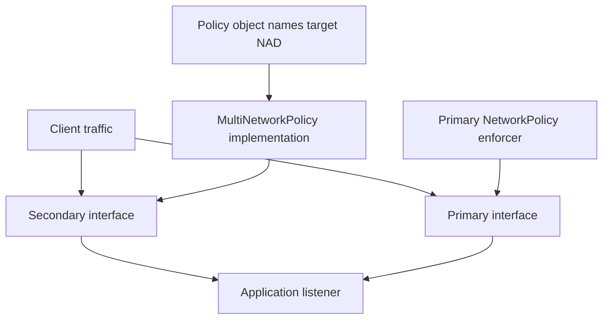

# Enforce Policy on Multus Secondary Interfaces and Verify the Gaps

Author: [nawazdhandala](https://www.github.com/nawazdhandala)

Tags: Multus, Kubernetes, Security

Description: Identify the enforcer for secondary-network traffic, scope a MultiNetworkPolicy example, and verify allowed and denied connections on the actual interface.

A default-deny Kubernetes NetworkPolicy may protect a Pod's primary network while an application remains reachable through a Multus secondary address. The YAML can be valid and the primary policy can work correctly. The missing piece is enforcement on the other traffic path.

Multus attaches networks through delegates. It does not make every secondary interface inherit the primary CNI's policy behavior. Before relying on a rule, identify the implementation that observes the policy object and programs enforcement for that specific interface.

This guide uses the **OpenShift 4.18** documented MultiNetworkPolicy model for the example and reviews upstream API and iptables implementation sources. Local checks cover the example's structure, not live packet enforcement. Other distributions and versions require their own support review.

## Start with the enforcement boundary

Kubernetes NetworkPolicy requires a network implementation that enforces it. Creating an object without a suitable implementation does not itself filter packets. The same principle applies to a custom MultiNetworkPolicy API: installing its CRD makes the object available, but a controller or node agent must implement the behavior. [Kubernetes NetworkPolicy requirements](https://kubernetes.io/docs/concepts/services-networking/network-policies/).



Document the enforcer, policy API, target network, address family, and supported datapath together. A datapath is the mechanism through which packets move: ordinary kernel interfaces and userspace device access can have very different filtering opportunities.

The upstream `multi-networkpolicy-iptables` implementation describes programming rules inside Pod network namespaces for selected interfaces. Its README also describes the project as actively developing and not stable. That is evidence of an implementation approach, not a blanket production support claim. Use your distribution's supported packaging and version policy. [Pinned implementation description](https://github.com/k8snetworkplumbingwg/multi-networkpolicy-iptables/blob/cbf2b11730b9fb0477d8d578129609df0c51f06b/README.md).

## Check the installed version's support matrix

OpenShift 4.18 documents MultiNetworkPolicy for several secondary network types, including macvlan, ipvlan, SR-IOV, bond over SR-IOV, and OVN-Kubernetes secondary networks. Its SR-IOV support is limited to kernel NICs. Do not translate that into a promise for userspace packet processing or another product version. [OpenShift 4.18 secondary-network policy](https://docs.redhat.com/en/documentation/openshift_container_platform/4.18/html/multiple_networks/secondary-networks).

Before proceeding, confirm that multi-network policy support is enabled, the relevant agents are healthy on every target node, and the chosen network meets the documented limitations. Check IPv6 handling separately. Policy support can change between releases, so an older guide's list of unsupported plugins may no longer describe your installation.

Also identify which controls remain outside this policy. Admission rules decide who may request an attachment; network policy filters traffic after attachment. Neither replaces control over who can modify NADs, workload labels, or policy objects.

## Define a narrow staging target

Assume a staging namespace `policy-lab`, an existing supported NAD named `telemetry-net`, and a destination Pod labeled `app: collector`. The destination must listen on TCP port 4317 on its secondary address. Approved source Pods use `role: telemetry-client` in the same namespace.

First establish that the test clients can reach that port before policy is applied. Otherwise, a routing failure could be mistaken for successful denial. Use disposable workloads and the direct secondary destination IP, not a Service address that might route through the primary network.

This baseline policy selects only the collector Pods and the intended NAD:

```yaml
apiVersion: k8s.cni.cncf.io/v1beta1
kind: MultiNetworkPolicy
metadata:
  name: collector-secondary-deny-ingress
  namespace: policy-lab
  annotations:
    k8s.v1.cni.cncf.io/policy-for: policy-lab/telemetry-net
spec:
  podSelector:
    matchLabels:
      app: collector
  policyTypes: [Ingress]
  ingress: []
```

The `policy-for` annotation selects the network definition; `podSelector` selects destination Pods in the policy namespace. Replace the sample names and labels with your reviewed staging setup. This is an ingress baseline, not an egress restriction or a primary-network policy.

Then add the intended exception:

```yaml
apiVersion: k8s.cni.cncf.io/v1beta1
kind: MultiNetworkPolicy
metadata:
  name: collector-secondary-allow-client
  namespace: policy-lab
  annotations:
    k8s.v1.cni.cncf.io/policy-for: policy-lab/telemetry-net
spec:
  podSelector:
    matchLabels:
      app: collector
  policyTypes: [Ingress]
  ingress:
    - from:
        - podSelector:
            matchLabels:
              role: telemetry-client
      ports:
        - protocol: TCP
          port: 4317
```

The peer selector here is for same-namespace source Pods. It is not a cross-namespace allow rule. The API follows additive policy semantics: other policies selecting the same destination can also allow traffic. Inventory them before interpreting a denial test. The upstream schema documents selectors, ports, policy types, and additive rules. [Pinned API schema](https://github.com/k8snetworkplumbingwg/multi-networkpolicy/blob/a6d2c547f9f9dc756d285e7015fc32f7b6793f76/scheme.yml).

## Validate objects, then validate traffic

Save the two documents in `secondary-policy.yaml`. With an identity authorized for this API, validate against the staging API server:

```bash
kubectl --context REPLACE_STAGING_CONTEXT apply \
  --dry-run=server -f secondary-policy.yaml
```

A successful server dry run checks the request through the API without persisting the policy. It does not prove that a node agent installed rules or that the target traffic passes through them. Apply through your approved process only after confirming the intended namespace and scope. [kubectl apply reference](https://kubernetes.io/docs/reference/kubectl/generated/kubectl_apply/).

Run fresh connections for this matrix after allowing the implementation to reconcile:

| Source and destination | Expected result with these policies |
| --- | --- |
| Approved same-namespace client to secondary TCP 4317 | Allowed |
| Unapproved client to secondary TCP 4317 | Denied |
| Approved client to another listening secondary TCP port | Denied unless another policy permits it |
| Client to the primary address | Governed by the primary-network policy |
| Destination initiating an outbound connection | Not restricted by these ingress-only objects |

Test from another node as well as the same node. Use a listening service for negative port tests; “connection refused” from a closed port does not establish policy enforcement. Record timeout, rejection, or successful handshake along with relevant enforcement evidence.

## Investigate an unexpected pass carefully

If disallowed traffic succeeds, check the destination address and interface first. Then inspect target labels, the NAD annotation, overlapping allow policies, source identity, and agent health. An annotation typo can point at a different network while leaving the object syntactically valid.

Do not assume an established connection will behave like a new one immediately after a policy change. Use fresh client processes or connections and document the implementation's convergence behavior. For IPv6, repeat the tests with IPv6 addresses instead of relying on the IPv4 result.

If the selected datapath is outside the enforcer's supported coverage, use an appropriate supported enforcement point, such as the network fabric or application authentication, while redesigning the attachment. Do not declare a secondary network isolated merely because a policy object exists. Isolation is an observed property of the actual traffic path and its enforced rules.
