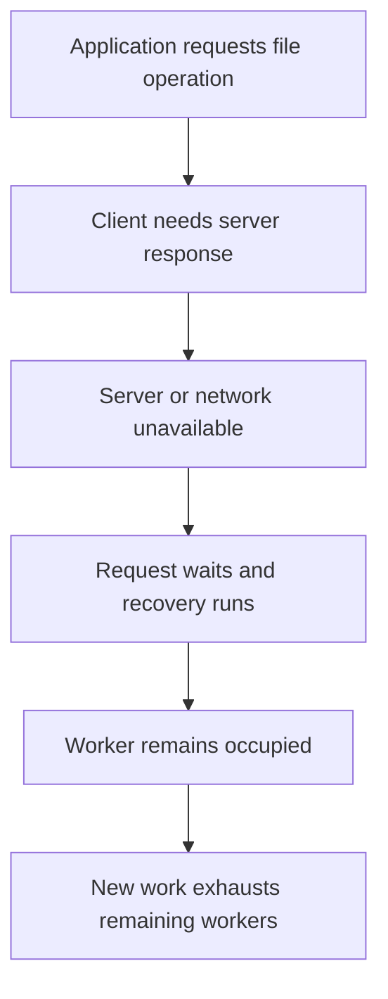

# Why NFS Hangs: Choose hard, soft, timeo, and retrans Carefully

Author: [nawazdhandala](https://www.github.com/nawazdhandala)

Tags: NFS, Linux, Troubleshooting

Description: Diagnose blocked NFS commands without worsening an outage, understand retry settings, and test recovery before changing mount failure behavior.

An application stops responding. Someone runs `df` to check capacity, and that command stops too. Another person tries `ls` on the share and gets no output. The host may still accept SSH connections and have plenty of free memory.

These symptoms can share one cause: operations are waiting for a remote filesystem. Changing a retry setting might change the visible symptom, but it also changes what happens to application requests when storage becomes unavailable. Diagnose the wait before choosing a different failure policy.

## Why an innocent command needs the server

Network File System (NFS) makes remote files appear in the local directory tree. Reading names, obtaining attributes, and asking for filesystem capacity can require communication with the server. Cached information sometimes lets one operation finish while another waits.

GNU `df` without a path reports mounted filesystems, so a routine capacity check can encounter a failed remote mount. `ls` lists directory information; long listings request more details than a name alone. A command that prints nothing is not necessarily consuming CPU or looping in application code. [GNU df manual](https://man7.org/linux/man-pages/man1/df.1.html), [GNU ls manual](https://man7.org/linux/man-pages/man1/ls.1.html).

Repeatedly starting these commands creates more requests without explaining the first one. During an incident, keep the diagnostic shell in a known local directory and use tools installed locally. Avoid recursively walking the affected share or writing diagnostic logs to it.



This is also why a storage problem can become an application availability problem. Even unrelated endpoints may queue behind a worker pool whose threads all need the same mount.

## Separate retry policy from a request deadline

The Linux NFS manual defines these options:

| Setting | Meaning |
| --- | --- |
| `hard` | Retry requests indefinitely; this is the default policy |
| `soft` | Return `EIO` after the configured retransmission limit |
| `softerr` | Return `ETIMEDOUT` instead |
| `timeo` | Response timeout in tenths of a second |
| `retrans` | Retries before further recovery action |

For TCP, the documented default is `timeo=600`, meaning 60 seconds, with linear backoff up to 600 seconds. The default TCP retry count is two. With `hard`, reaching that count does not make the operation give up.

The manual warns that soft timeouts can cause silent data corruption. It also documents that `intr` has been ignored since Linux 2.6.25. `softreval` permits cached paths and attributes after failed revalidation; it does not make uncached operations on a hard mount stop retrying. [Linux NFS mount options](https://man7.org/linux/man-pages/man5/nfs.5.html).

Do not translate `timeo × retrans` into an application service-level promise. A business request may perform many filesystem operations, encounter different recovery stages, and wait behind other work. Decide the allowed business delay separately, then measure the complete request during a controlled outage.

## Inspect the mount without walking its contents

The following examples target Linux systems with util-linux `findmnt` and procps-ng `ps`. They are read-only, source-checked examples, not results from an NFS outage reproduced for this article. Record your installed versions before comparing results across hosts.

First, list NFS mount metadata from the kernel's mount table:

```bash
findmnt --kernel --nocanonicalize --types nfs,nfs4   --output TARGET,SOURCE,FSTYPE,OPTIONS
```

This asks for mount identities and options rather than free-space figures. `--nocanonicalize` avoids resolving paths into canonical names. Do not add size or available-space columns while trying to avoid filesystem capacity queries. The expected result is a row for each matching mount visible in the current mount namespace, including its server and options. An empty result is not proof that a container or another namespace has no NFS mounts. [findmnt options](https://man7.org/linux/man-pages/man8/findmnt.8.html).

Keep the affected application's namespace in mind. A host shell and a container may see different mounts at the same-looking path. Establish which mount the application actually uses before changing host configuration.

Next, inspect threads of a known affected process. Replace `12345` with its numeric process ID:

```bash
ps -L -p 12345 -o pid,tid,stat,wchan:32,comm
```

The output includes thread IDs, state, and a wait-channel name when available. `D` indicates uninterruptible sleep, usually associated with I/O; it does not uniquely identify NFS. An absent or restricted wait-channel name is not evidence that nothing is blocked. Compare thread evidence with mount information and kernel incident logs. [procps process and thread fields](https://man7.org/linux/man-pages/man1/ps.1.html).

Have the server and network owners check the same time interval. Useful questions include whether the export is still served, whether the active storage node changed, and whether the client can reach the required service. A successful ping alone cannot establish that a filesystem request can complete.

## Understand what a command timeout actually does

GNU `timeout` sends signals after a duration; it is not a filesystem transaction canceler. Its `--kill-after` option adds a later kill signal. A wrapper returning or a signal being sent does not prove that a storage request was canceled safely. [GNU timeout behavior](https://man7.org/linux/man-pages/man1/timeout.1.html).

For operational planning, treat a blocked kernel wait as something that may outlive the caller's desired deadline. Do not build a health check that launches another share probe every few seconds without tracking whether its previous process finished. Use bounded concurrency and report an outstanding probe as a failure instead of accumulating more probes.

Similarly, distinguish a client-facing timeout from worker recovery. An HTTP request can time out while its worker still waits for storage. Monitor outstanding operations and worker availability as well as response latency. Stop accepting additional storage-dependent work when the service cannot make useful progress.

## Choose failure behavior by data requirements

For authoritative files, start with the application's supported storage configuration and its integrity requirements. Ask what an error means during a partial update, whether the application checks close and synchronization errors, and how it reconciles an operation whose outcome is unknown.

A disposable, independently reproducible dataset may justify a different availability tradeoff, but “read mostly” is not enough. Confirm that no workflow writes important metadata there, and that errors cannot be mistaken for an empty directory or a valid partial result. Document who accepts that failure mode.

Do not use an incident as an opportunity to experiment with mount policies on live writers. Prepare a replacement configuration and test it on separate staging clients with disposable data. Preserve the original settings so the comparison is reproducible.

## Rehearse failure and recovery together

Build an acceptance test around the real application rather than a single directory listing:

1. Record the client kernel, server release, protocol, transport, security mode, and effective mount options.
2. Run representative reads, writes, metadata operations, and synchronization behavior against a disposable export. Assign unique IDs to writes.
3. Have the infrastructure owner introduce a narrowly scoped staging outage affecting only that client/export path. Retain independent administrative access and an agreed restoration step.
4. Capture application errors, outstanding workers, acknowledged write IDs, and the time useful work stops. Prevent the test from creating unbounded workers.
5. Restore service. Verify both progress and file contents, including whether acknowledged writes remain and whether failed requests left partial results.

A passing test needs an agreed recovery duration and data outcome. “The shell eventually returned” is insufficient. Repeat after meaningful client, server, or mount-policy changes.

## Recover deliberately

Restore the missing server or network dependency where possible, then assess applications before resuming normal traffic. Preserve incident evidence and reconcile uncertain writes. If a process must be restarted, coordinate that with its data owner rather than assuming every failed request is safe to replay.

Forced and lazy unmounts have different semantics. The Linux manual warns that forced unmount is not guaranteed to avoid hanging; lazy unmount detaches the filesystem and cleans references later. Neither is proof that outstanding writes reached durable storage. Use the platform's reviewed recovery procedure instead of treating detachment as data recovery. [Linux umount behavior](https://man7.org/linux/man-pages/man8/umount.8.html).

The useful outcome is a documented storage failure contract: which work waits, which work fails, how concurrency is bounded, and how the team verifies recovery. Mount options are one part of that contract, not a substitute for it.
