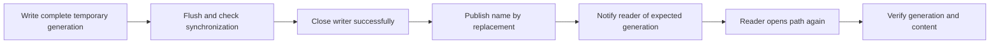

# Diagnose Stale NFS Reads: Caches, fsync, and Reopening Files

Author: [nawazdhandala](https://www.github.com/nawazdhandala)

Tags: NFS, File Storage, Troubleshooting

Description: Separate NFS cache delays from buffered writes and old file handles, then use a controlled two-client test to verify publication and reader behavior.

A writer reports success, but another host still reads yesterday's configuration. Before changing NFS mount options, determine what “success” and “read” mean in that application. The writer may have updated a language buffer, the reader may retain an old file descriptor, or the two hosts may not even be using the same export.

NFS, the Network File System protocol, adds another cache boundary to normal file I/O. This guide focuses on Linux clients and a single writer publishing complete file generations. It separates application behavior from mount configuration and provides a local descriptor demonstration. No live NFS test was performed for this article.

## First prove both clients refer to the same resource

On each Linux client, substitute an existing path inside the affected mount and run these read-only commands. They require util-linux's `findmnt` and the NFS utilities package containing `nfsstat`.

```bash
findmnt --target /mnt/shared/config --output TARGET,SOURCE,FSTYPE,OPTIONS
nfsstat --mounts
```

[findmnt](https://man7.org/linux/man-pages/man8/findmnt.8.html) identifies the mount containing the path, while [nfsstat](https://man7.org/linux/man-pages/man8/nfsstat.8.html) reports mounted NFS file systems and flags. Record the server, exported path, negotiated protocol version, effective options, and client kernel version with the incident evidence.

Compare that evidence across both hosts. Container mount namespaces, bind mounts, replicas, and similarly named exports can make two identical-looking paths point at different data. Do not proceed on the assumption that matching path strings prove shared storage.

Use a dedicated test directory on a staging export. Choose unique generation identifiers rather than judging freshness from modification times alone. Record writer completion and reader observations in an explicit sequence; unsynchronized host clocks can otherwise make the timeline misleading.

## Identify the boundary that is stale

| Observation | First question | Targeted next test |
| --- | --- | --- |
| A fresh reader sees new data but the application does not | Does the application cache content or hold an old descriptor? | Reopen through the application's actual code path |
| Writer completion occurs before its file closes | Are bytes still buffered or pending? | Check flush, synchronization, and close errors |
| A newly created name is temporarily absent | Is directory lookup involved? | Compare direct fresh opens with directory-listing behavior |
| Multiple clients see different generations after orderly publication | Do protocol, mount, or server conditions differ? | Repeat with captured configuration and one writer |

The Linux [NFS manual](https://man7.org/linux/man-pages/man5/nfs.5.html) distinguishes attribute caching, directory lookup caching, and data caching. Its close-to-open discussion describes the familiar sequence of a writer closing and another client opening, particularly for NFSv3. That is different from continuously reading an already-open file while someone else modifies it.

NFSv4 adds protocol rules around opens, change attributes, locking, and delegations. A delegation lets a client manage certain state locally under server control. [RFC 7530 section 10.3](https://www.rfc-editor.org/rfc/rfc7530.html#section-10.3) explains the caching relationship; it does not make unsynchronized concurrent application access a transaction. Keep the actual protocol version in the diagnosis.

## Separate buffer flushing, storage synchronization, and publication

For a buffered Python file, `flush()` moves pending Python-level output to the underlying file operation. `os.fsync()` requests synchronization for that descriptor. Python's [os documentation](https://docs.python.org/3.11/library/os.html#os.fsync) explicitly describes flushing the file object before calling it.

Check exceptions from writing, flushing, synchronizing, and closing. A prior successful write does not justify ignoring a later storage error. On Linux, [fsync](https://man7.org/linux/man-pages/man2/fsync.2.html) can report delayed write failures and has separate considerations for persisting directory entries.

Neither operation tells another process to discard an application-level cached object. Calling synchronization on a reader's descriptor is not an application reload protocol.

For a whole-file publication pattern, distinguish these stages:



This diagram assumes one publisher and a temporary file on the same file system as the published path. A real implementation also needs its metadata, permission, failure, and crash-durability policy. A successful namespace replacement is not a guarantee that every existing reader switches to the new file.

## Demonstrate the old-descriptor case locally

Run this with Python 3.11 on a local POSIX file system. It creates and removes only its own temporary directory. `os.open` and `os.read` avoid a Python buffered reader, so the old result cannot be explained by Python read-ahead.

```python
import os
import tempfile
from pathlib import Path

with tempfile.TemporaryDirectory(prefix='file-generation-') as directory:
    root = Path(directory)
    current = root / 'current.txt'
    current.write_bytes(b'generation-1\n')
    old_fd = os.open(current, os.O_RDONLY)
    try:
        pending = root / 'pending.txt'
        with pending.open('wb') as writer:
            writer.write(b'generation-2\n')
            writer.flush()
            os.fsync(writer.fileno())
        os.replace(pending, current)
        held = os.read(old_fd, 4096)
        reopened = current.read_bytes()
        assert held == b'generation-1\n'
        assert reopened == b'generation-2\n'
        print('Held descriptor:', held.decode().strip())
        print('Reopened path:', reopened.decode().strip())
    finally:
        os.close(old_fd)
```

Expected output is `Held descriptor: generation-1` followed by `Reopened path: generation-2`. We executed this example on local macOS storage and both assertions passed.

The descriptor still refers to the old file object; the pathname now selects the replacement. Linux documents that open descriptors remain unaffected by [rename](https://man7.org/linux/man-pages/man2/rename.2.html). This is a useful explanation for a stale-looking reader even without NFS.

The example is deliberately not a complete crash-safe publisher: it does not synchronize the containing directory after replacement or test server failures. It also does not demonstrate cross-client cache behavior. Keep those limits separate from its descriptor result.

## Reproduce the actual problem with two clients

Use client A as the only writer and client B as the reader. Keep production workloads out of the test directory. Before publishing, have B open generation one and retain that descriptor without consuming it.

On A, create a complete second generation in a temporary file in the same directory. Include a unique generation ID and a checksum or deterministic payload. Flush, synchronize, close, and publish according to the application's supported procedure. Record every result before signaling B that publication completed.

On B, compare three observations: reading the retained descriptor, opening the published path afresh, and reading through the real application. Record generation IDs and content hashes rather than only a directory listing.

If the retained descriptor gives the old generation while a fresh open gives the new one, investigate reader lifecycle first. If only the application gives the old result, investigate its memory cache or pooling. If fresh opens on B remain old, preserve that reproduction and inspect client/server configuration and protocol behavior with the storage owner.

Repeat with the application's real update style. In-place mutation and whole-file replacement have different reader implications. Do not let a successful replacement test stand in for a workload that writes sections of a file concurrently.

## Change cache settings only after isolating the cause

Linux options such as `actimeo`, `lookupcache`, and `noac` affect different cache behavior. `noac` is not “no data caching”; it also changes write behavior and can impose substantial overhead. Protocol-specific meanings matter, including differences in `cto`/`nocto` handling. Consult the [mount-option and coherence sections](https://man7.org/linux/man-pages/man5/nfs.5.html) for the deployed client.

Test a proposed change on isolated clients and a staging mount, with measured metadata traffic and application latency. Do not treat dropping system-wide caches or remounting a production share as the first diagnostic step. Either action can obscure the cause while affecting unrelated workloads.

If correctness requires coordinated access, define a supported locking or single-writer protocol. With NFSv4 byte-range locking, the locked ranges must correspond to the data being protected; a token lock on an unrelated byte is not automatically a cache-coherence protocol for the entire dataset. The RFC's caching rules explain why application agreement matters.

Close the incident with evidence that the actual writer reports completion correctly, the reader obtains the intended generation, and expected failure paths are handled. A shorter observed delay after a mount change is useful performance evidence, but it is not by itself proof that the application's publication protocol is correct.
