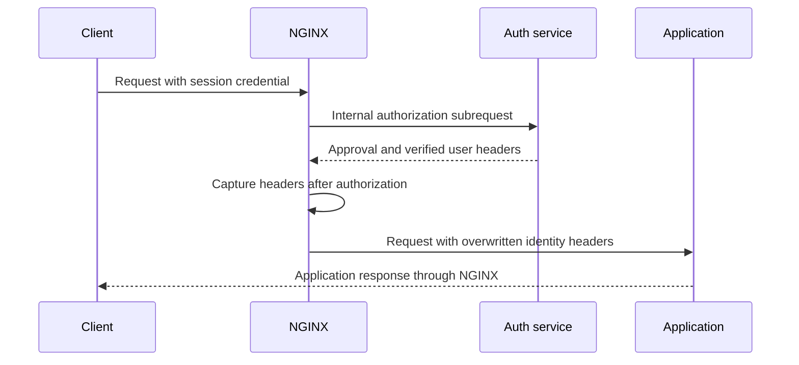

# Pass OAuth Identity Headers Through NGINX auth_request

Author: [nawazdhandala](https://www.github.com/nawazdhandala)

Tags: Nginx, OAuth, Security

Description: Capture trusted identity headers from an NGINX authorization subrequest, overwrite client-supplied values, and test denial and authentication-service failures.

An authentication service approves a request, but the application still sees an empty user field. The missing step is often header propagation. Headers returned by an authorization subrequest do not automatically become headers on the separate request NGINX sends to the application.

The solution is to capture the authorization response into variables after that subrequest completes, then explicitly set the application's identity headers. Just as importantly, those values must replace anything the client supplied under the same names.

This example uses NGINX 1.30.7 and the response-header contract in OAuth2 Proxy 7.15.6. Local runtime testing used a deterministic authorization stub, not a live identity provider or OAuth2 Proxy login session.

## Define the trust contract

OAuth2 Proxy handles authentication with the configured provider and exposes an endpoint that NGINX can consult. Depending on the provider, OpenID Connect may supply identity information on top of OAuth authorization. NGINX's `auth_request` module itself does not implement an OAuth login flow or validate identity-provider tokens.

For this integration, the auth service returns `X-Auth-Request-User` and `X-Auth-Request-Email`. NGINX passes their values to the application as `X-User` and `X-Email`.

| Boundary | Expected contract |
| --- | --- |
| Client to NGINX | Session credential, never authoritative identity headers |
| NGINX to auth service | Credential and original request context |
| Auth service to NGINX | Status decision plus verified identity fields |
| NGINX to application | Explicitly overwritten identity headers |

The application must accept these headers only through the trusted proxy path. If callers can reach its listener directly, they can bypass this contract. Restrict that path using the deployment's network and service controls.

## Enable the auth response headers

In an existing, working OAuth2 Proxy 7.15.6 configuration, enable the response-header option:

```toml
set_xauthrequest = true
reverse_proxy = true
```

This is a configuration fragment, not a complete login deployment. Keep the reviewed provider, callback, cookie, secret, TLS, and trusted-proxy settings from your existing setup. The [configuration overview](https://oauth2-proxy.github.io/oauth2-proxy/configuration/overview/) explains configuration-file names and reverse-proxy behavior.

The tagged [7.15.6 header configuration](https://github.com/oauth2-proxy/oauth2-proxy/blob/v7.15.6/pkg/apis/options/legacy_options.go) maps `set-xauthrequest` to response headers populated from the authenticated session's user and email claims. Request-header forwarding options for applications proxied directly through OAuth2 Proxy are a different path; they do not replace this response contract.

Ensure that your chosen provider actually supplies the fields your application requires. Email can change and may not be an appropriate permanent account key. Decide which stable identity the application recognizes, and reject missing mandatory identity fields there rather than silently treating them as an anonymous privileged user.

## Capture the subrequest result explicitly

Check that your NGINX build includes `--with-http_auth_request_module`. Then adapt the following staging fragment inside `http`. Replace the two loopback service ports with your deployment's endpoints. HTTP is used here for a same-host lab; protect inter-host authentication traffic with verified TLS or equivalent reviewed transport security.

```nginx
upstream oauth_auth {
    server 127.0.0.1:4180;
}

upstream private_app {
    server 127.0.0.1:8081;
}

server {
    listen 127.0.0.1:8080;

    location = /_auth {
        internal;
        proxy_pass http://oauth_auth/oauth2/auth;
        proxy_pass_request_body off;
        proxy_set_header Content-Length "";
        proxy_set_header X-Original-URI $request_uri;
        proxy_set_header X-Forwarded-Uri $request_uri;
    }

    location /private/ {
        auth_request /_auth;
        auth_request_set $auth_user $upstream_http_x_auth_request_user;
        auth_request_set $auth_email $upstream_http_x_auth_request_email;

        proxy_set_header X-User $auth_user;
        proxy_set_header X-Email $auth_email;
        proxy_set_header X-Auth-Request-User "";
        proxy_set_header X-Auth-Request-Email "";
        proxy_set_header Authorization "";
        proxy_pass http://private_app;
    }
}
```

`auth_request_set` evaluates its value after authorization finishes. That is why `$upstream_http_x_auth_request_user` refers to the auth response at the right stage. The [auth_request module reference](https://nginx.org/en/docs/http/ngx_http_auth_request_module.html) also specifies that 2xx permits access, 401/403 denies it, and other auth response codes are errors.

The auth endpoint is internal, so it cannot be called as an ordinary public NGINX location. The authorization subrequest omits the body and clears Content-Length. The application's main request remains separate.

The application receives only the mapped user/email headers from this contract. An empty `proxy_set_header` value suppresses that header, which removes the original auth-response header names and Authorization from the application request. See [proxy_set_header](https://nginx.org/en/docs/http/ngx_http_proxy_module.html#proxy_set_header). Removing Authorization is appropriate only when the application uses the proxy identity and does not need the original bearer token.

Review every additional identity header the application trusts. Clearing two names is not a universal defense if it also accepts an unreviewed `X-Remote-User` or tenant header.

## Keep login redirects and cookie renewal separate

This fragment protects an already-authenticated request path and returns denial statuses directly. It does not create browser login routes, callback handling, or cookie renewal propagation. Preserve those parts of your existing integration.

OAuth2 Proxy's [NGINX integration guide](https://oauth2-proxy.github.io/oauth2-proxy/7.11.x/configuration/integration/) illustrates the header mapping and explains why refreshed session cookies need explicit propagation from the auth response. Large split cookies require particular care. A successful user header today does not prove that the session will renew correctly tomorrow.



The successful path is shown here. For a denial or auth-service error, the application should not receive the request.

## Test identity replacement and failure behavior

Use a staging application that reports only the received user/email fields, not credentials. Send a valid test session with deliberately false `X-User` and `X-Email` headers. The application must see the authenticated values instead of the supplied ones.

Then test no session, an explicitly denied session, and an auth-service failure. Count application requests as well as checking client statuses. A failure response is insufficient evidence if the application was still invoked.

The local NGINX 1.30.7 fixture produced:

| Auth fixture response | Client status | Application reached |
| --- | --- | --- |
| 202 with user/email | 200 | Once, with verified fixture values |
| 403 | 403 | No |
| 401 | 401 | No |
| 500 | 500 | No |

The approved request contained forged identity headers. NGINX replaced them, removed the original auth-header names, and omitted Authorization on the application side. These tests verified NGINX's propagation and access decisions; they did not verify a provider, token validation, login callback, cookie refresh, or application authorization policy.

Finally, inspect logs without recording session cookies or bearer tokens. If identity fields are empty, check the auth service's response first, then the capture variables, then the application's accepted header names. Keep authentication success and application permissions separate: knowing the user is only the starting point for deciding what that user may do.
