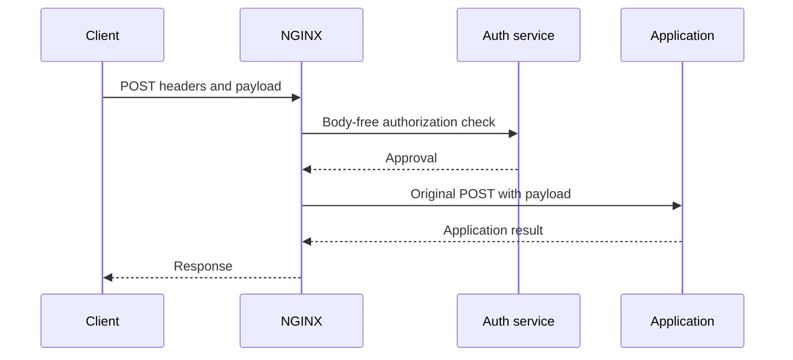

# Preserve POST Bodies with NGINX auth_request

Author: [nawazdhandala](https://www.github.com/nawazdhandala)

Tags: Nginx, Security, Troubleshooting

Description: Keep authorization subrequests body-free while forwarding approved POST payloads intact, then verify byte counts, hashes, and application invocation counts.

A POST succeeds without authentication, then starts arriving with an empty body after `auth_request` is added. Another deployment sends a body to the auth service, which waits for bytes it should never have needed. Both problems often come from treating the authorization subrequest and the main application request as if they were the same message.

They have different jobs. The auth service checks whether the request may proceed. The application receives and processes the original payload after approval. Keep the body-suppression settings local to the auth location and verify both requests independently.

This guide uses NGINX 1.30.7. Local tests checked a small JSON body, a 1 MiB binary body, and a denied POST against counting test handlers.

## Establish the authorization contract

This pattern suits decisions based on credentials and request metadata, such as the original method and URI. It does not send the application's body to the auth service. If authorization depends on individual JSON fields or file contents, that requirement needs a different design or enforcement inside the application.

The [auth_request module](https://nginx.org/en/docs/http/ngx_http_auth_request_module.html) allows a main request after a 2xx auth response, denies it for 401/403, and treats other statuses as errors. Its documented example disables body forwarding and clears Content-Length specifically in the auth location.

The tagged [1.30.7 implementation](https://github.com/nginx/nginx/blob/release-1.30.7/src/http/modules/ngx_http_auth_request_module.c) creates a separate authorization subrequest and a fake request-body structure so that the subrequest does not take ownership of the main request's body resources. Do not try to repair this flow by manually copying a payload into a header.



For a denied request, the application step must be absent. NGINX may still need to handle incoming client bytes as part of connection management; denial does not mean the client never transmitted a body.

## Scope body settings to the right location

The following belongs inside `http`. Replace the service endpoints and body-size budget. It uses a loopback listener for staging and assumes an existing auth service that accepts body-free checks.

```nginx
upstream auth_service {
    server 127.0.0.1:4180;
}

upstream submit_service {
    server 127.0.0.1:8081;
}

server {
    listen 127.0.0.1:8080;
    client_max_body_size 2m;

    location = /_auth {
        internal;
        proxy_pass http://auth_service/auth;
        proxy_pass_request_body off;
        proxy_set_header Content-Length "";
        proxy_set_header X-Original-URI $request_uri;
        proxy_set_header X-Original-Method $original_method;
    }

    location /submit {
        set $original_method $request_method;
        auth_request /_auth;

        proxy_pass_request_body on;
        proxy_request_buffering on;
        proxy_next_upstream off;
        proxy_pass http://submit_service;
    }
}
```

The main location captures the original method before the subrequest. This prevents a policy service from mistaking the body-free auth check for the application's operation. The fixture observed GET on the auth connection and POST in `X-Original-Method`.

`proxy_pass_request_body off` and the empty Content-Length belong only in `/_auth`. The application location explicitly enables body forwarding. Do not place body suppression at a broad parent level and assume it cannot affect other routes.

Request buffering tells NGINX to read the client body before forwarding it to the application. It is distinct from response buffering. With larger bodies, temporary storage can be involved, so check capacity and permissions for the configured request-body temporary path. The [proxy module documentation](https://nginx.org/en/docs/http/ngx_http_proxy_module.html#proxy_request_buffering) describes forwarding and buffering behavior.

The two-megabyte limit is merely this example's acceptance budget. Choose a limit that matches the API contract and test the expected rejection response for oversized uploads. The [HTTP core reference](https://nginx.org/en/docs/http/ngx_http_core_module.html#client_max_body_size) documents the body-size and buffering controls.

## Separate preservation from duplicate prevention

The example disables NGINX's upstream retry selection for the application location to make the test easy to interpret. It does not guarantee exactly-once application execution across the whole system.

A client can retry after a timeout even if the application already committed a change. An earlier proxy can retry too. If duplicate processing matters, the application needs an idempotency mechanism: a stable operation identifier whose repeated use returns the existing result instead of repeating the side effect.

Do not enable replay of non-idempotent operations simply to hide intermittent upstream errors. First determine whether the request was delivered and whether the application already acted. Body buffering makes bytes available for forwarding; it is not a transaction protocol.

## Measure the body that reaches the application

Use a harmless staging handler that records an operation marker, received byte count, and SHA-256 hash. Do not record production payloads or secrets. The auth handler should record the original method and whether body framing was present, without logging credentials.

Create a small test payload in a scratch directory:

```bash
printf '%s\n' '{"test":"body-preservation"}' > payload.json
curl --noproxy '*' --connect-timeout 2 --max-time 10 \
  --header 'Content-Type: application/json' \
  --data-binary @payload.json --show-error \
  http://127.0.0.1:8080/submit
```

Run this only against the approved staging listener with whatever test-session setup your auth service requires. The command contains no credential; without an accepted session, denial is expected. `--data-binary` preserves the file's bytes rather than treating the payload as form fields, as documented in the [curl manual](https://curl.se/docs/manpage.html#--data-binary).

Compare the application's hash with the source file's hash and require exactly one application record for the approved operation. A 200 response alone is not enough: an application can return success after receiving an empty or truncated body.

Then repeat with a binary payload larger than the configured in-memory body buffer. This exercises a different storage path without needing a large production upload. Keep the payload below the intentional maximum body size.

## Review the local evidence and remaining cases

The NGINX 1.30.7 fixture used an 8 KiB body buffer and a 2 MiB limit. The small JSON payload was 29 bytes. The binary payload was 1,048,576 bytes. Each approved request produced one application record with the exact expected byte count and SHA-256 hash.

Three authorization checks were observed: the two approved POSTs and one denied POST. All auth checks were GET requests without Content-Length, carrying the original method as POST. The denied request returned 403 and produced no application invocation. This confirmed separation and byte preservation in the tested configuration.

Those checks did not cover chunked client uploads, `Expect: 100-continue`, multipart forms, client disconnects, upstream failures, or application idempotency. Add them according to your clients and API behavior. In particular, a successful file-backed body test is not proof that streaming mode behaves identically.

If a body still disappears, inspect the effective configuration for inherited `proxy_pass_request_body`, manual Content-Length changes, body-replacement directives, and rewrites that change the route. Trace one harmless operation from the client through authorization to the application. Correct bytes, correct identity, and the expected invocation count together provide a much stronger result than any single status code.
