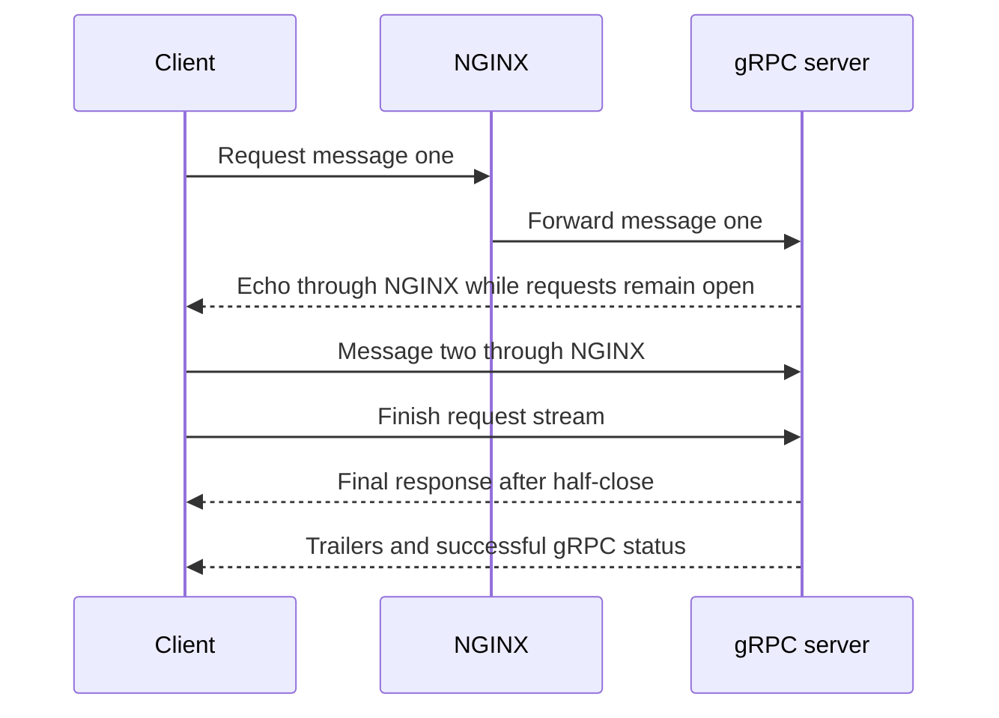

# Preserve Bidirectional gRPC Streams Through NGINX

Author: [nawazdhandala](https://www.github.com/nawazdhandala)

Tags: Nginx, gRPC, Troubleshooting

Description: Proxy bidirectional gRPC through NGINX and test responses before and after a client half-close, including final status and trailing metadata.

A client finishes sending messages and immediately stops receiving the server's final result. It is tempting to blame the proxy, but finishing the request stream is not the same as cancelling the call. A correct bidirectional RPC can continue delivering server responses after the client has no more messages to send.

The first diagnostic goal is to separate normal half-close behavior from cancellation, deadline expiry, and an upstream disconnect. A small controlled stream is more useful than increasing every timeout in an otherwise opaque application.

This guide uses NGINX 1.30.7 and Python `grpcio` 1.76.0. A local runtime test received a response while the client request stream remained open, then received a final server message after the client half-closed.

## Understand the two directions

In a bidirectional remote procedure call, or RPC, request and response messages flow independently. Each direction preserves its own message order. The application decides when to send and receive; it need not finish all requests before processing responses. These semantics are described in [gRPC's core concepts](https://grpc.io/docs/what-is-grpc/core-concepts/).

A client half-close means that it will send no more request messages. It should still consume responses and the final call status. Cancelling the RPC or closing the channel is different and can prevent delivery of the remaining response stream.



HTTP/2 provides the underlying streams. Do not apply a generic TCP half-close workaround to an HTTP-layer gRPC location without understanding which layer actually ended the call.

## Use the gRPC proxy module

Confirm that the deployed NGINX binary includes HTTP/2 support. The [gRPC module](https://nginx.org/en/docs/http/ngx_http_grpc_module.html) requires it. Use `grpc_pass` for this path, rather than trying to make an HTTP/1 proxy configuration behave like a gRPC transport.

This minimal staging fragment belongs inside `http`:

```nginx
server {
    listen 127.0.0.1:50052;
    http2 on;

    location /lab.Chat/ {
        grpc_pass grpc://127.0.0.1:50051;
        grpc_connect_timeout 3s;
        grpc_read_timeout 10s;
        grpc_send_timeout 10s;
        grpc_next_upstream off;
    }
}
```

The listener and backend are intentionally loopback-only and plaintext for the local exercise. Use your reviewed TLS and authentication configuration across real network boundaries. No certificate verification setting is disabled here.

`http2 on` is supported in the pinned version and enables HTTP/2 on the listener; see the [HTTP/2 module reference](https://nginx.org/en/docs/http/ngx_http_v2_module.html). The method path remains `/lab.Chat/Exchange` through the proxy.

The read and send values bound inactivity between operations on the upstream side; they are not the client's total RPC deadline. Retries are disabled in this lab so a second server attempt cannot confuse the message-count evidence. Production retry policy requires its own analysis of application side effects.

## Build a minimal half-close server

Use Python 3.11 in a disposable virtual environment with the pinned [grpcio 1.76.0 package](https://pypi.org/project/grpcio/1.76.0/):

```bash
python3.11 -m venv .venv
.venv/bin/pip install 'grpcio==1.76.0'
```

Save the following as `server.py`. It uses raw byte messages through a generic handler to avoid generated protocol files in this diagnostic fixture. Production services should use their normal generated message types.

```python
from concurrent import futures
import time
import grpc


def exchange(requests, context):
    for message in requests:
        yield b"echo:" + message
    time.sleep(0.3)
    yield b"final-after-half-close"
    context.set_trailing_metadata((("fixture-result", "complete"),))


server = grpc.server(futures.ThreadPoolExecutor(max_workers=2))
handler = grpc.stream_stream_rpc_method_handler(
    exchange, request_deserializer=lambda value: value,
    response_serializer=lambda value: value,
)
server.add_generic_rpc_handlers((
    grpc.method_handlers_generic_handler("lab.Chat", {"Exchange": handler}),
))
server.add_insecure_port("127.0.0.1:50051")
server.start()
server.wait_for_termination()
```

Start it with `.venv/bin/python server.py`, then start the reviewed staging NGINX configuration. The handler echoes each message immediately. When request iteration ends, it waits briefly and sends another response plus trailing metadata. That deliberate final response is the half-close check.

## Keep receiving after sending ends

Save this as `client.py` and run it against the NGINX listener:

```python
import threading
import grpc

first_response = threading.Event()


def requests():
    yield b"one"
    if not first_response.wait(3):
        raise RuntimeError("No response while request stream remained open")
    yield b"two"


with grpc.insecure_channel("127.0.0.1:50052") as channel:
    grpc.channel_ready_future(channel).result(timeout=5)
    exchange = channel.stream_stream(
        "/lab.Chat/Exchange", request_serializer=lambda value: value,
        response_deserializer=lambda value: value,
    )
    call = exchange(requests(), timeout=5)
    received = []
    for message in call:
        received.append(message)
        if message == b"echo:one":
            first_response.set()
    assert received == [b"echo:one", b"echo:two", b"final-after-half-close"]
    assert call.code() == grpc.StatusCode.OK
    assert dict(call.trailing_metadata())["fixture-result"] == "complete"
    print("Bidirectional exchange and half-close passed")
```

The request generator waits for the first response before sending its second message. Returning from that generator finishes sending; the response loop continues. The [Python gRPC API](https://grpc.github.io/grpc/python/grpc.html) documents stream-stream calls, response iteration, status, and trailing metadata.

The five-second call deadline keeps the lab bounded. Do not copy it into a long-lived production stream unchanged. The [gRPC deadline guide](https://grpc.io/docs/guides/deadlines/) explains that deadlines limit how long a client is willing to wait for completion.

## Compare direct and proxied behavior

First run the same client directly against port 50051, then against NGINX on 50052. Require identical message order, successful status, and the final metadata. If direct mode fails, investigate the handler or client lifecycle before the proxy.

The local test through NGINX received both echoes, the delayed final message, status OK, and `fixture-result=complete`. The server observed the request stream ending before producing the final response. The synchronization check also proved that the first response arrived before the client finished sending.

That result does not establish behavior under every failure. Test client cancellation, deadline expiry, backend shutdown, flow-control pressure, and proxy reload separately. The local fixture did not include TLS, generated protobuf messages, large transfers, or production authentication.

When a real call ends early, record the gRPC status and timing alongside NGINX and server logs. Check whether application code closes the channel after sending, whether a deadline expires, and whether a silent backend exceeds the read allowance. Preserve these distinctions: a normal half-close, an explicit cancellation, and a transport failure require different fixes.
