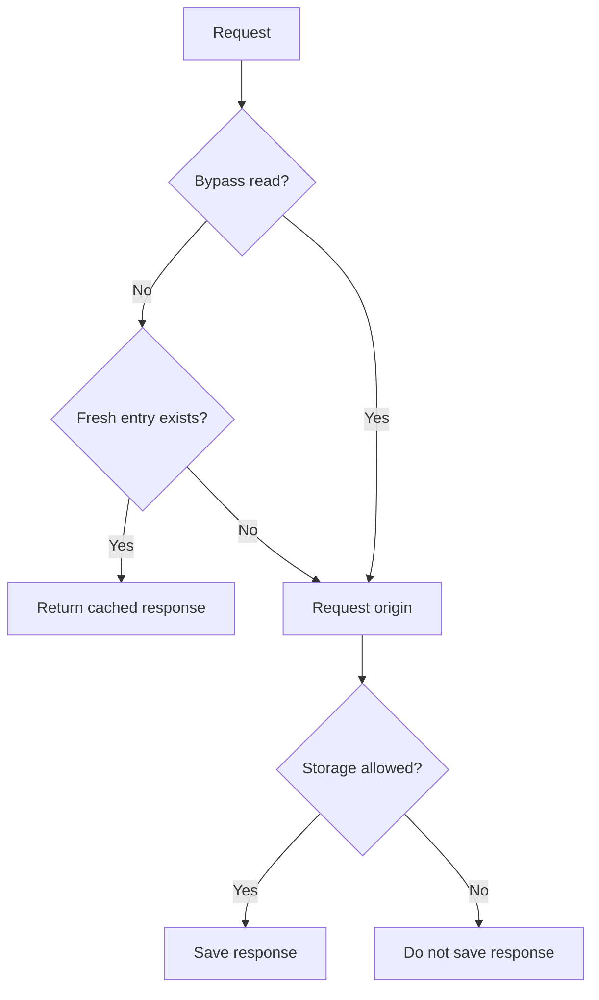

# Debug NGINX Cache Bypass and No-Cache Decisions

Author: [nawazdhandala](https://www.github.com/nawazdhandala)

Tags: Nginx, Caching, Troubleshooting

Description: Explain repeated MISS and BYPASS responses by separating cache reads from cache writes, logging decision inputs, and testing a controlled origin.

A request returns `MISS`, so you expect the next request to return `HIT`. Instead, it misses again. Another request returns `BYPASS`, yet its response appears in the cache afterward. Both behaviors can be correct.

NGINX makes separate decisions about reading an existing entry and storing a new response. `$upstream_cache_status` describes the cache result for a request; it is not a complete explanation of every policy input. Debugging becomes easier when you observe those inputs alongside the result.

This guide uses NGINX 1.30.7 and a disposable HTTP origin whose response increments a counter. The counter makes actual origin requests visible without guessing from response speed.

## Separate reading from writing

`proxy_cache_bypass` controls whether NGINX takes a response from cache. `proxy_no_cache` controls whether it saves the response. A nonempty condition other than `0` activates each rule. The [proxy module reference](https://nginx.org/en/docs/http/ngx_http_proxy_module.html#proxy_cache_bypass) documents the distinction.



A bypassed request can still populate the cache if storage is allowed. Conversely, a no-cache condition does not prevent an already-cached response from being read. If your intent is “neither read nor write for this class of request,” you need both policies.

For authenticated or personalized responses, this distinction matters more than hit rate. Do not try to improve cache metrics by removing a privacy boundary.

## Read the status as evidence, not a diagnosis

The [upstream variable reference](https://nginx.org/en/docs/http/ngx_http_upstream_module.html#var_upstream_cache_status) lists the cache-status values. Start with the common cases:

| Value | Useful interpretation |
| --- | --- |
| `HIT` | A cached response served the request |
| `MISS` | No usable cached response served this lookup; storage still needs investigation |
| `BYPASS` | A configured bypass condition skipped cache use |
| `EXPIRED` | An entry existed but was no longer fresh |
| `REVALIDATED` | The cache entry was successfully revalidated |
| `STALE` or `UPDATING` | Stale/update behavior needs examination |
| Empty value | Check whether caching was involved in this request path |

There is no separate `NO_CACHE` result that reliably explains a write prohibition. Repeated `MISS` can be a storage decision, changing cache keys, or a response that was never eligible for caching.

An empty value appears as a dash in many access-log formats. It is different from an explicit `BYPASS` decision. Check location selection, redirects, and whether the request actually used the expected proxy cache.

## Add narrowly scoped diagnostic variables

The following fragment belongs inside `http` in an isolated lab. It uses deliberately artificial headers to control read and write decisions independently. Do not expose these test controls on a public gateway.

```nginx
proxy_cache_path /var/cache/nginx/cache-lab
    keys_zone=cache_lab:1m max_size=10m inactive=5m;

map $http_x_lab_bypass $skip_read {
    default 0;
    1       1;
}

map $http_x_lab_no_store $skip_write {
    default 0;
    1       1;
}

log_format cache_decisions escape=json
    '{"cache":"$upstream_cache_status",'
    '"skip_read":"$skip_read",'
    '"skip_write":"$skip_write",'
    '"origin_cache_control":"$upstream_http_cache_control"}';

server {
    listen 127.0.0.1:8081;
    access_log logs/cache-decisions.log cache_decisions;

    location / {
        proxy_pass http://127.0.0.1:9000;
        proxy_cache cache_lab;
        proxy_cache_key "$scheme|$proxy_host|$request_uri";
        proxy_cache_bypass $skip_read;
        proxy_no_cache $skip_write;
        add_header X-Lab-Cache $upstream_cache_status always;
    }
}
```

Create a writable cache directory and logs directory for the staging NGINX identity, and run a fixture origin on port 9000. The origin should return a short counter body and `Cache-Control: public, max-age=60`. Validate the full configuration with the matching NGINX binary before starting it.

The [map documentation](https://nginx.org/en/docs/http/ngx_http_map_module.html) explains how request values become the diagnostic variables. The [log module](https://nginx.org/en/docs/http/ngx_http_log_module.html#log_format) documents JSON escaping. Logging the boolean results avoids dumping raw authorization headers or cookies.

In production, instrument the actual policy variables instead of adding caller-controlled bypass switches. Even origin cache headers may contain unexpected content, so keep diagnostic logs restricted and bounded.

## Run a sequence that distinguishes the two decisions

Use a fresh path for each case. Do not purge a shared production cache for this experiment. These commands use GET, print headers, and discard the body:

```bash
curl -sS -D - -o /dev/null http://127.0.0.1:8081/normal
curl -sS -D - -o /dev/null http://127.0.0.1:8081/normal
curl -sS -D - -o /dev/null -H 'X-Lab-No-Store: 1' http://127.0.0.1:8081/no-store
curl -sS -D - -o /dev/null -H 'X-Lab-No-Store: 1' http://127.0.0.1:8081/no-store
curl -sS -D - -o /dev/null -H 'X-Lab-Bypass: 1' http://127.0.0.1:8081/bypass
curl -sS -D - -o /dev/null http://127.0.0.1:8081/bypass
```

For the first pair, expect `MISS` then `HIT`, with one origin execution. For the second, expect two `MISS` results and two origin executions. For the third, expect `BYPASS` then `HIT`: the bypassed response was allowed to populate the cache.

Now send the no-store header to the already-populated `/normal` path. It can still return `HIT`, proving that suppressing writes does not suppress reads. Finally, send both headers to another fresh path; the response should bypass and remain unstored.

I ran these cases with NGINX 1.30.7 and observed the expected statuses and counter values. A separate origin response with `Cache-Control: private` produced repeated `MISS` and two origin executions without an explicit no-store condition. These were single-worker loopback tests, not concurrency or production traffic tests.

## Explain a persistent MISS

First confirm the key stays constant. Query strings, host changes, URI normalization, or a varying configured component can create distinct entries. Compare safe synthetic requests before logging keys that might contain secrets.

Next inspect cache eligibility: origin cache-control policy, cookies, `Vary`, response status, configured valid lifetimes, request method, and any storage conditions. A response can be ineligible even when `$skip_write` is `0` because that variable represents only your custom rule.

Then check cache directory permissions, disk capacity, and relevant error logs. A correct policy cannot store a response in an unusable cache location. Avoid immediately adding `proxy_ignore_headers`; overriding an origin’s privacy or freshness rules can create a much larger problem than repeated misses.

Finally, distinguish downstream caches. A browser or CDN can serve a response without contacting NGINX at all. An old diagnostic response header observed there may describe an earlier gateway request. Correlate with a current NGINX log entry and origin counter before changing gateway policy.

## Remove the experiment, retain the useful signal

Keep aggregate counts of cache statuses and explicit policy outcomes after diagnosis. Remove public diagnostic headers and lab-only controls. Test personalized and anonymous traffic separately whenever the policy changes.

A healthy cache is not one that returns `HIT` for everything. It is one that reuses only eligible responses, respects freshness and privacy, and leaves enough evidence to explain why a particular request went to the origin.
