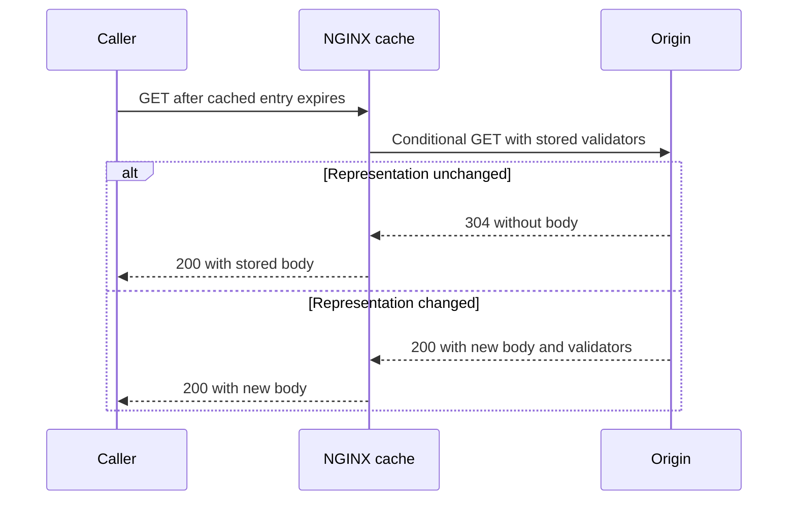

# Revalidate NGINX Cache Entries with ETag and Last-Modified

Author: [nawazdhandala](https://www.github.com/nawazdhandala)

Tags: Nginx, Caching, Performance

Description: Use conditional requests to refresh expired NGINX cache entries, verify body-free origin responses, and distinguish revalidation from ordinary cache hits.

An expired cached response is not necessarily wrong. Its freshness period may have ended while the underlying document remains unchanged. Fetching the entire body again wastes bandwidth when the origin can simply confirm that the stored version is still current.

NGINX can ask that question through conditional requests. The origin returns either a new representation or a `304 Not Modified` response that lets the cache reuse its existing body. The important test is not whether the browser sees a 304. It is whether the NGINX-to-origin exchange avoids transferring an unchanged body while the caller still receives the correct content.

This guide uses NGINX 1.30.7. Local runtime checks covered both an origin supplying ETag plus Last-Modified and an origin supplying Last-Modified alone.

## Understand the validators

An ETag is an opaque identifier for a representation, such as `"catalog-v7"`. Last-Modified is a timestamp for its last change. A cache can send these back as `If-None-Match` and `If-Modified-Since` respectively.

For GET, a matching validator allows the origin to return 304 without a representation body. When both conditions are present, If-None-Match takes precedence. The server must evaluate the validators correctly; a proxy cannot repair an origin that reuses an old ETag after changing the content. These semantics are defined in [RFC 9110](https://www.rfc-editor.org/rfc/rfc9110.html#name-if-none-match).

A suitable initial response might include:

```http
HTTP/1.1 200 OK
Cache-Control: public, max-age=30
ETag: "catalog-v7"
Last-Modified: Fri, 20 Nov 2026 12:00:00 GMT
Content-Type: application/json
```

The origin supplies the corresponding JSON body. After expiry, an unchanged representation can produce:

```http
HTTP/1.1 304 Not Modified
Cache-Control: public, max-age=30
ETag: "catalog-v7"
```

The 304 updates the applicable stored response metadata instead of replacing its body. Freshness and validator handling are part of the cache protocol, not a reason to extend every object's lifetime indefinitely. See [RFC 9111's cache validation rules](https://www.rfc-editor.org/rfc/rfc9111.html#section-4.3).

## Enable revalidation for a public endpoint

Start with content that is safe to share across anonymous callers. Confirm that its cache key represents every property that changes the response. Avoid using this example for account pages or permission decisions.

Prepare the cache directory with ownership appropriate for the deployed NGINX process. Put this fragment inside `http`, replacing the documentation-range address and filesystem path:

```nginx
proxy_cache_path /var/cache/nginx/catalog
    levels=1:2 keys_zone=catalog_cache:10m
    max_size=1g inactive=10m;

upstream catalog_origin {
    server 192.0.2.20:8081;
}

server {
    listen 127.0.0.1:8080;

    location /public/ {
        proxy_pass http://catalog_origin;
        proxy_set_header Host catalog.internal.example;

        proxy_cache catalog_cache;
        proxy_cache_key "$scheme|$proxy_host|$request_uri";
        proxy_cache_revalidate on;

        proxy_cache_bypass $http_authorization $http_cookie;
        proxy_no_cache $http_authorization $http_cookie;
        add_header X-Cache $upstream_cache_status always;
    }
}
```

`proxy_cache_revalidate on` enables conditional requests for expired entries using their stored validators. It does not manufacture validators for an origin that omits them. The two guards exclude requests carrying authorization or cookies from cache reads and writes; review other personalization inputs separately. These settings are documented in the [NGINX proxy module](https://nginx.org/en/docs/http/ngx_http_proxy_module.html#proxy_cache_revalidate).

This example leaves freshness to the origin's Cache-Control header. Do not confuse `inactive=10m` with ten minutes of freshness: storage retention and response freshness answer different questions. An entry must still exist when revalidation occurs, so a frequently evicted cache may produce more full fetches than expected.

The configuration intentionally omits background updates to make the request sequence easy to observe. Revalidation can save body transfer while the caller still waits for an origin round trip. It does not promise zero latency or eliminate application work needed to compute a validator.

## Observe both sides of the exchange



The caller in this diagram sends an ordinary GET, without its own conditional headers. A browser making a conditional request is a separate case and can legitimately receive 304. Keep those two conversations separate when interpreting logs.

For an approved staging endpoint, inspect the proxy response with:

```bash
curl --noproxy '*' --connect-timeout 2 --max-time 5 \
  --show-error --dump-header - \
  http://127.0.0.1:8080/public/catalog
```

This prints headers and body, bypasses environment proxy settings, and bounds the request duration. Replace the path with the public test resource. The flags are described in the [curl manual](https://curl.se/docs/manpage.html).

Run the first request against a fresh test key. Expect a body and a cache miss. Repeat while fresh and expect a cache hit without another origin request. After the origin's freshness period ends, request again and examine the origin's received conditional headers, status, and body-byte count.

## Verify unchanged and changed content

The local NGINX test used one-second freshness for speed and a counting origin. It produced the following sequence:

| Stage | Origin exchange | Proxy result |
| --- | --- | --- |
| First fetch | Unconditional GET, 200 with generation 1 | `MISS`, generation 1 |
| Expired but unchanged | Both stored validators, 304 with zero body bytes | `REVALIDATED`, generation 1 |
| Expired after content update | Old validators, 200 with generation 2 | `EXPIRED`, generation 2 |

The origin received the stored ETag exactly, including its quotes. A separate run omitted ETag; NGINX sent If-Modified-Since alone, and the unchanged case still revalidated successfully. Updating the representation and its modification timestamp then fetched generation 2.

These checks show actual body reuse, not just a favorable status label. They did not cover compressed variants, multiple cache nodes, browser conditional requests, or production response sizes. Add those cases when they matter to your deployment.

## Investigate unexpected full responses

If every expired entry produces an origin 200, first inspect what was originally cached. Did it include validators? Did another proxy strip them? Does the application implement conditional GET, or does it always send a body regardless of the request headers?

Next inspect representation stability. A generated timestamp inside every response may change the ETag each time. Different origin replicas may calculate different validators for identical content. Fix the inconsistency at the source instead of forcing a 304 in NGINX.

Finally, distinguish three measurements: requests avoided by fresh hits, body bytes avoided by revalidation, and time spent at the origin. Revalidation usually still contacts the application. Track all three to see whether the change reduces the resource you actually need to protect. A body-free response can be a useful bandwidth improvement even when the origin's computation cost remains unchanged.
