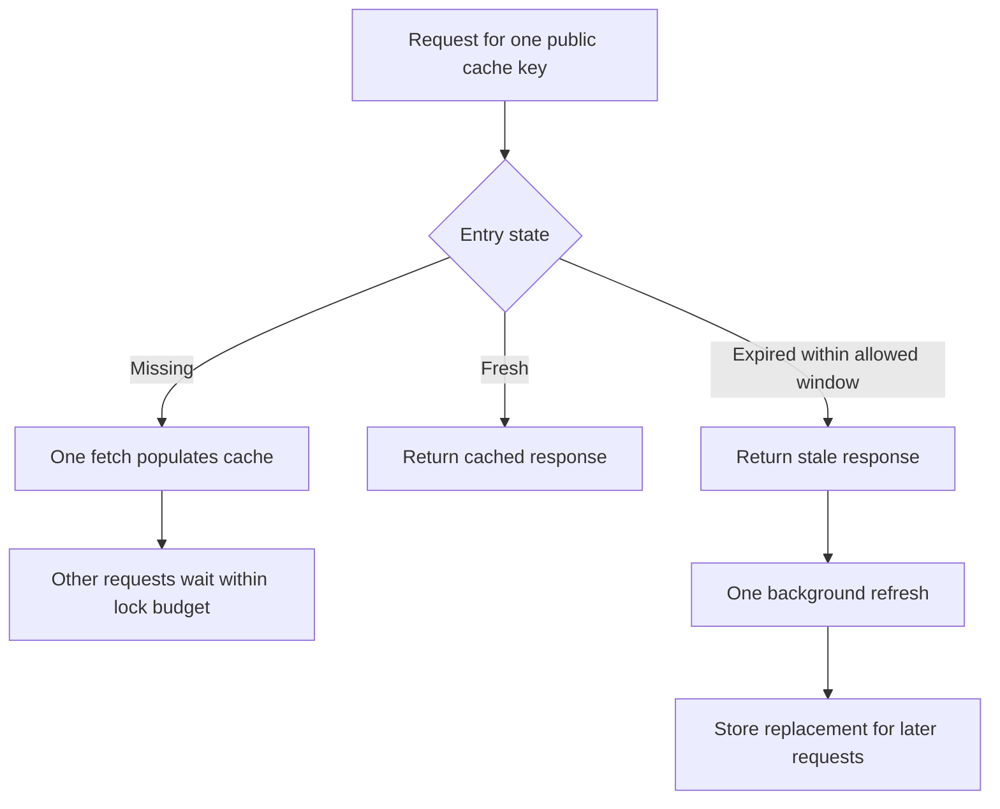

# Prevent NGINX Cache Stampedes with Locks and Background Refresh

Author: [nawazdhandala](https://www.github.com/nawazdhandala)

Tags: Nginx, Caching, Performance

Description: Protect origins from simultaneous cache misses, serve approved stale responses during refresh, and verify NGINX behavior with origin request counts.

A popular response expires, hundreds of requests arrive, and the origin computes the same result hundreds of times. That surge is a cache stampede. Adding more cache storage does not solve the coordination problem: several callers need the same missing or expired object at once.

There are two situations to handle. An empty cache has nothing to serve, so requests must wait for an initial fetch. An expired cache already has a response that might be acceptable briefly while a replacement arrives. NGINX can coordinate both, provided the content is safe to share and its owner permits stale responses.

This guide uses NGINX 1.30.7. A local eight-request test verified origin counts, response generations, and cache statuses. The example targets anonymous public content, not personalized account pages.

## Decide what may be shared

Choose one endpoint whose response is identical for all callers with the same cache key. A public product description may qualify; inventory used to authorize a purchase might not. Write down the maximum acceptable age before changing caching behavior.

The example origin sends:

```http
Cache-Control: public, max-age=30, stale-while-revalidate=10
```

This permits thirty seconds of freshness followed by a ten-second stale-while-revalidate allowance. During that allowance, a cache may return the older response while refreshing it. Refresh is driven by a request; this header does not schedule work while traffic is absent. The distinction and time window come from [RFC 5861](https://datatracker.ietf.org/doc/html/rfc5861#section-3).

Have the application emit that header on the actual cacheable response. Adding a downstream header after proxying is not equivalent to making the origin's caching decision available when NGINX processes it. Keep private or session-dependent responses outside this location.

## Configure the cache and the lock

Prepare a cache directory writable by the NGINX service account, with a storage limit appropriate for the deployment. Add the following inside `http`. Replace the filesystem path and the documentation-range origin address before testing.

```nginx
proxy_cache_path /var/cache/nginx/public
    levels=1:2 keys_zone=public_cache:10m
    max_size=1g inactive=10m;

upstream public_origin {
    server 192.0.2.20:8081;
}

server {
    listen 127.0.0.1:8080;

    location /public/ {
        proxy_pass http://public_origin;
        proxy_set_header Host catalog.internal.example;

        proxy_cache public_cache;
        proxy_cache_key "$scheme|$proxy_host|$request_uri";
        proxy_cache_lock on;
        proxy_cache_lock_timeout 3s;
        proxy_cache_lock_age 3s;
        proxy_cache_background_update on;

        proxy_cache_bypass $http_authorization $http_cookie;
        proxy_no_cache $http_authorization $http_cookie;
        add_header X-Cache $upstream_cache_status always;
    }
}
```

The lock coordinates population of a new entry for the same key. A waiting request that exceeds `proxy_cache_lock_timeout` can proceed to the origin without caching its response. `proxy_cache_lock_age` permits another population request when the existing one takes too long. These are escape valves, not a guarantee of exactly one fetch under every condition. See the [proxy cache directives](https://nginx.org/en/docs/http/ngx_http_proxy_module.html#proxy_cache_lock).

Three seconds is an example budget. Compare it with measured origin latency and your caller timeout. A shorter wait reduces waiting but can increase origin load. A longer wait can protect the origin at the cost of slower cold requests. Do not derive these values from average response time alone.

The two cookie/authorization guards exclude those requests from both cache reads and writes. They are a conservative starting point, not a complete personalized-content audit: a tenant header, geography header, or another request property might also change the response. Review the cache key and origin behavior together.

## Let the origin bound stale use

The configuration enables background updates but relies on the origin's `stale-while-revalidate` allowance. It deliberately does not add `proxy_cache_use_stale updating`. That directive-level permission can override the header's narrower time window. Do not add broad stale-on-error permissions unless the content owner has approved that separate failure policy.

NGINX's [tagged upstream implementation](https://github.com/nginx/nginx/blob/release-1.30.7/src/http/ngx_http_upstream.c) distinguishes background refresh from ordinary cache retrieval and uses the stale eligibility recorded for the response. Background refresh does not turn an uncacheable response into a cacheable one.



Outside the approved stale interval, callers may need to wait for a fresh response. When the origin is unavailable, an error may be more correct than silently serving obsolete information. That is a product decision, not simply a performance setting.

## Prove the result with origin counts

Run the acceptance test against an isolated staging cache and an origin that records request counts. Give each response a generation marker, such as `generation=1`, incremented when the origin handles another request. Add a small deliberate delay only to that test origin so concurrent requests overlap.

Use a fresh test key for the cold case instead of deleting a shared production cache. Send a small, agreed burst of identical anonymous GET requests. Record each response body, `X-Cache` value, and elapsed time. Count requests at the origin separately.

The `X-Cache` header is diagnostic; [add_header](https://nginx.org/en/docs/http/ngx_http_headers_module.html#add_header) supports variables and the `always` option. Remove it if you do not want to expose cache behavior externally. A header alone does not prove origin protection: count the work that actually reached the application.

In the local test, eight simultaneous cold requests caused one origin fetch. One response reported `MISS`, and the waiting responses reported `HIT`; all contained generation 1. With a 0.6-second origin delay, cold responses took approximately 0.6 to 1.0 seconds. Lock waiters did not all finish at the same instant as the first response.

The fixture used one-second freshness and a ten-second stale allowance to keep the test short. After expiry, another eight-request burst returned generation 1 immediately with `STALE` or `UPDATING` statuses. One background origin fetch produced generation 2. A later request returned generation 2 as a `HIT`. Total origin work was two requests across both bursts and the final read.

## Test the limits before rollout

Repeat the experiment with an origin slower than the lock budget. Expect the protection to weaken as waiting requests are allowed through. Also test a response that is intentionally uncacheable: a lock cannot provide lasting coalescing if nothing usable is stored.

Confirm that different query strings produce the intended distinct keys. Conversely, avoid unnecessary per-request identifiers in URLs that turn every request into a unique miss. Locks are per cache key; they cannot combine unrelated entries. The [file-cache implementation](https://github.com/nginx/nginx/blob/release-1.30.7/src/http/ngx_http_file_cache.c) maintains update and lock state for individual cache nodes.

Finally, measure each proxy replica. The local test covered one NGINX instance, not a distributed lock across a fleet. Several independent caches may each fetch the same object once. Monitor origin concurrency, cache status distribution, stale-response age, and request latency together. A high hit rate is useful only when the responses remain correct and the origin survives the misses.
