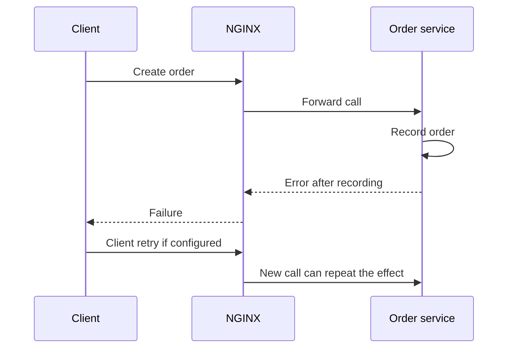

# Set Safe NGINX gRPC Retry Rules for Non-Idempotent Calls

Author: [nawazdhandala](https://www.github.com/nawazdhandala)

Tags: Nginx, gRPC, Troubleshooting

Description: Separate NGINX failover from gRPC client retries, protect state-changing calls, and test whether a failed response repeats an operation.

A checkout service creates an order, then its response fails. The caller sees an error. Sending the same call again may create another order, even though retrying appears to fix the connection problem.

An **idempotent** operation has the same intended effect when repeated. A non-idempotent operation, such as incrementing a balance or creating an order without a duplicate guard, can change state again. Decide which kind of operation you have before increasing retry limits.

This guide uses NGINX 1.30.7 and a local Python gRPC 1.76.0 fixture. The goal is to identify who can repeat a call and give state-changing methods a conservative starting policy.

## Separate the two retry owners

NGINX can choose another upstream server. Independently, the gRPC client can create a new attempt. Disabling one does not disable the other. An application loop or service mesh can introduce further attempts.



The diagram represents an application error after a change, not proof that NGINX repeated anything. During an incident, count handler executions and business records as well as network requests. A final successful response cannot establish that an order was created only once.

## Understand what NGINX sees

A gRPC call uses HTTP/2 POST, including a read-only method such as `GetOrder`. Its path identifies the service and method. NGINX therefore cannot infer business idempotency from the HTTP verb. The [gRPC 1.76.0 protocol specification](https://github.com/grpc/grpc/blob/v1.76.0/doc/PROTOCOL-HTTP2.md) defines this wire format.

The default `grpc_next_upstream error timeout` allows certain upstream failures to trigger failover. POST requests already sent upstream are normally protected unless `non_idempotent` is enabled. `off` disables passing the request to another server. The [NGINX directive reference](https://nginx.org/en/docs/http/ngx_http_grpc_module.html#grpc_next_upstream) documents these conditions.

Do not interpret `non_idempotent` as a feature that makes writes safe. It relaxes a protection. Moreover, the [1.30.7 upstream source](https://github.com/nginx/nginx/blob/release-1.30.7/src/http/ngx_http_upstream.c) has additional restrictions around already-sent, unbuffered request bodies. Adding that flag does not guarantee that a particular gRPC request can be replayed.

An HTTP `503` and gRPC `UNAVAILABLE` are also different signals. A normal gRPC failure can travel in status metadata with HTTP 200. `http_503` in an NGINX retry rule does not mean “retry every gRPC UNAVAILABLE.” Inspect the client’s final RPC status, rather than treating HTTP 200 as application success.

## Start with explicit protection for writes

This complete configuration is for a loopback lab with two already-running gRPC backends. Replace ports and method names with your fixture’s values. Plaintext is restricted to the local test; a deployed service needs its normal authenticated TLS configuration.

```nginx
worker_processes 1;
error_log stderr notice;
pid logs/nginx.pid;

events {
    worker_connections 128;
}

http {
    upstream orders {
        server 127.0.0.1:50051;
        server 127.0.0.1:50053;
    }

    server {
        listen 127.0.0.1:50052;
        http2 on;

        grpc_connect_timeout 1s;
        grpc_read_timeout 5s;
        grpc_send_timeout 5s;
        grpc_next_upstream off;

        location = /lab.Orders/Get {
            grpc_pass grpc://orders;
            grpc_next_upstream error timeout;
            grpc_next_upstream_tries 2;
            grpc_next_upstream_timeout 2s;
        }

        location / {
            grpc_pass grpc://orders;
        }
    }
}
```

Unknown and state-changing methods inherit `off`. Only the exact reviewed read method gets bounded failover. Two tries means at most two upstream attempts, not two extra attempts. The two-second limit bounds the opportunity to move to another server; it is not an end-to-end RPC deadline. Existing sent-request restrictions still apply to the read method’s HTTP POST.

Save this as `nginx.conf` in a disposable directory, create its `logs` subdirectory, and check it with your NGINX 1.30.7 binary:

```bash
mkdir -p logs
nginx -p "$PWD/" -c "$PWD/nginx.conf" -t
```

Expected output includes a successful configuration test. This checks configuration validity, not backend availability or duplicate protection. Do not reload a production gateway just to try the example.

## Review the client policy too

gRPC supports method-specific retry policies and transparent retries for narrowly defined failures. A configured retry can replay a call after a retryable status, subject to commitment and attempt limits. The [gRPC retry guide](https://grpc.io/docs/guides/retry/) explains these distinctions.

For a controlled Python 1.76.0 diagnostic, this channel disables the client retry machinery using the [documented channel argument](https://github.com/grpc/grpc/blob/v1.76.0/include/grpc/impl/channel_arg_names.h):

```python
import grpc

with grpc.insecure_channel(
    "127.0.0.1:50052",
    options=[("grpc.enable_retries", 0)],
) as channel:
    grpc.channel_ready_future(channel).result(timeout=3)
    # Construct your generated stub here and invoke one fixture method.
    # Give that call an explicit timeout, for example timeout=3.
```

The loopback channel should become ready when the lab proxy is listening. It is deliberately not a complete application client: use your generated stub and request type. Keep application retry loops disabled during this comparison too.

For reads, prefer one clearly owned retry policy with a total deadline and bounded attempts. Avoid independently generous policies at every layer. Review hedging as well: concurrent duplicate attempts require the same business-safety assessment as sequential retries.

## Prove the ambiguous-result case

Use a disposable handler that records a synthetic operation identifier and then returns `UNAVAILABLE`. Record every execution separately; do not have the fixture quietly deduplicate them. Send one logical call and inspect its execution count.

I ran this case through NGINX 1.30.7 with `grpc_next_upstream off`. With Python gRPC 1.76.0 retries disabled, the handler ran once. With a method-specific client policy allowing two attempts on `UNAVAILABLE`, it ran twice. Both callers ultimately received `UNAVAILABLE`. This demonstrates client-side repetition despite proxy retries being disabled.

That fixture used in-memory counters, not a database transaction or a broken TCP connection. It did not establish how every transport failure behaves. Extend your staging acceptance matrix deliberately:

| Failure introduced | Evidence to retain |
| --- | --- |
| Connection refused before the handler runs | Upstream attempts and zero business effects |
| Handler changes state, then returns an error | Execution count and durable operation result |
| Reply lost after commit | Reconciliation result for the original operation ID |
| Client deadline expires during processing | Server completion record and caller behavior |

The last two cases are especially important. The [gRPC status guide](https://grpc.io/docs/guides/status-codes/) notes that a deadline failure can occur even when a state-changing operation completed successfully.

## Make recovery a business operation

If users must safely retry creation, define a durable idempotency contract. Bind an operation key to the authenticated caller and request contents, coordinate concurrent submissions, and retain the original result long enough for recovery. Commit the duplicate guard and business change consistently. Reusing a key with different contents should produce an explicit conflict.

These are application design requirements, not capabilities supplied by the NGINX flag. A header containing a random identifier alone does not implement them.

When the outcome is uncertain, look up the original operation before submitting a replacement. Keep proxy failover conservative until staging evidence shows which failures are safe. The useful success criterion is one intended business effect with a recoverable result, not merely fewer errors in the gateway log.
