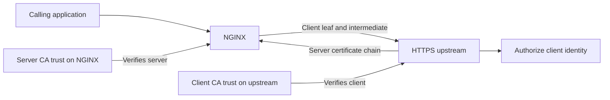

# Configure NGINX Upstream mTLS with the Correct Client Certificate Chain

Author: [nawazdhandala](https://www.github.com/nawazdhandala)

Tags: Nginx, TLS, Troubleshooting

Description: Configure NGINX upstream mutual TLS, assemble the client certificate chain, separate trust directions, and test fresh handshakes before rotating certificates.

An HTTPS upstream can accept your server trust settings and still reject NGINX. With mutual TLS, or mTLS, both endpoints present identities: the upstream proves which server it is, and NGINX proves which client it is. A missing client intermediate certificate can break the second check even when the first succeeds.

This guide uses NGINX 1.30.7 with OpenSSL 3.6.2. The local test used a separate client certificate authority and a client intermediate. It checked actual handshakes, including failure cases. The addresses and paths below are deployment placeholders, not an instruction to create a production certificate authority.

## Separate the two trust directions

A certificate authority, or CA, signs certificates. A leaf certificate identifies the endpoint; an intermediate CA connects that leaf to a trusted root.



These are separate decisions. The CA trusted by NGINX need not be the CA trusted by the upstream. Successfully validating a client chain also does not grant every application permission. The upstream must map the authenticated identity to appropriate access.

Prepare these files through your existing certificate-management process:

| File | Purpose |
| --- | --- |
| `client-leaf.pem` | Certificate identifying this NGINX service |
| `client-intermediates.pem` | Issuing intermediate, followed by any higher intermediates |
| `client.key` | Private key matching the client leaf |
| `client-root.pem` | Root used for local verification of the client chain |
| `server-ca.pem` | Approved trust anchors for the upstream server |

Do not copy a CA signing key to NGINX. Give the NGINX service only its own client key. Protect it through your secret-delivery system and restrict filesystem access to the accounts that must load it.

## Assemble and inspect the client chain

Work in a staging directory containing the approved certificate files. This command creates a new bundle; do not run it over a live certificate path:

```bash
cat client-leaf.pem client-intermediates.pem > client-fullchain.pem
```

The leaf comes first, then its issuing intermediate and any higher intermediates. Normally omit the root from the transmitted chain: trust comes from the upstream's configured trust store. NGINX's [1.30.7 TLS implementation](https://github.com/nginx/nginx/blob/release-1.30.7/src/event/ngx_event_openssl.c) loads the leaf and installs the accompanying chain separately. Putting the root first changes which certificate is treated as the endpoint identity.

Inspect the leaf without displaying the private key:

```bash
openssl x509 -in client-leaf.pem -noout \
  -subject -issuer -dates -ext extendedKeyUsage
```

Confirm the identity and validity dates with your certificate owner. If the certificate has an Extended Key Usage restriction, it must permit client authentication. The [OpenSSL x509 reference](https://docs.openssl.org/3.6/man1/openssl-x509/) documents these inspection options.

Then verify the chain for client use:

```bash
openssl verify -purpose sslclient -show_chain \
  -CAfile client-root.pem -no-CApath -no-CAstore \
  -untrusted client-intermediates.pem client-leaf.pem
```

Expect `client-leaf.pem: OK` and the intended chain. Here `-untrusted` supplies intermediates for building the chain; it does not make them trust anchors. Disabling the other trust locations keeps this check tied to the explicit root file. This checks certificate verification, not the upstream application's identity authorization or its revocation policy. See [OpenSSL verify](https://docs.openssl.org/3.6/man1/openssl-verify/).

Compare the certificate's public key with the public part of the private key:

```bash
set -o pipefail
openssl x509 -in client-leaf.pem -pubkey -noout |
  openssl pkey -pubin -outform DER | openssl dgst -sha256
openssl pkey -in client.key -pubout -outform DER |
  openssl dgst -sha256
```

Both commands must succeed and print the same digest. An encrypted key may prompt for its passphrase; never put that passphrase in shell history. These operations output only public-key material and hashes. The [pkey documentation](https://docs.openssl.org/3.6/man1/openssl-pkey/) explains the public-key export options.

## Configure the outbound identity

Place this fragment inside the `http` context of a reviewed staging configuration. Replace `192.0.2.20`, the DNS name, and all file paths. The loopback listener is for local testing; it does not configure inbound public HTTPS.

```nginx
upstream private_api {
    server 192.0.2.20:8443;
}

server {
    listen 127.0.0.1:8080;

    location / {
        proxy_pass https://private_api;
        proxy_set_header Host api.internal.example;

        proxy_ssl_server_name on;
        proxy_ssl_name api.internal.example;
        proxy_ssl_verify on;
        proxy_ssl_trusted_certificate /etc/nginx/mtls/server-ca.pem;
        proxy_ssl_verify_depth 2;

        proxy_ssl_certificate /etc/nginx/mtls/client-fullchain.pem;
        proxy_ssl_certificate_key /etc/nginx/mtls/client.key;
    }
}
```

The `proxy_ssl_certificate` pair supplies NGINX's outbound client identity. The trusted-certificate setting verifies the server; it does not install client trust on that server. `proxy_ssl_name` selects the expected server name, and `proxy_ssl_server_name on` sends it through Server Name Indication, or SNI. The verification depth applies to the server chain, not to the client's permissions. Review these directives in the [NGINX proxy module reference](https://nginx.org/en/docs/http/ngx_http_proxy_module.html#proxy_ssl_certificate).

Use your deployment's normal configuration-test command before any reload. A successful syntax test proves the files can be loaded, but does not contact the upstream or prove that it trusts the client.

## Test fresh handshakes, including failures

Use an authorized staging upstream that requires client certificates and trusts only the intended client root. Request a harmless endpoint and check the upstream's authenticated identity, not just a 200 response.

For the isolated acceptance test, add `proxy_ssl_session_reuse off;` to the test location and avoid upstream connection pooling. This forces the tests to exercise new authentication rather than reuse an established session. It is a testing control, not a blanket production performance recommendation.

The local NGINX 1.30.7 fixture produced these results:

| Client configuration | Result |
| --- | --- |
| Leaf plus intermediate, matching key | HTTP 200; upstream observed the expected client subject |
| Leaf alone, intermediate absent from server trust | HTTP 502; TLS handshake failed |
| No client certificate | HTTP 502; TLS handshake failed |

All three used server verification. In an initial run, session reuse hid the leaf-only failure after a successful full-chain request. Disabling reuse made the negative test meaningful. Real error wording varies by TLS version and backend, so investigate both NGINX and upstream logs.

A 502 before any HTTP request reaches the application suggests a transport or handshake problem. An application-generated 403 after successful authentication instead calls for reviewing identity mapping and authorization. Adding unrelated roots or turning verification off does not repair either decision.

## Rotate without mixing certificate generations

Stage a complete matching key and chain as a new version. Repeat the local chain and key checks, then validate the NGINX configuration. If the client root changes, first arrange an approved overlap in the upstream's client trust store. Keep server-trust rotation separate.

Activate the new files through the normal deployment mechanism and reload. NGINX starts new workers and lets old workers finish existing requests during a [graceful configuration change](https://nginx.org/en/docs/control.html). Consequently, a successful reload does not prove every old connection has stopped using the previous identity.

Verify new handshakes and the identity recorded upstream before removing old trust. Retire the previous certificate according to your revocation and connection-draining policy. This article's tests did not simulate production rotation, revocation checking, or long-lived pooled connections; those remain separate acceptance checks for your environment.
