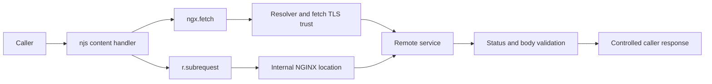

# Handle NGINX njs Fetch DNS, TLS, and Subrequest Errors

Author: [nawazdhandala](https://www.github.com/nawazdhandala)

Tags: Nginx, JavaScript, Troubleshooting

Description: Build an njs metadata handler with explicit DNS and TLS trust, checked response status, bounded bodies, and controlled subrequest failure handling.

An njs handler can fail before JavaScript ever sees an HTTP response. DNS might not resolve, the server certificate might be untrusted, or the connection might close. A different failure arrives as a perfectly valid response: HTTP 503, malformed JSON, or JSON with the wrong fields.

Treating all these cases as “fetch failed” makes diagnosis slow. Treating every resolved promise as success makes the endpoint incorrect. This example separates transport, HTTP status, and content validation while returning a predictable response to callers.

It targets NGINX 1.30.7 with njs 0.9.5 and the njs engine. Install a matching module package or build the module for your NGINX binary using the [official installation instructions](https://nginx.org/en/docs/njs/install.html). A module compiled for an unrelated binary is not a safe drop-in replacement.

## Choose fetch or a subrequest deliberately

`ngx.fetch()` makes an outbound HTTP request. An `r.subrequest()` targets an internal NGINX URI, whose location can use proxying and its own policies. Their response objects and configuration controls differ.



Use a subrequest when you want an existing proxy location to own the upstream behavior. Use fetch when its API suits the handler. Do not assume `proxy_ssl_trusted_certificate` configures fetch: fetch has its own trust directives.

The [njs reference](https://nginx.org/en/docs/njs/reference.html) documents both APIs, including the different `Response` and subrequest reply objects.

## Configure outbound dependencies explicitly

The fragment below belongs inside `http`. Replace the resolver address, CA file, and backend endpoints with approved internal values. The HTTPS service must present a certificate valid for `api.internal.example`; the port does not change that identity requirement.

```nginx
js_engine njs;
js_import handlers from /etc/nginx/njs/meta.js;

resolver 10.0.0.53 valid=30s;
resolver_timeout 2s;
js_fetch_trusted_certificate /etc/nginx/pki/internal-ca.pem;
js_fetch_verify on;
js_fetch_protocols TLSv1.2 TLSv1.3;
js_fetch_timeout 3s;
js_fetch_max_response_buffer_size 16k;

server {
    listen 127.0.0.1:8081;
    subrequest_output_buffer_size 16k;

    location = /metadata-fetch {
        js_content handlers.fetchMeta;
    }

    location = /metadata-local {
        js_content handlers.localMeta;
    }

    location = /_metadata {
        internal;
        proxy_pass http://127.0.0.1:9000/meta;
        proxy_pass_request_headers off;
        proxy_pass_request_body off;
        proxy_set_header Content-Length "";
        proxy_set_header Host metadata.internal.example;
        proxy_connect_timeout 1s;
        proxy_read_timeout 3s;
        proxy_next_upstream off;
    }
}
```

The subrequest backend here is a loopback fixture. Use authenticated TLS for a remote deployment as required by your environment. `internal` prevents callers from directly invoking that URI. Disabling forwarded request headers and body also keeps this simple metadata query from inheriting unrelated caller credentials or payloads.

The fetch CA file contains trusted certificate authorities, not a private key. Keep verification enabled and correct the trust chain or hostname when validation fails. The [njs module documentation](https://nginx.org/en/docs/http/ngx_http_js_module.html#js_fetch_trusted_certificate) lists fetch-specific TLS settings.

`js_fetch_timeout` limits gaps between read/write operations, not total elapsed response time. The response-size limit is a separate bound. A slow peer can still occupy work longer than three seconds by making intermittent progress; account for that in the endpoint’s overall capacity and deadline design.

## Validate before sending the response

Save this as the configured `meta.js` file. The fixed URL is intentional: callers cannot supply an arbitrary destination. Replace it only with your approved service URL.

```javascript
function decode(text) {
    const value = JSON.parse(text);
    if (!value || typeof value.version !== 'string' || value.version.length > 80) {
        throw new Error('invalid metadata schema');
    }
    return JSON.stringify({version: value.version});
}

async function fetchMeta(r) {
    let stage = 'fetch';
    try {
        const reply = await ngx.fetch('https://api.internal.example:8443/meta');
        if (reply.status !== 200) {
            r.error('metadata fetch HTTP status=' + reply.status);
            return r.return(502, 'metadata unavailable\n');
        }
        stage = 'decode';
        const text = await reply.text();
        const body = decode(text);
        r.headersOut['Content-Type'] = 'application/json';
        return r.return(200, body);
    } catch (error) {
        r.error('metadata failure stage=' + stage);
        return r.return(502, 'metadata unavailable\n');
    }
}

async function localMeta(r) {
    try {
        const reply = await r.subrequest('/_metadata', {method: 'GET', body: ''});
        if (reply.status !== 200) {
            r.error('metadata subrequest HTTP status=' + reply.status);
            return r.return(502, 'metadata unavailable\n');
        }
        const body = decode(reply.responseText);
        r.headersOut['Content-Type'] = 'application/json';
        return r.return(200, body);
    } catch (error) {
        r.error('metadata subrequest or decode failure');
        return r.return(502, 'metadata unavailable\n');
    }
}

export default {fetchMeta, localMeta};
```

The decoder permits only a string version no longer than 80 characters, then returns a newly constructed object. Extra backend fields are not reflected to callers. Empty or malformed bodies fail instead of becoming a misleading successful response.

The fetch path checks HTTP status before consuming the body. Its catch also covers transport rejection and parsing failures. The subrequest path checks `reply.status` explicitly; a completed subrequest carrying an HTTP error is not automatically a JavaScript exception.

Both handlers await their asynchronous work and issue one final response. Do not send headers first and then try to replace the response with a 502 after parsing fails. Keep asynchronous network work in an appropriate handler such as `js_content`, rather than moving it into a body filter that cannot await it.

The logs retain stage or numeric status without recording response bodies, cookies, tokens, or an exception string that might contain a sensitive URL. Detailed NGINX resolver and TLS diagnostics can then explain the transport failure in a restricted error log.

## Test failure classes independently

Start with a disposable service that returns `{"version":"fixture-v1"}` and the expected certificate. Validate the full NGINX configuration before starting that isolated instance. A syntax check cannot prove DNS or TLS connectivity.

Exercise one change at a time:

| Change | Expected handler outcome |
| --- | --- |
| Valid certificate and expected JSON | 200 with the selected version field |
| HTTP 503 | 502 with a generic unavailable body |
| HTTP 200 containing invalid JSON | 502 from content validation |
| Certificate for a different hostname | 502; certificate verification remains enabled |
| Unrelated trusted CA file | 502; TLS diagnostic explains trust failure |
| No resolver configured for the fetch hostname | 502; resolver diagnostic explains configuration |
| Internal subrequest returns 503 | 502 after explicit status check |

I ran these seven cases locally with NGINX 1.30.7 and njs 0.9.5; they produced the listed outcomes. The macOS test build needed a linker-flag adjustment, documented in the review record. No production service was contacted.

These cases distinguish a completed HTTP exchange from a useful dependency result. Add an oversized response and a delayed-response case to your staging acceptance suite, rather than assuming the happy path establishes those limits.

## Diagnose by stage, then repair the dependency

For DNS failures, check the resolver reachable from NGINX’s environment and the exact configured name. A shell lookup on another machine is not proof. For TLS failures, inspect certificate names, issuer chain, validity period, and the actual CA file available to workers.

For subrequests, inspect the internal location’s status and proxy logs. Check its output buffer allowance when the reply is unexpectedly truncated or rejected. The [core module reference](https://nginx.org/en/docs/http/ngx_http_core_module.html#subrequest_output_buffer_size) defines that buffer separately from fetch’s response limit.

Keep status handling aligned with the endpoint’s purpose. This metadata wrapper maps dependency failures to 502; an authentication service would need its own explicit distinction between denied access and an unavailable identity provider. Never turn an exception into an automatic authorization success.

Finally, measure failure counts by dependency and stage, alongside latency and response size. A predictable error contract helps callers recover, while the internal evidence tells operators whether to repair DNS, trust, upstream availability, or the payload contract.
