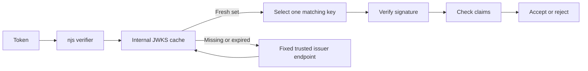

# Validate JWTs with Rotating JWKS and Caching in NGINX njs

Author: [nawazdhandala](https://www.github.com/nawazdhandala)

Tags: Nginx, JWT, Security

Description: Verify a restricted JWT profile with njs, cache issuer keys, test key rotation, and reject unknown keys without fetching JWKS for every token.

A JSON Web Token (JWT) carries claims such as who issued it and which API may accept it. A JSON Web Key Set (JWKS) publishes verification keys. Fetching that set for every request makes authentication depend on an extra network round trip and amplifies load during an outage.

Cache the public key set, but continue verifying every token. These are different operations: a cached key does not make an expired token valid, and a valid signature does not make a token intended for another API acceptable.

This tutorial uses NGINX 1.30.7 with njs 0.9.5 and its njs engine. It provides a restricted RS256 verifier and a loopback test endpoint, not a universal identity-provider integration or a complete application authorization policy.

## Define the accepted token profile

The accompanying [jwt.js verifier](./jwt.js) accepts only compact signed tokens with `alg=RS256`, `typ=JWT`, and a nonempty key identifier, `kid`. The deployment constants require issuer `https://issuer.internal.example/` and a single string audience `catalog-api`.

It requires a subject and finite expiry, checks optional not-before time, rejects unsupported header fields, and verifies the signature over the original encoded header and payload. Keys must declare RSA, signature use, and RS256. Change the profile deliberately to match your issuer; it intentionally rejects otherwise valid formats such as array-valued audiences or a different token type.

[RFC 8725](https://www.rfc-editor.org/rfc/rfc8725.html) explains why algorithm, issuer, audience, and token-type rules must be explicit. [RFC 7519](https://www.rfc-editor.org/rfc/rfc7519.html) defines the claims. Decoding the payload alone performs none of these authenticity checks.

## Cache by issuer, never by an untrusted key ID



The internal cache key identifies one configured issuer endpoint. It contains no bearer token or caller-supplied `kid`. The verifier does not follow a token’s `jku`, `x5u`, or embedded key; its strict header profile rejects those fields.

A missing `kid` match is a rejection against the current set. It does not trigger a special refresh. Otherwise, an attacker could submit endless random key IDs to turn your gateway into a request generator. The tradeoff is deliberate: a newly published key may remain unavailable until the current cache entry expires.

A JWKS contains a `keys` array, and `kid` selects among its members. The helper requires exactly one match rather than guessing when identifiers are duplicated. See [RFC 7517](https://www.rfc-editor.org/rfc/rfc7517.html).

## Configure a fixed internal key endpoint

Install the companion file at `/etc/nginx/njs/jwt.js`. Put this fragment inside `http`; replace the paths and issuer endpoint together. The example expects a trusted local key service on port 9000 serving only public JWKS material.

```nginx
js_engine njs;
js_import jwt from /etc/nginx/njs/jwt.js;

proxy_cache_path /var/cache/nginx/jwks
    keys_zone=jwks:1m max_size=10m inactive=10m;

server {
    listen 127.0.0.1:8081;
    subrequest_output_buffer_size 64k;

    location = /token-check {
        js_content jwt.authorize;
    }

    location = /_jwks {
        internal;
        proxy_pass http://127.0.0.1:9000/keys;
        proxy_pass_request_headers off;
        proxy_pass_request_body off;
        proxy_set_header Content-Length "";

        proxy_cache jwks;
        proxy_cache_key "issuer-internal-example-v1";
        proxy_cache_valid 200 60s;
        proxy_cache_lock on;
        proxy_cache_lock_timeout 3s;
        proxy_cache_use_stale off;
        proxy_cache_background_update off;
        proxy_next_upstream off;
        proxy_connect_timeout 1s;
        proxy_read_timeout 2s;
    }
}
```

The local key service is a prerequisite, not an unauthenticated remote HTTP recommendation. For a remote issuer, use HTTPS with certificate verification, the intended server name, trusted CA roots, and a configured resolver where needed. Signature verification cannot compensate for obtaining attacker-controlled keys.

The cache directory must be writable by the NGINX worker identity. Keep this cache separate from application response caches. The key service should return a small JSON response with `Cache-Control: public, max-age=60`, no cookies, and no varying user-specific content.

The 60-second `proxy_cache_valid` is a fallback, not a cap on an origin’s longer cache lifetime. Check the actual response headers and effective freshness. Authorization-bearing requests and cacheability directives require attention even though the proxied JWKS request forwards no caller credentials. The [NGINX cache reference](https://nginx.org/en/docs/http/ngx_http_proxy_module.html#proxy_cache_valid) documents these controls.

Cache locking reduces duplicate cold-cache fills. It is not a global rate limiter: waits can expire, and errors or uncacheable replies may still cause repeated origin requests. Monitor origin fetch counts and protect the key service accordingly.

## Verify signatures on every check

The companion helper uses njs WebCrypto rather than constructing an RSA operation manually. This is the central verification step, after selecting and checking the JWK:

```javascript
const key = await crypto.subtle.importKey(
    'jwk', jwk,
    {name: 'RSASSA-PKCS1-v1_5', hash: 'SHA-256'}, false, ['verify']);
const valid = await crypto.subtle.verify(
    'RSASSA-PKCS1-v1_5', key, signature,
    Buffer.from(parts[0] + '.' + parts[1]));
if (!valid) throw new Error('signature');
```

The full helper supplies the variables, validates encoding, and checks claims afterward. The [njs cryptography reference](https://nginx.org/en/docs/njs/reference.html#crypto) documents key import and signature verification. This example reimports a public key per check; it caches network retrieval, not imported cryptographic objects or authorization decisions.

A successful check returns 204. Invalid tokens return 401; unavailable or malformed key-set retrieval returns 503. The loopback endpoint does not automatically protect another location. Connect it through a reviewed access-control integration before exposing an application, and test that every non-success result denies access. Role, tenant, and resource permissions remain application responsibilities.

## Rotate with an overlap window

Publish the new public key alongside the old key before signing tokens with it. Wait at least the observed cache propagation interval across the fleet, then begin issuing with the new `kid`. Retain the old public key while legitimately issued old tokens can still be used, including your explicitly chosen clock-skew allowance.

Removing a compromised key is different from ordinary rotation. A fresh cache can continue trusting it until expiry. Define an emergency cache invalidation or verifier policy update procedure and rehearse it. This example deliberately does not serve expired JWKS when the issuer is down; it favors denying access over extending stale trust.

Keep clocks synchronized. The helper uses no expiry grace, so even a small clock difference near a boundary can reject a token. Introduce any grace as an explicit bounded policy, not an accidental workaround.

## Prove the behavior before deployment

I tested the companion file in actual NGINX/njs using locally generated RSA keys and a one-second JWKS lifetime. Repeated valid checks and invalid-token cases used one origin fetch. Wrong signature, algorithm, issuer, audience, expiry, future not-before, and unknown key ID were rejected.

Publishing a second key did not bypass the fresh cache. After expiry, both old and new tokens passed during overlap. Removing the old key caused its token to fail after the next refresh. An origin 503 after expiry produced 503 rather than stale acceptance.

The fixture used one worker and a loopback HTTP key service. It did not test production issuer TLS, concurrent cache locking, distributed invalidation, or application access-control wiring. The macOS njs build needed a linker-only adjustment recorded in validation. Treat the verifier as a reviewed starting profile, and retain these negative tests when adapting it to your real issuer.
