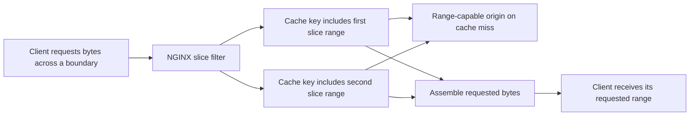

# Cache Large Files with NGINX Slice and Correct Range Keys

Author: [nawazdhandala](https://www.github.com/nawazdhandala)

Tags: Nginx, Caching, Performance

Description: Configure NGINX slice caching for large immutable files, keep byte ranges separate in cache keys, and verify cross-boundary responses against source bytes.

A client seeking into a large download may need only a small region of the file. Caching the entire object before that region becomes useful can waste origin bandwidth and delay the request. Slice caching stores fixed-size portions independently, allowing later requests to reuse the portions already fetched.

That independence creates an important requirement: the cache must distinguish one slice from another. If every portion of `/release-v1.bin` shares one key, NGINX cannot safely treat those entries as different byte ranges.

This guide uses NGINX 1.30.7 with its slice module enabled. A local test verified a request crossing a slice boundary, a repeat served without additional origin fetches, and a later request requiring a different slice. All returned bytes were compared with the original test data.

## Check the build and the origin first

Run this against the binary used by your deployment:

```bash
nginx -V
```

Look for `--with-http_slice_module`. The module is not enabled by default in a source build. If your package lacks it, use your normal reviewed package or image build process; replacing a running system binary is not part of this tutorial. NGINX documents the build option in its [configuration reference](https://nginx.org/en/docs/configure.html).

Next, choose a public, immutable test object. A versioned filename such as `/releases/app-v1.bin` is easier to reason about than a mutable `/latest.bin`. The origin must correctly implement byte-range requests: for a satisfiable range, expect `206 Partial Content` and an accurate `Content-Range` describing the returned bytes and full representation length. Those response semantics are defined in [RFC 9110](https://www.rfc-editor.org/rfc/rfc9110.html#name-range-requests).

An origin that ignores Range and returns the whole file has not demonstrated slice support. Do not proceed merely because the download completes. Confirm the status, headers, and actual byte count.

## Configure a distinct cache entry for each slice

Prepare a cache directory with the proper owner and storage budget. Put this fragment inside `http`, replacing the origin address and cache path. The loopback listener is intended for staging inspection, not public deployment.

```nginx
proxy_cache_path /var/cache/nginx/releases
    levels=1:2 keys_zone=release_slices:10m
    max_size=10g inactive=1h;

upstream release_origin {
    server 192.0.2.20:8081;
}

server {
    listen 127.0.0.1:8080;

    location /releases/ {
        slice 1m;
        proxy_pass http://release_origin;
        proxy_set_header Host downloads.internal.example;
        proxy_set_header Range $slice_range;
        proxy_set_header Accept-Encoding "";

        proxy_cache release_slices;
        proxy_cache_key "$scheme|$proxy_host|$request_uri|$slice_range";
        proxy_cache_valid 200 206 1h;
        proxy_cache_background_update off;

        proxy_cache_bypass $http_authorization $http_cookie;
        proxy_no_cache $http_authorization $http_cookie;
    }
}
```

The three connected settings are `slice 1m`, the upstream Range header, and `$slice_range` in the cache key. NGINX calculates aligned one-megabyte ranges and sends each to the origin. Caching must permit status 206. The [slice module documentation](https://nginx.org/en/docs/http/ngx_http_slice_module.html) describes this combination and warns that very small slices can increase memory and open-file usage.

The key also separates request URIs, query strings, and upstream groups. This configuration fixes the upstream Host header for one download service. If your deployment varies the representation by tenant, host, language, or another input, review those dimensions before sharing entries. Adding a range component does not make an otherwise incomplete cache key correct.

The cookie and authorization guards conservatively exclude those requests from cache reads and writes. Do not use a public cache policy to expose downloads that require per-user authorization. The [proxy module reference](https://nginx.org/en/docs/http/ngx_http_proxy_module.html) explains these controls and the precedence of response caching headers over configured validity.

Clearing Accept-Encoding asks the origin for an uncompressed representation, simplifying byte comparison. Verify that the origin honors that request. Mixing content encodings or changing bytes under the same object name makes both troubleshooting and cache correctness harder.

## Keep background updates out of this location

Do not copy a background-refresh configuration from an ordinary page cache into this location. The slice module documents a known issue with background cache-update subrequests, which are constructed without the expected byte-range support. Explicitly setting `proxy_cache_background_update off` prevents accidental inheritance from a parent context.

Also keep the object stable while slices are being fetched. The [1.30.7 slice implementation](https://github.com/nginx/nginx/blob/release-1.30.7/src/http/modules/ngx_http_slice_filter_module.c) checks Content-Range and detects inconsistent ETags across slice responses. Those checks can turn an inconsistent response into an error; they are not an atomic snapshot of a changing file. Publish a new version at a new URL rather than modifying the bytes beneath an active download.



The client receives the requested interval, not necessarily the full aligned slices fetched upstream. That distinction is why checking only response size is insufficient: an incorrect cache entry can contain the right number of wrong bytes.

## Test a boundary and then repeat it

Use an object larger than three megabytes with distinguishable data across its regions. From the staging listener's network environment, request a short interval crossing the first one-megabyte boundary:

```bash
curl --noproxy '*' --connect-timeout 2 --max-time 10 \
  --range 1048500-1048700 --dump-header range.headers \
  --output range.bin --fail --show-error \
  http://127.0.0.1:8080/releases/app-v1.bin
```

Run this in a scratch directory: it writes `range.headers` and `range.bin`. The range endpoints are inclusive, so the expected response body is 201 bytes. Check for status 206, the matching Content-Range, and equality with that exact interval of the source file. Curl's [range option](https://curl.se/docs/manpage.html#--range) sends the request; it does not prove that the server honored it.

In the local test, NGINX fetched `bytes=0-1048575` and `bytes=1048576-2097151`. The client received exactly bytes 1048500 through 1048700. Repeating the request returned identical bytes and caused no additional origin request.

A later request for bytes 2500000 through 2500100 fetched only `bytes=2097152-3145727`. These three origin ranges were recorded separately, demonstrating that the cache key distinguished the slices. This was a small loopback correctness test, not evidence of production throughput or storage efficiency.

## Review cost and failure cases

Before rollout, test an origin that returns an incorrect range, changes its ETag midway, or returns an error for one slice. Also test your clients' actual request patterns, including suffix or multi-range requests if they use them. Those cases were not exercised by the local fixture.

Measure origin bytes, file counts, disk occupancy, and latency together. Smaller slices can reduce unwanted fetched data for sparse reads but create more cache objects and requests. Larger slices reduce object count while fetching more unused bytes. Start with the documented one-megabyte example, then choose a size from observed access patterns rather than assuming it is optimal for every download.
