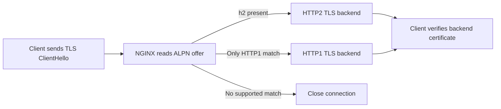

# Route NGINX Stream Traffic by ALPN Without Terminating TLS

Author: [nawazdhandala](https://www.github.com/nawazdhandala)

Tags: Nginx, TLS, Networking

Description: Route TLS connections using advertised ALPN protocols, make fallback and precedence explicit, and verify that backend TLS identity remains intact.

Two services need the same external TCP port, but they speak different application protocols over TLS. You want NGINX to choose a backend without holding the services' private keys or decrypting their application traffic. The stream preread module can inspect selected ClientHello fields and make that routing decision before passing the connection through.

Application-Layer Protocol Negotiation, or ALPN, is a TLS extension through which a client advertises supported application protocols. Common values include `h2` for HTTP/2 and `http/1.1`. The backend still negotiates the final protocol; the routing proxy only sees the client's offer.

This guide uses NGINX 1.30.7. Local tests verified routing and TLS certificate validation with synthetic backends. They tested ALPN selection, not complete HTTP/2 application exchanges.

## Separate routing from negotiation

In a TLS handshake, the client offers protocol identifiers and the server chooses one according to the protocol rules. [RFC 7301](https://www.rfc-editor.org/rfc/rfc7301.html) defines this negotiation. An advertised protocol is not evidence of an authenticated client identity or proof that the eventual application conversation will be valid.

NGINX's [stream SSL preread module](https://nginx.org/en/docs/stream/ngx_stream_ssl_preread_module.html) exposes the offered identifiers as a comma-separated variable. It can read them without terminating TLS. Therefore, it cannot inspect decrypted URLs or authorization headers in this configuration.



Each selected backend must present a certificate valid for the hostname the client requested. Routing an `h2` offer to another machine does not change the client's hostname verification target.

## Check the required modules

Inspect the deployed binary with `nginx -V`. This setup needs stream support and SSL preread support, commonly built with `--with-stream` and `--with-stream_ssl_preread_module`. If your package supplies stream as a dynamic module, load the compatible packaged module using its documented deployment procedure.

Do not assume that HTTP TLS support implies stream preread support. The existing local binary used for earlier HTTP tests needed a separate build with the stream options enabled for this exercise. That build remained in the test workspace and did not replace a system service.

## Make backend selection explicit

The following is a top-level `stream` block, alongside `http` if your configuration also contains HTTP services. Replace the documentation-range backend addresses and reserve the local listener ports before running a staging test.

```nginx
stream {
    map $ssl_preread_alpn_protocols $tls_route {
        ~(^|,)h2(,|$)         h2_backend;
        ~(^|,)http/1\.1(,|$)  http1_backend;
        default              reject_connection;
    }

    upstream h2_backend {
        server 192.0.2.20:443;
    }

    upstream http1_backend {
        server 192.0.2.21:443;
    }

    upstream reject_connection {
        server 127.0.0.1:9446;
    }

    server {
        listen 127.0.0.1:9443;
        ssl_preread on;
        proxy_connect_timeout 3s;
        proxy_timeout 60s;
        proxy_pass $tls_route;
    }

    server {
        listen 127.0.0.1:9446;
        return "";
    }
}
```

The regular expressions match complete comma-delimited identifiers. The first matching regular expression wins, as described by the [stream map module](https://nginx.org/en/docs/stream/ngx_stream_map_module.html). If a client offers `http/1.1,h2`, this policy still chooses the h2 backend because that map rule appears first. It does not simply follow the first identifier in the client's list.

The default route reaches a private local listener that closes without sending data. The [stream return module](https://nginx.org/en/docs/stream/ngx_stream_return_module.html) sends the configured value and closes the connection; an empty value gives a deliberate no-content rejection path. A TLS client will see a handshake failure, not an HTTP error page.

The public-facing test listener does not use `listen ... ssl`, and it has no certificate directives. It forwards the original TLS bytes. Do not add `proxy_ssl on` here: that option establishes an additional TLS connection from NGINX to the upstream rather than performing simple passthrough. The [stream proxy documentation](https://nginx.org/en/docs/stream/ngx_stream_proxy_module.html) describes that distinction.

## Choose a fallback policy deliberately

Some clients omit ALPN, including tools that were not configured to offer it. This example rejects them. If your service must support those clients, define a specific default backend and test the consequences instead of relying on an accidental match.

A client offering both protocols may still be incompatible with the selected service for reasons unrelated to ALPN. Keep the backend's own protocol negotiation and application validation enabled. ALPN routing is a selection mechanism, not an access-control boundary.

The sixty-second proxy timeout is an illustrative inactivity setting. It must fit the actual protocol's heartbeat and connection-lifetime behavior. A long-lived idle protocol may need a different value; do not interpret it as a guaranteed sixty-second maximum session duration.

## Verify the backend's TLS identity

From the staging machine, use a client that explicitly offers the desired protocol. Replace the hostname and CA file with values for your test backend:

```bash
openssl s_client -connect 127.0.0.1:9443 \
  -servername api.internal.example \
  -alpn h2 -verify_hostname api.internal.example \
  -verify_return_error -CAfile /path/to/test-root.pem </dev/null
```

The SNI name and hostname-verification name both identify the backend service. The command offers h2 and makes certificate errors fail verification. Check the negotiated ALPN and certificate verification output. The [OpenSSL s_client manual](https://docs.openssl.org/3.6/man1/openssl-s_client/) documents these options.

Repeat with `-alpn http/1.1`, then with `-alpn http/1.1,h2`. Finally omit `-alpn` and offer an unsupported identifier to test the default rejection. Use backend-side connection records to identify the selected service; identical certificates alone cannot tell you which backend handled the connection.

## What the local test established

The fixture used two TLS listeners with a temporary trusted CA. One negotiated h2 and the other HTTP/1.1. The client verified the backend hostname and certificate through NGINX, then exchanged a tiny diagnostic marker identifying the selected backend.

| Client offer | Selected backend | Negotiated protocol |
| --- | --- | --- |
| h2 | h2 backend | h2 |
| http/1.1 | HTTP/1.1 backend | http/1.1 |
| http/1.1, h2 | h2 backend | h2 |
| No ALPN | Rejected | None |
| Unsupported identifier | Rejected | None |

No certificate or private key was configured on NGINX. The marker exchange was not a valid HTTP/2 request and is not presented as an HTTP/2 interoperability test. Add real clients for your protocols before deployment.

Also test certificate rotation, unsupported TLS clients, and any ClientHello privacy features used in your environment. The local fixture did not cover encrypted ClientHello, fragmented or unusually large handshakes, or production load. Keep selection evidence, negotiated protocol, and application success as three separate checks; all three matter for a usable passthrough route.
