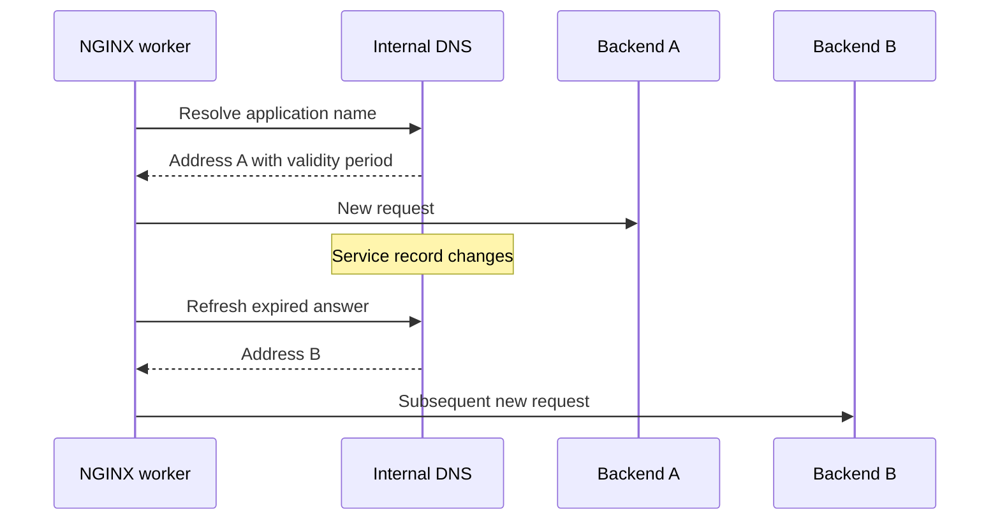

# Refresh NGINX Upstream DNS Without Reloading Workers

Author: [nawazdhandala](https://www.github.com/nawazdhandala)

Tags: Nginx, DNS, Troubleshooting

Description: Configure dynamic NGINX upstream DNS, verify backend changes without worker reloads, and separate resolver timing from connection draining.

Your backend moves to a new address, DNS shows the new record, and NGINX still connects to the old machine. Repeated reloads make the symptom disappear, but tie service discovery to your deployment system. The better question is whether this upstream was configured to watch DNS changes in the first place.

This tutorial uses open-source NGINX 1.30.7. A local test changed a DNS answer while NGINX was running and confirmed that subsequent requests reached a different backend with the same worker process. It did not test production DNS outages or long-lived connections.

## Choose the dynamic upstream mechanism

For a named upstream group, use `server ... resolve`, a shared-memory `zone`, and an explicit `resolver`. Dynamic upstream resolution became available in open-source NGINX in 1.27.3; older instructions describing it as exclusively commercial need that version qualification. The [upstream documentation](https://nginx.org/en/docs/http/ngx_http_upstream_module.html#resolve) specifies these requirements.

Before editing anything, identify the binary actually used by your deployment:

```bash
nginx -v
nginx -V
```

The first prints its version; the second also prints build details. Run these inside the relevant container if NGINX runs in one. A workstation package tells you nothing about the deployed image. These are read-only [NGINX command-line options](https://nginx.org/en/docs/switches.html).

Do not confuse an HTTP Host header with a resolver setting. The former tells the application which virtual host the request targets. DNS supplies addresses to connect to. Changing the Host header cannot refresh a stale address list.

## Give NGINX an explicit resolver

Use a trusted internal DNS service reachable from the NGINX process. In Kubernetes, that means reachability from the Pod network; on a host, it means the service's network environment. Record which resolver serves the application's private zone before writing configuration.

The following belongs inside an existing `http` block. Replace `192.0.2.53` with your resolver, and replace the application name and port. The documentation-range address is intentionally not a working DNS service.

```nginx
upstream changing_api {
    zone changing_api 256k;
    resolver 192.0.2.53 valid=10s;
    resolver_timeout 3s;

    server api.internal.example:8081 resolve;
}

server {
    listen 127.0.0.1:8080;

    location / {
        proxy_pass http://changing_api;
        proxy_set_header Host api.internal.example;
    }
}
```

This example uses HTTP to keep the experiment focused on discovery. For HTTPS, retain your server-name, certificate verification, and trust settings when changing the upstream address mechanism. A new address still needs to present the expected service identity.

The zone holds shared upstream state. Its size is a capacity choice, not a refresh interval. The local macOS ARM64 test rejected a 64k zone as too small; 256k passed. Validate sizing on your platform and with your expected number of addresses rather than treating either value as universal.

The resolver caches answers according to their DNS time to live, or TTL, unless `valid` overrides that duration. Here `valid=10s` selects a ten-second validity period. `resolver_timeout` limits resolution time; it is not a periodic refresh setting. NGINX normally looks up both IPv4 and IPv6 addresses. Disable a family only when the deployment deliberately does not support it. See the [resolver reference](https://nginx.org/en/docs/http/ngx_http_core_module.html#resolver).



The diagram describes successful refresh. It makes no promise that the change happens at the exact instant an operator updates DNS. An intermediate resolver may still have a cached answer, and network delays affect the next lookup.

## Make the selected address visible

A response saying only `OK` is weak evidence: both backends may return it. In staging, have a harmless endpoint return a distinct instance marker, and log the actual upstream address.

Add these directives inside `http`, choosing a writable log path through your deployment's logging policy:

```nginx
log_format discovery '$time_iso8601 status=$status '
                     'upstream=$upstream_addr upstream_status=$upstream_status';
access_log /var/log/nginx/discovery.log discovery;
```

The custom format records address selection without logging request bodies or authorization headers. The [log module](https://nginx.org/en/docs/http/ngx_http_log_module.html) supports named formats used by `access_log`. Keep access to these logs restricted because internal addresses can be operationally sensitive.

Use the exact configuration path and prefix from your deployment when running its configuration test. Passing the syntax check is necessary, but only a request test can prove resolver reachability and backend selection.

## Run a controlled cutover test

Create a staging DNS name whose records you are authorized to change. Start two test backends, A and B, and keep both available throughout the experiment. Begin with the name resolving only to A.

From the same machine or container network as the loopback test listener, request the approved endpoint:

```bash
curl --noproxy '*' --connect-timeout 2 --max-time 5 \
  --fail --show-error http://127.0.0.1:8080/health
```

Replace `/health` if necessary. This bypasses an environment-configured HTTP proxy, bounds the connection and total request time, and reports an HTTP error as failure. The options are documented in the [curl manual](https://curl.se/docs/manpage.html).

Confirm A's marker and address in the log. Change the staging DNS answer to B without touching the NGINX configuration. Repeat a small number of requests after allowing for resolver caching. Record the time the answer changed, the time B first appeared, and the worker identity before and after.

In the local test, a small DNS responder first supplied an IPv4 loopback address for A, then an IPv6 loopback address for B. Both backends used the same port. With one-second validity for the experiment, NGINX queried DNS again and returned B's marker. The worker process ID stayed unchanged. No reload signal was sent. This tested successful address replacement, not a production latency guarantee.

## Diagnose failures by stage

| Observation | Next check |
| --- | --- |
| Configuration rejects `resolve` | Verify deployed version and dynamic upstream support |
| Configuration rejects zone size | Increase reviewed capacity and rerun the test |
| DNS queries time out | Check reachability from NGINX to its configured resolver |
| DNS answer changes but requests still identify A | Compare actual resolver answers, logs, caching, and existing connections |
| B appears in logs but requests fail | Check B's listener, routing, application readiness, and TLS identity if applicable |

Keep A available until the migration's connection-draining criteria are met. Updating DNS does not move an in-flight request to another machine. WebSockets, streaming responses, and connection pools need their own lifecycle test.

Finally, test resolver failure and recovery in staging before depending on this for availability. A successful normal cutover does not establish behavior for NXDOMAIN, missing address families, or DNS timeouts. Capture the behavior of your exact build and decide how your deployment should react, rather than treating DNS refresh as a substitute for backend health checks.
