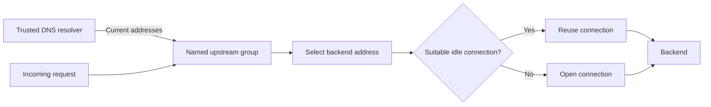

# Reuse NGINX Upstream Connections with DNS Service Discovery

Author: [nawazdhandala](https://www.github.com/nawazdhandala)

Tags: Nginx, DNS, Performance

Description: Combine dynamic upstream DNS with HTTP connection reuse, verify both independently, and avoid confusing DNS refresh with connection lifetime.

Your service name resolves correctly, requests succeed, and every request still opens another backend connection. Alternatively, connection reuse works beautifully until a deployment changes the addresses behind the name.

These are two separate responsibilities. DNS discovery maintains the set of destinations. Keepalive retains suitable idle connections so later requests can avoid another handshake. Configure and test both instead of assuming that fixing either one fixes the other.

This guide targets open-source NGINX 1.30.7 and HTTP/1.1 upstream services. It does not describe gRPC multiplexing or connection-bound authentication.

## Keep a named upstream group

Use an `upstream` block as the stable configuration object and let its server addresses change. A variable containing a hostname in `proxy_pass` is not needed for this design.



The diagram is a decision model, not a claim that DNS is queried on every request. The connection must match the selected destination. An existing socket cannot be retargeted to a new IP address when DNS changes.

The [NGINX 1.30.7 keepalive implementation](https://github.com/nginx/nginx/blob/release-1.30.7/src/http/modules/ngx_http_upstream_keepalive_module.c) selects a peer before searching cached connections for a matching address. That is why a useful acceptance test must observe both destination changes and connection reuse.

## Configure discovery and reuse together

Place the following inside `http`. Replace the example resolver with your trusted internal DNS service, the hostname with your service record, and port 8080 with the backend port. The listener stays on loopback for a staging fixture.

```nginx
upstream catalog_api {
    zone catalog_api 256k;
    resolver 10.0.0.53 valid=10s;
    resolver_timeout 2s;

    server catalog.internal.example:8080 resolve;

    keepalive 32 local;
    keepalive_timeout 15s;
    keepalive_requests 1000;
    keepalive_time 5m;
}

server {
    listen 127.0.0.1:8081;

    location / {
        proxy_pass http://catalog_api;
        proxy_http_version 1.1;
        proxy_set_header Connection "";
        proxy_set_header Host catalog.internal.example;
    }
}
```

`resolve` enables address updates and the shared `zone` holds upstream state. `valid=10s` overrides answer validity for this example; choose a value consistent with your discovery service and rollout requirements. Dynamic resolution became available without the commercial subscription in 1.27.3. See the [upstream server documentation](https://nginx.org/en/docs/http/ngx_http_upstream_module.html#server).

The keepalive limit counts idle connections per worker, not total active connections. The `local` parameter keeps cached connections scoped to the location. It is available from 1.29.7, so this exact configuration should not be copied unchanged to older binaries. Recent versions also enable keepalive by default; the explicit settings here document the policy. The [keepalive reference](https://nginx.org/en/docs/http/ngx_http_upstream_module.html#keepalive) covers these version differences.

Explicit HTTP/1.1 and an empty `Connection` header avoid asking the backend to close after each response. The upstream group name is a configuration identifier; the explicit `Host` supplies the application’s virtual-host name. Review any other inherited proxy headers when adapting this location, following the [proxy header documentation](https://nginx.org/en/docs/http/ngx_http_proxy_module.html#proxy_set_header).

## Give each lifetime a purpose

Do not tie all durations to the DNS validity period. They answer different questions:

| Setting | Reason to choose a value |
| --- | --- |
| DNS validity | How frequently discovery should reconsider addresses |
| Idle keepalive timeout | How long an unused socket remains worth retaining |
| Maximum requests per connection | When to recycle a frequently reused connection |
| Maximum connection processing lifetime | When to retire a connection after subsequent request processing |

The final setting is not an emergency timer that interrupts a running request at exactly five minutes. Likewise, DNS expiry does not automatically cancel an in-flight response.

Choose the proxy’s idle connection timeout with the backend’s own idle policy in mind. If the backend routinely closes earlier, expect more connection turnover. A shorter proxy idle period can reduce stale-socket races, but no timeout choice eliminates every race between checking and using a connection.

Do not increase write retries to conceal these failures. Repeating a request that changed state can create a second business effect. Diagnose connection lifetime separately from the application’s retry contract.

## Verify reuse at the backend

First check your adapted configuration with the target binary:

```bash
nginx -p "$PWD/" -c "$PWD/nginx.conf" -t
```

Use an isolated prefix and complete configuration containing `events` and `http` blocks. The expected result is a successful configuration test; DNS reachability and runtime updates still need an actual request test.

After starting the staging proxy, make several sequential reads of a harmless diagnostic endpoint:

```bash
for attempt in 1 2 3 4 5; do
    curl --fail --silent --show-error http://127.0.0.1:8081/identity
    printf '\n'
done
```

Have the fixture return a backend identity and record accepted connection identifiers or peer address/port pairs. Each separate curl process can open a new downstream connection while NGINX reuses an upstream connection. Client connection counts therefore do not measure backend reuse.

A quick response or a tiny upstream connect duration is useful supporting evidence, but backend accept counts are clearer. Ensure responses are fully consumed and have correct HTTP framing. For example, the [Python HTTP server documentation](https://docs.python.org/3.11/library/http.server.html#http.server.BaseHTTPRequestHandler.protocol_version) explains that an HTTP/1.1 fixture must send accurate `Content-Length` values to support persistent connections.

## Change DNS without restarting NGINX

In a controlled resolver, point the fixture name to backend A. Send several requests and retain A’s connection records. Then change the answer to backend B, wait for refresh, and send more requests. Keep both servers alive while measuring the transition.

I ran this experiment with NGINX 1.30.7, one worker, a one-second DNS validity, and an eight-connection local keepalive cache. Backend A used IPv4 loopback; B used IPv6 loopback at the same port. Each returned a short, length-delimited HTTP/1.1 response.

Requests to A reused one peer port. After the resolver answer changed, requests reached B and reused a different peer port. The worker PID remained unchanged. That proves reuse and DNS replacement together for this local fixture, without claiming a production drain test.

The experiment did not cover multiple workers, simultaneous requests, DNS outages, TLS sessions, or a long-running response during removal. Add those cases according to your deployment topology.

## Diagnose the remaining churn

If DNS changes work but sockets are not reused, inspect backend `Connection: close` responses, incomplete response bodies, idle closure, and request limits. Test one worker first so multiple independent caches do not obscure the result. Then repeat with the intended worker count.

If reuse works but traffic still reaches an old deployment, inspect the actual DNS answer and resolver path before assuming keepalive is responsible. A stable load-balancer address may hide backend changes entirely. Also distinguish a request that started before removal from a new request selected afterward.

For HTTPS upstreams, preserve certificate verification, the intended TLS server name, and appropriate trust roots when adding reuse. DNS returning a reachable address does not authenticate that endpoint.

Keep deployment retirement separate: remove an instance from discovery, allow existing work to drain, and observe new-request routing before shutdown. Reusing connections should reduce overhead while preserving an understandable service lifecycle, not turn DNS expiry into an assumed shutdown guarantee.
