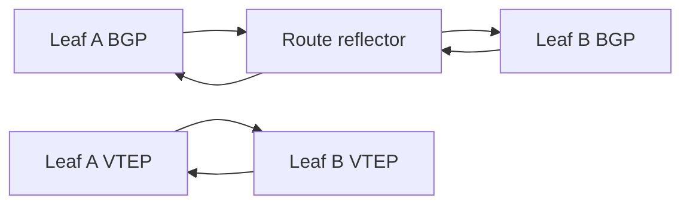

# No NVE Peers Despite VTEP Pings: Trace the EVPN Control Plane

Author: [nawazdhandala](https://www.github.com/nawazdhandala)

Tags: VXLAN, BGP, Troubleshooting

Description: Diagnose missing NX-OS VXLAN peers by separating underlay reachability, EVPN neighbor state, update-source identity, route-target import, and NVE programming.

Two VXLAN endpoint addresses answer ping, but the switch reports no NVE peers. The ping has answered one question: a particular IP probe can travel between the selected source and destination. It has not answered whether the switches exchanged the information needed to build the overlay.

Start with the first missing piece of evidence. Repeatedly changing tunnel parameters while the EVPN session is absent makes the investigation longer and can introduce a second fault.

This procedure targets **Cisco Nexus 9000 NX-OS 10.4(x)** with an IPv4 underlay and BGP EVPN ingress replication for a shared Layer 2 VNI. It is a documentation-reviewed diagnostic workflow, not a lab deployment report. Multicast-based flooding, EVPN multihoming, and multi-site border gateways need their own topology-specific checks.

## Separate the three relationships

A VTEP is the VXLAN tunnel endpoint carrying encapsulated workload traffic. NVE means network virtualization edge; NX-OS represents the tunnel function through an NVE interface. EVPN, Ethernet VPN, supplies overlay reachability through BGP, the Border Gateway Protocol.

The BGP peer and remote VTEP need not be the same machine. In a route-reflector design, a leaf can exchange routes with a spine while sending VXLAN packets directly to another leaf. A route reflector redistributes BGP information; it need not terminate the tenant tunnel. [BGP route reflection](https://www.cisco.com/c/en/us/td/docs/dcn/nx-os/nexus9000/104x/unicast-routing-configuration/cisco-nexus-9000-series-nx-os-unicast-routing-configuration-guide/m-n9k-configuring-basic-bgp-101x.html).



The upper path exchanges control information. The lower path carries tenant packets. Record both sets of addresses before treating a successful ping as relevant to a failed session.

Use an evidence sheet like this, replacing the illustrative values:

| Identity | Leaf A | Leaf B |
| --- | --- | --- |
| BGP source loopback | `192.0.2.11` | `192.0.2.12` |
| NVE source loopback | `192.0.2.101` | `192.0.2.102` |
| Intended Layer 2 VNI | `10100` | `10100` |
| BGP neighbor in this design | Route reflector | Route reflector |

Do not infer that the BGP source is correct because the NVE source answers ping.

## Establish local readiness first

Run these read-only NX-OS commands on both leaves:

```text
show nve interface nve1 detail
show nve vni
show nve peers
```

Use the actual NVE interface name if different. Record its source interface and operational state, whether the intended VNI appears and is up, and the peer table. These displays are documented in the release's VXLAN guide. [NX-OS 10.4(x) NVE verification](https://www.cisco.com/c/en/us/td/docs/dcn/nx-os/nexus9000/104x/configuration/vxlan/cisco-nexus-9000-series-nx-os-vxlan-configuration-guide-release-104x/m_configuring_vxlan_bgp_evpn.html).

An absent local VNI is a different fault from an absent remote advertisement. Compare the intended VLAN-to-VNI mapping and NVE membership with the approved configuration. Check whether the design actually enables BGP host reachability and ingress replication for this segment.

Keep the comparison limited to the failing segment. A working VNI elsewhere on the switch is a useful reference, but its route targets and VLAN mapping are not automatically appropriate for this tenant.

## Ask the EVPN address family about its session

Collect:

```text
show bgp l2vpn evpn summary
show bgp l2vpn evpn neighbors
```

Look at the EVPN neighbor state and negotiated information, not just a successful IPv4-unicast BGP session. An address family identifies which kind of routes BGP exchanges; EVPN requires its own family configuration. Save the relevant neighbor detail and any last-reset information for comparison at the other endpoint. [NX-OS BGP display commands](https://www.cisco.com/c/en/us/td/docs/dcn/nx-os/nexus9000/104x/command-reference/show/b_n9k_show_commands_104x/m_b_showcmds.html).

If the EVPN session is not established, investigate the transport identity first. Compare the configured neighbor address on one side with the source address actually selected on the other. Review autonomous-system numbers, authentication, applicable routing context, TCP reachability, and policy logs.

For loopback-based peering, the BGP `update-source` selects the session's source interface. The NVE `source-interface` selects the tunnel source. They perform different jobs. Cisco's VXLAN examples use `update-source loopback0` for BGP and `source-interface loopback1` for NVE; those names are examples, not mandatory interface assignments. [NX-OS EVPN source configuration](https://www.cisco.com/c/en/us/td/docs/dcn/nx-os/nexus9000/104x/configuration/vxlan/cisco-nexus-9000-series-nx-os-vxlan-configuration-guide-release-104x/m_configuring_vxlan_bgp_evpn.html).

Where the approved design uses eBGP between nonadjacent loopbacks, review its multihop settings too. Do not add multihop indiscriminately to a different peering design. A repair should resolve the observed source or adjacency mismatch, not broaden every neighbor's settings. [NX-OS basic BGP configuration](https://www.cisco.com/c/en/us/td/docs/dcn/nx-os/nexus9000/104x/unicast-routing-configuration/cisco-nexus-9000-series-nx-os-unicast-routing-configuration-guide/m-n9k-configuring-basic-bgp-101x.html).

## Trace segment membership through EVPN

Once the session is established, inspect the routes:

```text
show bgp l2vpn evpn
show l2route evpn imet all detail
```

The second display exposes inclusive multicast Ethernet tag, or IMET, information. In EVPN, a Type 3 IMET route advertises participation used for broadcast, unknown-unicast, and multicast delivery. These are often grouped as BUM traffic. With ingress replication, the sender sends copies to participating remote endpoints. [EVPN overlay procedures](https://www.rfc-editor.org/rfc/rfc8365.html), [NX-OS IMET inspection](https://www.cisco.com/c/en/us/td/docs/dcn/nx-os/nexus9000/104x/configuration/vxlan/cisco-nexus-9000-series-nx-os-vxlan-configuration-guide-release-104x/m_configuring_vxlan_bgp_evpn.html).

Trace one expected remote segment advertisement from its originating leaf through the reflector to the receiving leaf. Record where it is last visible. If the origin never advertises it, examining receiver import policy alone cannot fix the fault. If it reaches the receiver's BGP table but not the segment's operational state, investigate import and programming next.

Check the advertised next hop as well as the session neighbor. The next hop must resolve according to the overlay design; the reflector's address is not automatically the intended tunnel destination.

## Compare route targets in both directions

A route target, or RT, is an extended community used for route import policy. A route distinguisher, or RD, makes routes distinct. Equal RDs are not the goal, and matching VNIs alone does not demonstrate matching import policy. [EVPN route attributes](https://www.rfc-editor.org/rfc/rfc7432.html).

Consider this illustrative policy error:

| Advertisement | Export RT | Receiver import RT | Result of RT comparison |
| --- | --- | --- | --- |
| Leaf A to B | `65000:10100` | `65000:10100` | Match |
| Leaf B to A | `65001:10100` | `65000:10100` | No match |

This table predicts only the import-policy comparison, not successful forwarding. Inspect the actual RT carried by the advertisement and the receiver's intended import set. Also verify that extended communities survive the BGP path. Do not assume an automatically derived RT is identical across different autonomous systems.

Correct the specific policy mismatch through the fabric's configuration owner. Importing every RT as a shortcut can join segments that were meant to remain isolated. Preserve tenant boundaries while repairing the shared segment.

## Finish with a forwarding acceptance check

Use the evidence to choose the next action:

| First missing evidence | Investigation focus |
| --- | --- |
| Local NVE or VNI readiness | Local source, membership, segment configuration |
| Established EVPN neighbor | BGP source identity, transport, family negotiation |
| Remote segment advertisement | Origin state, reflection, export filtering |
| Imported segment participation | RT policy, next-hop resolution, programming state |
| Workload delivery after peers appear | VXLAN transport and tenant forwarding |

After the approved correction, repeat the same read-only collection. Confirm the expected peer and segment state, then send controlled tenant traffic in both directions before restoring ordinary traffic. A populated peer table is progress, not the final application test.

No NX-OS command was executed locally for this article. The commands and protocol distinctions were checked against the linked documentation; acceptance still requires evidence from the specific switches, software build, and fabric design.
