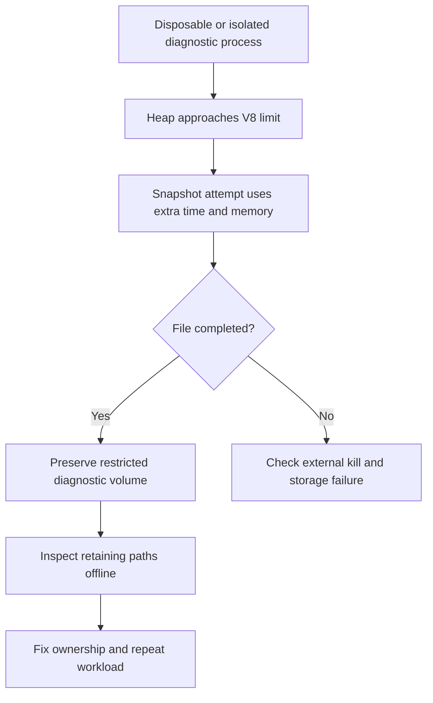

# Capture Node.js Heap Snapshots Before a V8 Memory Crash

Author: [nawazdhandala](https://www.github.com/nawazdhandala)

Tags: Node.js, Garbage Collection, Troubleshooting

Description: Capture a bounded near-heap-limit snapshot, preserve it after a Node.js crash, and distinguish JavaScript heap exhaustion from container and native-memory failures.

A Node.js process can disappear before you attach a debugger. If the failure is V8 heap exhaustion, a snapshot taken near the heap limit can preserve the object relationships that explain what remained alive. V8 is the JavaScript engine inside Node.js; its heap holds JavaScript objects and their associated storage.

A snapshot is evidence, not an emergency memory fix. Creating one consumes additional memory and blocks execution. Start with a disposable reproduction, prove that files survive the crash, and only then consider a controlled diagnostic replica. This guide tests Node.js 24.11.0 on macOS ARM64 with a small deliberately leaking program.

## Identify which memory boundary is failing

Do not assume every out-of-memory event reaches V8's heap-limit handler. A container can be killed because total charged memory crosses its limit while the JavaScript heap still has room. Native libraries and buffers can grow independently of ordinary JavaScript objects.

The [process memory API](https://nodejs.org/download/release/v24.11.0/docs/api/process.html#processmemoryusage) separates `heapUsed`, `heapTotal`, `external`, `arrayBuffers` and resident memory (`rss`). Record those fields with workload volume and the process termination reason. Array-buffer accounting is included in external memory, so do not add both as independent categories.

| Evidence | Likely next diagnostic step |
|---|---|
| V8 reports JavaScript heap exhaustion | Inspect retained JavaScript objects |
| Container reports a memory-limit kill | Compare its limit with total process and container memory |
| External memory grows while heap usage stays flatter | Investigate buffer ownership and native consumers |
| Process exits without a completed snapshot | Check whether the trigger, memory headroom and writable storage existed |

The near-limit option attempts capture before V8 exhaustion. It cannot promise a snapshot before an external kill.

## Budget for the snapshot itself

Node documents snapshot generation as synchronous and warns that creating one may require roughly twice the heap's size in memory. Worker threads also have separate V8 isolates: one snapshot is not an inventory of every worker's heap. These constraints appear in the [V8 snapshot API](https://nodejs.org/download/release/v24.11.0/docs/api/v8.html#v8writeheapsnapshotfilenameoptions).

Choose a replica whose interruption is acceptable, keep diagnostic traffic controlled, and provide persistent writable storage with restricted access. A heap snapshot can contain request bodies, tokens and application data. Do not put the output directory behind a public static-file server or attach real snapshots to public issues.



Set a small snapshot count first. Multiple captures can help compare growth, but they also multiply the operational cost. The [Node 24.11.0 flag documentation](https://nodejs.org/download/release/v24.11.0/docs/api/cli.html#--heapsnapshot-near-heap-limitmax_count) marks this option experimental and treats its count as a maximum, not a guaranteed number of files.

## Prove capture with an intentionally leaking program

Save this included program as `retain.cjs`. It repeatedly stores arrays in a long-lived collection. Every object has a recognizable marker, making the lab data easier to locate later. Do not run this in a production service: it is designed to exhaust its JavaScript heap.

```javascript
'use strict';
const retained = [];
let sequence = 0;
setInterval(() => {
  retained.push({
    marker: `snapshot-lab-${sequence++}`,
    values: new Array(50_000).fill(sequence),
  });
  if (sequence % 20 === 0) {
    console.log(JSON.stringify({ sequence, ...process.memoryUsage() }));
  }
}, 5);
```

With Node.js 24.11.0 selected in your shell, use a fresh private directory:

```bash
umask 077
mkdir node-snapshot-lab
node --version
node --max-old-space-size=32 \
  --heapsnapshot-near-heap-limit=1 \
  --diagnostic-dir="$PWD/node-snapshot-lab" \
  retain.cjs
```

The 32 MiB old-space setting is deliberately tiny for this lab. It is not a process-memory ceiling or a suggested service setting. Node can adjust the V8 heap limit to accommodate snapshot overhead, so the process may grow well beyond that number.

Our run wrote one 4,553,973-byte `.heapsnapshot` file before terminating with a fatal JavaScript heap-out-of-memory message. The subprocess exited through an abort signal. The snapshot parsed as JSON, reported 52,821 nodes and contained the lab marker. Core dumps were disabled for the local test. These observations verify capture for this reproduction, not capture reliability under a container limit.

## Verify the artifact without treating file existence as success

Keep the Node version, workload identifier, stderr and snapshot together. A file can exist but be incomplete if the process died while writing it. For this small synthetic artifact, basic JSON parsing provides a useful integrity check:

```bash
node -e '
const fs = require("node:fs");
const snapshot = JSON.parse(fs.readFileSync(process.argv[1], "utf8"));
console.log({ nodeCount: snapshot.snapshot.node_count });
' node-snapshot-lab/REPLACE_WITH_ACTUAL_FILE.heapsnapshot
```

Replace the filename with the generated file. This command reads the entire artifact into memory, so run it only where the file size and available memory make that appropriate. It confirms parseability, not the completeness of every diagnostic insight. V8's snapshot schema can change; avoid building a permanent parser around this tiny check.

For real diagnosis, load the file into the Memory panel of Chrome DevTools. The official [heap snapshot walkthrough](https://nodejs.org/en/learn/diagnostics/memory/using-heap-snapshot) describes loading and comparing snapshots. Inspect large retained objects and follow retaining paths toward the root that keeps them reachable. Shallow size describes an object itself; retained size helps explain what would become reclaimable if that ownership disappeared.

In this lab, the long-lived array is the intentional owner. In a service, the corresponding owner might be an unbounded cache, listener collection or pending-work queue. A large allocation site alone does not prove that it owns the leak.

## Move from capture to a repeatable fix

Use equivalent workload windows when comparing snapshots. A larger heap after twice as many active requests is not automatically evidence of unintended retention. Allow legitimate work to finish and compare after similar warmup and cleanup conditions.

After changing the suspected ownership policy, rerun the same reproduction. Check the memory trend and the application's latency and error behavior without snapshot generation enabled. The diagnostic capture changes execution timing, so do not use its pauses as the normal-service baseline.

If no file appears, verify the actual process arguments, storage permissions and free space first. Then distinguish V8 exhaustion from an operating-system kill. Preserve the failed attempt's logs before restarting. More snapshots or a larger old-space value can increase the pressure that prevented capture; establish headroom and a reliable artifact path before repeating the experiment.
