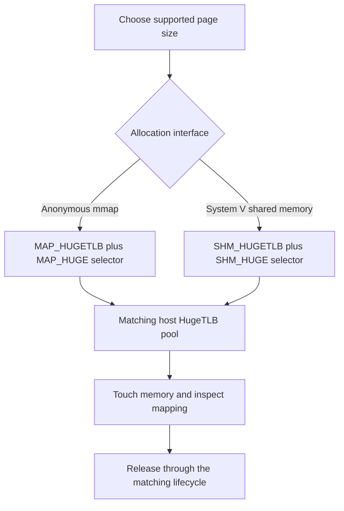

# Request Non-Default Huge Page Sizes with mmap and shmget

Author: [nawazdhandala](https://www.github.com/nawazdhandala)

Tags: Linux, HugePages, C

Description: Select explicit HugeTLB page sizes with MAP_HUGE and SHM_HUGE flags, check the matching pool, and use a scoped C probe with correct mapping cleanup.

A host can provide both 2 MiB and 1 GiB HugeTLB pages while keeping only one of them as the default. If an application requests explicit huge pages without selecting a size, it can use the wrong pool for its intended capacity or performance plan.

Choose the page size at the allocation interface. For anonymous `mmap()`, combine `MAP_HUGETLB` with the appropriate `MAP_HUGE_*` selector. For System V shared memory, pass `SHM_HUGETLB` and the corresponding `SHM_HUGE_*` selector to `shmget()`.

This guide uses **Linux 6.12** interfaces and a C example compile-checked with **musl 1.2.5** headers for Linux x86-64. The probe is for a staging host with approved free capacity. Selecting 1 GiB means requesting a real 1 GiB huge page, even though the probe writes only two bytes.

## Distinguish size, length, and mechanism

These are separate choices:

| Choice | Example | Meaning |
|---|---|---|
| Allocation mechanism | `MAP_HUGETLB` | Request explicit HugeTLB backing |
| Page-size selector | `MAP_HUGE_1GB` | Select 1 GiB pages |
| Mapping length | `2 * 1024 * 1024 * 1024` bytes | Request a region that spans two such pages |

A large mapping length alone does not request huge pages. A selector alone does not replace the HugeTLB flag. Transparent Huge Page advice is a different interface and does not reserve capacity from these pools. The [mmap manual](https://man7.org/linux/man-pages/man2/mmap.2.html) documents the HugeTLB flags and size selection.

The selectors encode the base-two logarithm of the requested page size in bits 26 through 31. For 2 MiB, that exponent is 21; for 1 GiB, it is 30. These values come from the [Linux 6.12 HugeTLB encoding header](https://raw.githubusercontent.com/torvalds/linux/v6.12/include/uapi/asm-generic/hugetlb_encode.h). Do not shift the byte count itself into the flags.

## Verify the selected pool and caller permissions

On the target Linux host, inspect supported sizes and their capacity:

```bash
awk '/^Hugepagesize:/ {print}' /proc/meminfo
for size in 2048 1048576; do
    pool="/sys/kernel/mm/hugepages/hugepages-${size}kB"
    [ -d "$pool" ] || continue
    printf '\n%s\n' "$pool"
    for field in nr_hugepages free_hugepages resv_hugepages; do
        printf '%s=' "$field"
        cat "$pool/$field"
    done
done
```

The first line identifies the default, while the directories show size-specific pools. An absent size directory is a reason to investigate support before running that variant. Free capacity already promised through reservations is not necessarily available to this new request. See the [HugeTLB administration guide](https://www.kernel.org/doc/html/v6.12/admin-guide/mm/hugetlbpage.html).

Run the probe with an account appropriately authorized for HugeTLB allocation. Both interfaces can reject an unauthorized caller; inspect `CAP_IPC_LOCK` and configured `hugetlb_shm_group` access instead of solving every failure by running the whole service as root. Also check the process's NUMA eligibility and cgroup limits.



## Use a probe that requests exactly one selected page

Save the following as `huge-probe.c`. It accepts `mmap` or `shm`, followed by `2M` or `1G`. The fallback definitions cover the two named selectors when a libc header omits their convenience names; their values match the Linux encoding above. The program still requires Linux headers exposing the base HugeTLB flags.

```c
#define _GNU_SOURCE
#include <stdio.h>
#include <string.h>
#include <sys/mman.h>
#include <sys/shm.h>
#include <unistd.h>

#ifndef MAP_HUGE_2MB
#define MAP_HUGE_2MB (21U << 26)
#endif
#ifndef MAP_HUGE_1GB
#define MAP_HUGE_1GB (30U << 26)
#endif
#ifndef SHM_HUGE_2MB
#define SHM_HUGE_2MB (21U << 26)
#endif
#ifndef SHM_HUGE_1GB
#define SHM_HUGE_1GB (30U << 26)
#endif

int main(int argc, char **argv) {
    if (argc != 3 || (strcmp(argv[1], "mmap") && strcmp(argv[1], "shm")) ||
        (strcmp(argv[2], "2M") && strcmp(argv[2], "1G"))) {
        fprintf(stderr, "Usage: %s mmap|shm 2M|1G\n", argv[0]);
        return 2;
    }
    int large = !strcmp(argv[2], "1G");
    int use_shm = !strcmp(argv[1], "shm");
    size_t length = (size_t)1 << (large ? 30 : 21);
    int map_size = large ? MAP_HUGE_1GB : MAP_HUGE_2MB;
    int shm_size = large ? SHM_HUGE_1GB : SHM_HUGE_2MB;
    void *address;
    if (!use_shm) {
        address = mmap(NULL, length, PROT_READ | PROT_WRITE,
                       MAP_PRIVATE | MAP_ANONYMOUS | MAP_HUGETLB | map_size,
                       -1, 0);
        if (address == MAP_FAILED) { perror("mmap"); return 1; }
    } else {
        int id = shmget(IPC_PRIVATE, length, 0600 | SHM_HUGETLB | shm_size);
        if (id == -1) { perror("shmget"); return 1; }
        address = shmat(id, NULL, 0);
        if (address == (void *)-1) {
            perror("shmat");
            if (shmctl(id, IPC_RMID, NULL) == -1) perror("cleanup IPC_RMID");
            return 1;
        }
        if (shmctl(id, IPC_RMID, NULL) == -1) {
            perror("IPC_RMID");
            fprintf(stderr, "Review cleanup for newly created shmid=%d\n", id);
            if (shmdt(address) == -1) perror("shmdt");
            return 1;
        }
    }
    volatile unsigned char *bytes = address;
    bytes[0] = 17;
    bytes[length - 1] = 29;
    printf("PID=%ld address=%p length=%zu; endpoints touched.\n",
           (long)getpid(), address, length);
    puts("Inspect this process, then press Enter to release the mapping.");
    fflush(stdout);
    (void)getchar();
    int result = use_shm ? shmdt(address) : munmap(address, length);
    if (result == -1) { perror("release"); return 1; }
    return 0;
}
```

The `mmap` path requests anonymous private memory with a null address hint, letting the kernel choose placement. The mapping length is an exact huge-page multiple, and the same length is used for `munmap()`.

The shared-memory path creates a new segment with `IPC_PRIVATE`, then attaches it with `shmat()`. Here, `IPC_PRIVATE` means “create a new segment”; it is not a permission mode. The `0600` bits restrict ordinary access to its owner. Page-size selection belongs in `shmget()` flags, not in the later attach call. See [shmget](https://man7.org/linux/man-pages/man2/shmget.2.html) and the [Linux SHM selector definitions](https://raw.githubusercontent.com/torvalds/linux/v6.12/include/uapi/linux/shm.h).

After attachment, the probe marks its own new segment for removal. It remains usable while attached and is destroyed after the final detach. That prevents the successful test from leaving a persistent segment behind if it subsequently exits. The failure paths also attempt cleanup. This lifecycle is documented by [shmctl](https://man7.org/linux/man-pages/man2/shmctl.2.html) and [shmat/shmdt](https://man7.org/linux/man-pages/man2/shmat.2.html). Do not copy the removal operation onto an existing production segment.

## Build and run only the intended variant

On a Linux development host with a C compiler and development headers:

```bash
cc -std=c11 -Wall -Wextra -Werror huge-probe.c -o huge-probe
./huge-probe mmap 2M
```

A successful test prints its PID, address, and a length of 2,097,152 bytes, then waits for Enter. Inspect that process before releasing the mapping. Run `./huge-probe shm 2M` separately to exercise the other interface.

For the 1 GiB variant, first confirm that the matching pool and workload limits can accommodate the test, then use `./huge-probe mmap 1G` or `./huge-probe shm 1G`. Do not launch all variants simultaneously unless you have budgeted their combined capacity.

The endpoint writes cause access to the selected page. This is a smoke check, not a memory-bandwidth test or proof that a larger multi-page production working set fits. A fault-time constraint can still terminate the probe with `SIGBUS` before it prints success.

## Verify backing while the probe waits

Use the printed PID, replacing `12345`:

```bash
app_pid=12345
cat "/proc/$app_pid/smaps"
awk '{for (i=1;i<=NF;i++) if ($i=="huge") {print; break}}' "/proc/$app_pid/numa_maps"
```

Correlate the printed address with its smaps range. Check the HugeTLB `ht` flag, the page size, and the HugeTLB accounting fields. Inspect the node placement if locality matters. The [smaps format](https://man7.org/linux/man-pages/man5/proc_pid_smaps.5.html) and [NUMA mapping interface](https://man7.org/linux/man-pages/man7/numa.7.html) describe these observations.

Press Enter to release the allocation. In an isolated test, compare the selected pool's counters before and after cleanup. Concurrent consumers can obscure that comparison, so a single host-wide snapshot is not a complete lifecycle test.

## Diagnose the actual failure instead of falling back silently

Record which call failed. `shmget()` returning a segment ID is not the same as `shmat()` succeeding, and neither proves that a subsequent write will succeed. Preserve the reported error and the selected page size in logs.

Check unsupported size or invalid parameters, insufficient matching-pool capacity, caller permissions, and System V segment limits where relevant. Avoid silently retrying without the size selector: that changes the allocation contract and can conceal that the intended pool was never used.

The exact C example compiled to a Linux x86-64 ELF object with warnings treated as errors against musl 1.2.5 headers. It was not linked or executed on Linux, and no HugeTLB allocation, shared-memory lifecycle, or SIGBUS behavior was tested live. Complete those staging checks before adopting the pattern in an application.
