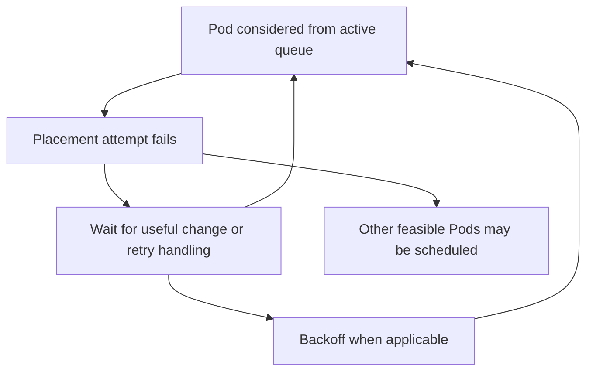

# Why High-Priority Non-Preempting Pods Can Wait Behind Others

Author: [nawazdhandala](https://www.github.com/nawazdhandala)

Tags: Kubernetes, Scheduling, Troubleshooting

Description: Understand scheduler backoff, distinguish queue priority from capacity reservation, and investigate why lower-priority Pods can start before non-preempting work.

A Pod has a higher priority than its neighbors and uses `preemptionPolicy: Never`. It fails to schedule, then a lower-priority Pod starts. The higher-priority Pod remains pending. That sequence can be expected behavior, not evidence that Kubernetes ignored its priority.

Priority affects ordering among Pods considered for scheduling. It does not reserve all future capacity for a Pod that cannot currently fit. After a failed attempt, retry handling can keep the Pod out of the active scheduling queue while other feasible work proceeds.

This guide reviews **Kubernetes 1.34.0** default scheduler behavior. Custom queue sorting, scheduler plugins, and newer scheduling features can change the details, so record the scheduler profile involved in a real incident.

## Separate priority from permission to preempt

`preemptionPolicy: Never` prevents a Pod from initiating preemption against lower-priority Pods. It does not remove its queue priority, make it immune to preemption by higher-priority work, or guarantee a placement deadline.

The [non-preempting PriorityClass documentation](https://kubernetes.io/docs/concepts/scheduling-eviction/pod-priority-preemption/#non-preempting-priorityclass) explicitly notes that these Pods can back off after unsuccessful attempts, allowing lower-priority Pods to be scheduled meanwhile.

Consider an illustrative node with two CPU cores free. Pod H has priority `1000`, requests three cores, and cannot preempt. Pod L has priority `100`, requests one core, and otherwise fits. Trying H first does not make three cores available. Scheduling L can use capacity that H could not use at that moment.

Even if enough capacity becomes available later, retry timing and competing work can affect the observed order. The example explains a possibility; it does not predict an exact scheduler trace.

## Understand the queues without treating them as an API

The [1.34.0 queue implementation](https://github.com/kubernetes/kubernetes/blob/v1.34.0/pkg/scheduler/backend/queue/scheduling_queue.go) distinguishes active work, backoff, and Pods currently considered unschedulable. Events and scheduling-plugin decisions influence when a Pod becomes worth retrying.



This is a simplified explanation. A Pod does not necessarily traverse every box on every failure. Queueing hints can help determine whether a cluster event may make a previously failed Pod schedulable; the [scheduling framework documentation](https://kubernetes.io/docs/concepts/scheduling-eviction/scheduling-framework/#queueinghint) describes their role.

There is no general Pod status field named “current scheduler backoff deadline” that you can read as a complete account of these internal queues. A `Pending` phase or an old `FailedScheduling` event alone does not prove the Pod is presently in backoff.

## Verify the admitted policy and current failure

Use your actual context, namespace, and Pod name:

```bash
kubectl --context staging -n workloads get pod REPLACE_WITH_POD -o json \
  > pending-pod.json
kubectl --context staging -n workloads describe pod REPLACE_WITH_POD
```

With `jq` installed, extract the identity and scheduling fields:

```bash
jq '{
  uid: .metadata.uid,
  class: .spec.priorityClassName,
  priority: .spec.priority,
  preemptionPolicy: .spec.preemptionPolicy,
  scheduler: .spec.schedulerName,
  assignedNode: .spec.nodeName,
  scheduled: [.status.conditions[]? |
    select(.type == "PodScheduled") |
    {status, reason, message, lastTransitionTime}]
}' pending-pod.json
```

Confirm that the actual Pod has the intended numeric priority and `Never` policy. A template edit does not rewrite an existing Pod, and a default class may have been applied at admission. Keep the UID so a replacement is not mistaken for the same waiting object.

Read the current scheduling failure before blaming retry delay. A missing toleration, incompatible volume topology, required affinity, or oversized resource request can keep a Pod infeasible indefinitely. Backoff tuning does not fix any of those constraints.

If `assignedNode` is populated, investigate container initialization, images, or storage instead of assuming the Pod is still waiting in a scheduling queue.

## Reconstruct order with timestamps and constraints

Compare the high-priority Pod and the lower-priority Pod that started first. Record their creation times, scheduling events, requests, affinity, tolerations, and assigned nodes. Different feasible node sets can explain the order without any competition for the same capacity.

An illustrative timeline might be:

| Observation | Interpretation to investigate |
|---|---|
| H fails a placement attempt | Determine the exact filter or resource constraint |
| L is assigned a node | Confirm L actually fits where H did not |
| A node changes or capacity is released | Determine whether the event can make H feasible |
| H retries and still fails | Recheck current constraints rather than assuming stale backoff |

Do not infer the scheduler's internal queue state solely from these observations. Correlate scheduler logs and metrics available in your deployment. If you need exact retry analysis, use a controlled staging workload and appropriate scheduler observability rather than increasing production log verbosity without reviewing cost and sensitive metadata exposure.

## Tune the cause before the timer

The [1.34.0 scheduler defaults](https://github.com/kubernetes/kubernetes/blob/v1.34.0/pkg/scheduler/apis/config/v1/defaults.go) set initial Pod backoff to one second and maximum backoff to ten seconds. Those defaults are not a promise that every pending Pod retries or schedules within ten seconds. Waiting for a relevant change, plugin behavior, workload feasibility, and control-plane load also matter.

Reducing backoff can increase repeated failed work. It does not create capacity, and it can consume scheduler resources without improving application startup. Scheduler settings belong in the administrator-managed [scheduler configuration](https://kubernetes.io/docs/reference/scheduling/config/), not arbitrary annotations invented for an individual Pod.

Choose a policy matching the workload's objective. If it must avoid disturbing running work, keep non-preempting behavior and provide suitable headroom or accept queueing delay. If displacement is acceptable, evaluate a preempting class through the priority governance process, including its effect on other services. Changing that policy is an availability tradeoff, not a routine troubleshooting shortcut.

Also consider whether the work can request a smaller valid unit of capacity, use a different eligible pool, or start on demand-provisioned nodes. Do not understate resource requests just to win placement; actual resource pressure can create a worse failure later.

The JSON extraction was tested against representative pending, assigned, and missing-condition fixtures, and shell syntax and tagged source defaults were reviewed. No scheduler queue or timing experiment was run. A useful conclusion distinguishes “this Pod is temporarily waiting to retry” from “this Pod cannot fit,” and does not turn high priority into an unsupported capacity reservation guarantee.
