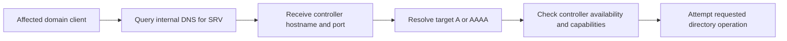

# Find Broken Active Directory SRV Registration with nslookup

Author: [nawazdhandala](https://www.github.com/nawazdhandala)

Tags: Active Directory, DNS, Networking, Troubleshooting

Description: Check domain and site-specific SRV records, resolve domain controller targets, and narrow registration failures without confusing DNS with service health.

A domain join fails, but the domain controller responds when you connect to its IP address. That leaves an important question unanswered: can the client discover the right controller through DNS?

Active Directory publishes service-location records, called **SRV records**, that identify servers offering directory and authentication services. A domain controller, or **DC**, needs more than a working host address. Its service records must be visible through the DNS path used by the affected client.

This workflow starts at that client, then moves toward the authoritative records and the controller's registration diagnostics. The examples target Windows Server 2025's documented tools. They are diagnostic examples, not a claim that the commands were run against a live Active Directory domain.

## Understand the discovery chain

An SRV lookup returns a service target hostname and port, not proof of a successful sign-in. The client must resolve the target's address, reach it, and verify that it offers the required capabilities. Microsoft's [DC locator overview](https://learn.microsoft.com/en-us/windows-server/identity/ad-ds/manage/dc-locator) describes DNS discovery followed by UDP-based LDAP availability checks and caching of the selected controller.

LDAP means **Lightweight Directory Access Protocol**. It is one of the protocols used to communicate with the directory. A successful DNS response is only an earlier step in that process.



Collect the Active Directory DNS domain, the client's intended site, its configured internal DNS servers, and the controllers expected to advertise. Use the DNS domain name, such as `ad.example.`, rather than a short legacy domain label. Replace all example names and documentation IP addresses below with approved internal values.

## Ask the resolver the client actually uses

From the affected network, run these commands in Command Prompt or PowerShell:

```text
nslookup -debug -type=SRV _ldap._tcp.dc._msdcs.ad.example. 192.0.2.53
nslookup -debug -type=SRV _ldap._tcp.dc._msdcs.ad.example. 192.0.2.54
```

The two final arguments represent the client's two internal resolvers. Query them individually so a working server cannot hide an inconsistent one. These commands request SRV explicitly; they do not depend on an ANY query returning every record type. Microsoft's [registration verification guide](https://learn.microsoft.com/en-us/troubleshoot/windows-server/networking/verify-srv-dns-records-have-been-created) identifies this LDAP locator name.

Save the full response, timestamp, resolver address, and returned targets. A timeout means the query did not obtain a usable response. NXDOMAIN means that resolver answered that the name does not exist. A successful response without the required SRV records is another distinct result. None of these alone proves that Netlogon failed to register the controller: you might be asking a resolver without a route to the internal zone.

Do not use a public resolver as the expected source of private Active Directory records. Also avoid changing the client's DNS settings just to make one diagnostic succeed; first establish what the configured internal path returns.

## Read the complete SRV result

An illustrative SRV record can be represented as:

```text
_ldap._tcp.dc._msdcs.ad.example. 600 IN SRV 0 100 389 dc1.ad.example.
```

Here `600` is the TTL in seconds. The SRV data contains priority `0`, weight `100`, port `389`, and target `dc1.ad.example.`. Lower numeric priority is preferred; weight influences selection among records at the same priority. These fields are defined in [RFC 2782](https://www.rfc-editor.org/rfc/rfc2782.html).

Do not mistake weight for a health score, or assume the first printed controller is the one Windows will use. Domain controller selection also considers capabilities, site information, and cached discovery state. Keep all returned targets and compare them with the expected inventory.

Next, query the actual returned hostname through the same resolver:

```text
nslookup -type=A dc1.ad.example. 192.0.2.53
nslookup -type=AAAA dc1.ad.example. 192.0.2.53
```

Check every applicable address against the controller's current network configuration. An SRV target with no usable address is broken discovery even when the SRV record itself exists. Conversely, a host A record without the corresponding service registration does not establish that a client can discover the controller.

## Check the correct site and service

A domain-wide result can work while a site's service records are wrong. Replace `London` with the site's actual Active Directory name:

```text
nslookup -type=SRV _ldap._tcp.London._sites.dc._msdcs.ad.example. 192.0.2.53
```

Microsoft's [DNS-based discovery specification](https://learn.microsoft.com/en-us/openspecs/windows_protocols/ms-adts/7fcdce70-5205-44d6-9c3a-260e616a2f04) defines both domain-wide and site-specific forms. It also defines separate queries for Kerberos and the global catalog. Test the service the failing operation needs; an LDAP result does not automatically validate every directory-related service.

A site-specific answer is not necessarily supposed to contain every controller in the domain. Compare it with the intended site coverage and controller roles. If the client is assigned to the wrong site, repairing an otherwise correct SRV record will not fix that placement problem.

## Compare published records with registration intent

If resolvers disagree, have the DNS administrator inspect the zone servers and replication state for the relevant records. Determine whether the difference originates in the authoritative data or in a recursive cache or forwarding path. A stale decommissioned target and an absent newly promoted target require different investigation.

On the suspect controller, an administrator can inspect `%systemroot%\System32\Config\Netlogon.dns` with a text editor. Microsoft's [verification guide](https://learn.microsoft.com/en-us/troubleshoot/windows-server/networking/verify-srv-dns-records-have-been-created) describes this file, including its use with non-Microsoft DNS. Treat its contents as registration information to compare with published DNS, not proof that an update was accepted everywhere.

For a targeted diagnostic, run the following from an elevated prompt with appropriate administrative access and DCDiag installed on a DC or through Remote Server Administration Tools:

```text
dcdiag /test:DNS /DnsRecordRegistration /s:dc1.ad.example /v
```

This checks registration of address, alias, and well-known service records, and includes the basic DNS tests. The explicit server limits the investigation to one controller. The [DCDiag reference](https://learn.microsoft.com/en-us/windows-server/administration/windows-commands/dcdiag) documents these switches and prerequisites.

Read failures in order. Microsoft notes that failed preliminary connectivity can prevent later DNS tests from running in its [DNS verification procedure](https://learn.microsoft.com/en-us/windows-server/identity/ad-ds/manage/troubleshoot/verify-dns-functionality-to-support-directory-replication). A test that never reached record inspection is not evidence that the SRV record is absent.

## Separate registration repair from connectivity repair

| Evidence | Next investigation |
| --- | --- |
| No SRV response through the client resolver, records exist at the zone | Internal forwarding, delegation, cache, or DNS view |
| Expected target missing from authoritative records | Netlogon registration, update permissions, zone state, and controller events |
| SRV exists but target address is wrong | Host registration and obsolete interface addresses |
| Correct target and address, connection fails | Routing, filtering, controller listener, and service availability |
| DNS checks pass but domain operation fails | DC locator behavior, authentication, time, and operation-specific diagnostics |

A narrow TCP test can provide additional evidence from the affected Windows client:

```powershell
Test-NetConnection -ComputerName dc1.ad.example -Port 389
```

Inspect `RemoteAddress` and `TcpTestSucceeded`. This [documented connection test](https://learn.microsoft.com/en-us/powershell/module/nettcpip/test-netconnection?view=windowsserver2025-ps) verifies TCP establishment, not LDAP authentication, UDP locator traffic, or every port Active Directory needs.

Have the directory owner repair the identified registration or infrastructure issue through the normal change process. Avoid creating hand-written service records merely to hide a persistent registration failure. Afterward, repeat the same resolver-specific queries, confirm target addresses, and retry the original domain operation from the affected network. Preserve that evidence together: DNS publication and a successful user operation answer different parts of the incident.
