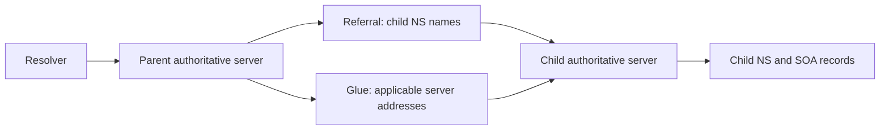

# Find Broken DNS Delegation by Comparing Parent, Child, and Glue

Author: [nawazdhandala](https://www.github.com/nawazdhandala)

Tags: DNS, Networking, Troubleshooting

Description: Compare parent referrals, child authoritative NS records, and glue addresses with nslookup to isolate delegation failures and coordinate the right repair.

A DNS zone answers when you query its server directly, yet ordinary clients cannot resolve it reliably. The zone's records may be correct while the route used to discover that zone is broken. A parent can refer resolvers to an old server, publish an obsolete address, or name a server that no longer hosts the child zone.

To diagnose this, compare three pieces of evidence: the parent's delegation, the child's authoritative nameserver list, and the addresses needed to reach those nameservers. Querying NS records through one recursive resolver does not expose all three reliably.

## Define the boundary you are testing

A **delegation** is a parent zone's referral of responsibility for a child zone to named servers. The parent and child each publish NS records at the boundary, but those records have different roles. The parent directs discovery; the child describes its authoritative server set. [RFC 9499](https://www.rfc-editor.org/rfc/rfc9499.html) defines delegation and related DNS terminology.

For this walkthrough, `example.` is the parent and `ops.example.` is the child. The parent server is represented by `192.0.2.10`; two child endpoints are `192.0.2.53` and `192.0.2.54`. These are placeholders, not public DNS infrastructure. Obtain the real zone boundaries and server addresses from the DNS owner or a trusted inventory before running the queries.



The diagram shows a discovery path. It does not mean a resolver must contact the parent for every lookup; cached delegation information can affect what it reaches during an incident.

## Ask the parent directly

Use nslookup debug mode and disable the request for recursion:

```bash
nslookup -debug -norecurse -type=NS ops.example. 192.0.2.10
```

The explicit server must be authoritative for the parent zone. In the expected referral, inspect the **authority section** for the child NS names and the **additional section** for applicable address records. Preserve the timestamp, flags, TTLs, and every returned name and address.

On Windows, `set d2` in an interactive session enables [detailed packet output](https://learn.microsoft.com/en-us/windows-server/administration/windows-commands/nslookup-set-d2). BIND output differs; do not assume it prints the same header fields.

The options follow the [BIND 9.18.33 nslookup manual](https://bind9.readthedocs.io/en/v9.18.33/manpages.html#nslookup-name-server-lookup-utility). Windows Server 2025 also documents [disabling recursion](https://learn.microsoft.com/en-us/windows-server/administration/windows-commands/nslookup-set-recurse). Disabling recursion does not magically make a recursive cache authoritative; selecting the correct server is essential.

If the parent has several authoritative endpoints, repeat the query against each reachable endpoint in the intended DNS view. Different referrals may explain intermittent behavior. Do not infer that every parent is consistent from one successful answer.

## Determine whether the addresses are glue

Suppose the referral names `ns1.ops.example.`. That server's name lies inside the delegated zone. A resolver needs its address before it can reach that zone, creating a circular dependency. The parent supplies address records, called **glue**, to make that initial contact possible.

For an in-domain nameserver, [RFC 9471](https://www.rfc-editor.org/rfc/rfc9471.html) requires a referral to include available glue. If message-size limits prevent inclusion, the server must indicate truncation. Inspect completeness before deciding that an address is missing.

If necessary, inspect a TCP response in an interactive Windows nslookup session:

```text
nslookup - 192.0.2.10
set debug
set d2
set norecurse
set type=NS
set vc
ops.example.
exit
```

Enter these lines in nslookup, starting with the launch command in your shell. `set vc` requests TCP transport; Microsoft's [virtual-circuit option](https://learn.microsoft.com/en-us/windows-server/administration/windows-commands/nslookup-set-vc) documents the setting. A TCP failure is evidence to investigate, not a reason to treat an incomplete UDP response as the complete delegation.

A nameserver such as `ns1.provider.example.` lies outside `ops.example.`. Missing additional data for that name is not, by itself, an invalid delegation. Its address can have a separate resolution path. Classify the nameserver's relationship to the child before deciding which parent must supply address information.

## Ask every listed child endpoint for authoritative data

For each nameserver advertised by the parent, obtain and test its applicable IPv4 and IPv6 addresses. Start with these example IPv4 endpoints:

```bash
nslookup -debug -norecurse -type=NS ops.example. 192.0.2.53
nslookup -debug -norecurse -type=SOA ops.example. 192.0.2.53
nslookup -debug -norecurse -type=NS ops.example. 192.0.2.54
nslookup -debug -norecurse -type=SOA ops.example. 192.0.2.54
```

Expect authoritative responses for the child zone. The **AA flag**, meaning Authoritative Answer, is defined in the [DNS header specification](https://www.rfc-editor.org/rfc/rfc1035.html#section-4.1.1). An answer from a cache without that flag is not proof that the endpoint hosts the zone. In BIND, the [tagged output code](https://github.com/isc-projects/bind9/blob/v9.18.33/bin/dig/nslookup.c) prints the non-authoritative label when AA is clear. For these direct NS/SOA checks, use that distinction alongside the returned zone records; Windows detailed output exposes the header itself.

SOA means **Start of Authority**. Its response helps confirm that the server recognizes the expected zone apex. Compare the child NS set and zone information across the endpoints. An NS record listing a server does not prove that server is configured correctly; only direct checks can expose an endpoint that is missing the zone or refusing the relevant query.

A timeout and a non-authoritative answer are different failures. A timeout leaves authority unproven because no usable response arrived. A server that responds but does not serve the delegated zone needs a configuration or delegation investigation. Keep those categories separate in the incident notes.

## Reconcile the three inventories

Build a compact worksheet. Compare sets of names, ignoring their displayed order, and retain individual address families:

| Evidence | Example observation | Question to answer |
| --- | --- | --- |
| Parent NS | ns1.ops.example., ns2.ops.example. | Does discovery point to the intended servers? |
| Child NS | ns1.ops.example., ns3.ops.example. | Was one side of a migration left behind? |
| Parent glue | ns1.ops.example. = 192.0.2.53 | Is the bootstrap address current and reachable? |
| Child address | ns1.ops.example. = 192.0.2.153 | Which address matches the approved configuration? |
| Direct SOA response | One endpoint lacks AA | Does that endpoint actually host the child zone? |

To compare in-domain glue with the child's own address data, ask a working child authority:

```bash
nslookup -debug -norecurse -type=A ns1.ops.example. 192.0.2.54
nslookup -debug -norecurse -type=AAAA ns1.ops.example. 192.0.2.54
```

The parent and child addresses can disagree during an incomplete migration. Do not choose a winner solely because one answer is newer-looking. Confirm the intended deployment and test both addresses from the relevant network.

Likewise, an NS mismatch is a finding to reconcile, not proof that every query must fail. Reachable overlapping servers or cached data can mask the problem. That makes complete coverage important even when the application sometimes works.

## Coordinate the repair across owners

The parent delegation may be managed by a registrar, a hosting provider, or another internal DNS team. Child NS and address records are managed with the child zone. Correcting only the child cannot remove an obsolete server from the parent's referral.

For a planned server replacement, establish that the replacement serves the zone before directing discovery to it. Coordinate parent NS, applicable glue, and child NS/address changes, preserving sufficient working overlap for cached referrals. Record the observed TTLs rather than promising an arbitrary universal propagation time.

Afterward, repeat the parent and child matrix, then test a normal recursive lookup from the affected network. If these checks pass but validating resolvers still fail, investigate DNSSEC delegation trust separately; NS and glue checks do not validate DS or DNSKEY relationships. The completed evidence should identify both the corrected discovery path and the servers that now answer authoritatively.
