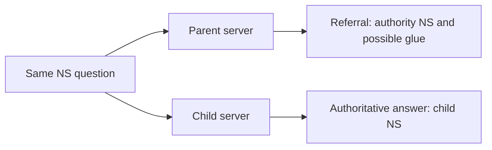

# Read nslookup Debug Output: TTLs, Authority, and Extra Records

Author: [nawazdhandala](https://www.github.com/nawazdhandala)

Tags: DNS, Networking, Troubleshooting

Description: Use a controlled interactive nslookup session to read response sections, record TTLs, and authority flags without mistaking supporting data for the answer.

An ordinary nslookup result tells you an address. Debug output helps explain what question was asked and which records came back. The extra detail becomes useful when you need to distinguish an answer from a referral, an alias from an address, or a cached lifetime from a zone setting.

The trick is to read the output in a consistent order. Start with the selected server and question, then inspect response status and sections, and only then interpret individual records. Otherwise, a perfectly valid address in the additional section can be mistaken for the application endpoint you were investigating.

## Start a session with known settings

This walkthrough uses Windows Server 2025's documented interactive nslookup commands. A BIND 9.18.33 comparison appears later because its output is not identical. Replace `192.0.2.53` with an approved resolver and `app.ops.example.` with your own test name.

Enter the first line in Command Prompt or PowerShell, then the remaining lines at the nslookup prompt:

```text
nslookup - 192.0.2.53
set all
set type=A
set recurse
set debug
app.ops.example.
```

Starting with a numeric resolver address avoids needing to resolve the server's hostname first. `set all` displays the session configuration, including the selected server. Microsoft documents [that inspection command](https://learn.microsoft.com/en-us/windows-server/administration/windows-commands/nslookup-set-all) and [debug mode](https://learn.microsoft.com/en-us/windows-server/administration/windows-commands/nslookup-set-debug).

The explicit type means this is an IPv4-address question. The trailing dot makes the queried name absolute. Recursion is requested so the selected recursive resolver can obtain the answer when it does not already have usable data. These settings describe the test; they do not guarantee that the server permits recursion.

Do not paste the entire interactive transcript into your shell after launching nslookup in a different window. Each `set` line is an nslookup command, not an operating-system configuration change.

## Read the response as a set of sections

Use this order when inspecting the result:

| Part | What to identify | Common misreading |
| --- | --- | --- |
| Server display | Destination used by the tool | Treating its IP as an answer for the application |
| Question | Exact name, class, and type | Assuming the tool asked for the name you intended |
| Header/status | Success or error and response flags | Treating no answer records as proof of NXDOMAIN |
| Answer | Records answering the question, possibly including aliases | Assuming every returned owner name is the original name |
| Authority | Referral or authority-related information | Assuming the section's presence makes the response authoritative |
| Additional | Supporting records supplied with the response | Treating them as the requested answer |

The section layout is defined by [RFC 1035](https://www.rfc-editor.org/rfc/rfc1035.html#section-4.1). The location of a record matters, but it does not replace checking that record's owner name and type.

For example, an MX response may include a mail server's address as supporting information. That address belongs to the mail server, not necessarily to the domain whose MX record you requested. A referral can contain NS records in authority and glue addresses in additional while having no final application answer.

## Use detailed Windows output for header questions

Within the Windows session, enable more verbose output and repeat the question:

```text
set d2
app.ops.example.
```

Microsoft describes [d2 mode](https://learn.microsoft.com/en-us/windows-server/administration/windows-commands/nslookup-set-d2) as displaying all packet fields. Read the response header rather than confusing it with the outgoing query when both are shown.

Useful flags include AA for an authoritative answer, RD for recursion desired, RA for recursion available, and TC for a truncated message. RD records what the query requested; RA describes server capability. Neither proves that fresh recursion occurred for this particular answer. AA is also different from the authority section: a referral can have authority records without being an authoritative answer to the original question.

A truncated response may omit information you need. To request TCP in this session, use:

```text
set vc
app.ops.example.
```

The [virtual-circuit option](https://learn.microsoft.com/en-us/windows-server/administration/windows-commands/nslookup-set-vc) selects TCP transport. Compare the complete response before concluding that an address or glue record is missing. Preserve a TCP failure separately from the earlier UDP result; they test different transport paths.

## Treat TTL as a property of each record

TTL means **time to live**, expressed in seconds. Record the owner, type, value, and TTL together. If the answer contains a CNAME and a final A record, those records can have different lifetimes because they are different record sets.

Repeat the same question after a short interval. A lower TTL is consistent with a cached record aging. An increased TTL can reflect a refresh or another answering cache instance. Neither observation alone establishes the time of the last administrative change.

For illustration, a record returned with 240 seconds remaining might appear with about 210 seconds remaining thirty seconds later. Do not turn that example into a strict expectation across a distributed resolver service. The result depends on which cache answers and whether data was refreshed.

The [DNS query and caching overview](https://learn.microsoft.com/en-us/windows-server/networking/dns/queries-lookups) explains retained records and their lifetimes. An SOA record's TTL and its minimum field also have distinct roles in negative caching; [RFC 2308](https://www.rfc-editor.org/rfc/rfc2308.html) explains how negative-answer lifetimes are determined. Do not use an SOA minimum field as the TTL for every positive record in the zone.

## Compare a referral with an authoritative answer

Use separate fresh sessions for the following two tests so earlier transport and query settings cannot accidentally carry over. Obtain the correct parent and child server addresses from the zone owner first.

For an illustrative parent server:

```text
nslookup - 192.0.2.10
set type=NS
set norecurse
set debug
ops.example.
exit
```

For an illustrative child authority:

```text
nslookup - 192.0.2.54
set type=NS
set norecurse
set debug
ops.example.
exit
```

The parent can return a referral naming the child's servers; the child should answer authoritatively with its own NS records. Compare where the records appear. Applicable glue addresses may accompany the parent referral, as described in [RFC 9471](https://www.rfc-editor.org/rfc/rfc9471.html). Additional data is supporting information, not a substitute for testing the referred server.



`set norecurse` controls the request's recursion flag; it does not transform an arbitrary server into an authority. Microsoft's [recursion option](https://learn.microsoft.com/en-us/windows-server/administration/windows-commands/nslookup-set-recurse) documents this control. Choose the destination according to the zone boundary you are testing.

## Account for implementation differences

BIND's [nslookup manual](https://bind9.readthedocs.io/en/v9.18.33/manpages.html#nslookup-name-server-lookup-utility) documents its interactive settings. Its debug display can show question and record sections without printing Windows-style header detail. In the [tagged BIND source](https://github.com/isc-projects/bind9/blob/v9.18.33/bin/dig/nslookup.c), the non-authoritative label is driven by the AA flag, while debug and d2 control different internal settings.

Do not build an incident conclusion around an exact Windows label appearing on Linux. Preserve the tool version and raw output, then interpret the DNS information that implementation actually exposes. If a required header field is not displayed, obtain suitable packet-level evidence rather than inventing a value from an empty section.

## Leave a reproducible record

Before finishing a session, use `set all` again if settings changed, then `exit`. Save the exact question, server address, timestamp, transport, response status, and relevant record rows. Note whether the result was a referral, an answer, or an error.

That small record makes the investigation repeatable. It also prevents a later comparison from confusing a cached A query through a recursive server with a nonrecursive NS query to an authority. Debug output is most useful when it explains the question you actually asked, not just when it produces more text.
