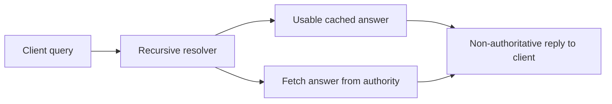

# When nslookup's Non-Authoritative Answer Is Normal

Author: [nawazdhandala](https://www.github.com/nawazdhandala)

Tags: DNS, Networking, Troubleshooting

Description: Understand the non-authoritative answer label, compare recursive and authoritative data, and diagnose old DNS answers without mistaking normal caching for failure.

`nslookup` returns the correct address, but the output begins with “Non-authoritative answer.” That label often looks like a warning. In an ordinary query to a recursive DNS resolver, it is expected. The server answered on behalf of another zone rather than claiming to host that zone's authoritative data.

The label does not establish that the answer is wrong, expired, or even served from a pre-existing cache entry. To investigate stale data, compare the returned record with the intended authoritative data and examine its lifetime. Treat the banner and the freshness question separately.

The commands below use Windows Server 2025's documented `nslookup` options. A separate BIND administrator check is scoped to BIND 9.18.33. Replace the example addresses and names with approved endpoints for your environment.

## Authority describes the responder's role

DNS responses include an Authoritative Answer flag, commonly called `AA`. It indicates that the responding server is authoritative for the name in the question. RFC 1035 defines this flag and notes that aliases can introduce other owner names into the answer section. See the [DNS header definition](https://www.rfc-editor.org/rfc/rfc1035.html#section-4.1.1).

An authoritative server hosts the zone's records. A recursive resolver obtains answers for clients, consulting authorities or other resolvers as necessary. The same server can perform both roles for different names. It might answer authoritatively for an internal zone and non-authoritatively for an unrelated public zone.

Microsoft's [DNS query overview](https://learn.microsoft.com/en-us/windows-server/networking/dns/queries-lookups) describes these resolution steps. A newly fetched answer delivered by a recursive resolver is still not that resolver's authoritative data. Therefore, “non-authoritative” is not a reliable cache-hit indicator.



This diagram shows a resolver that is not authoritative for the requested zone. Both paths can produce the same label. You need additional evidence to distinguish them.

## Establish whether anything is actually wrong

Before changing DNS settings, write down the expected record and the source of that expectation: an approved deployment, a DNS configuration change, or the service owner's current design. If the returned address matches that contract and the application works, the banner alone needs no repair.

If the address is unexpected, query a fixed name and type through the affected resolver:

```bash
nslookup -debug -type=A app.corp.example. 10.20.0.53
```

The trailing dot makes the name absolute, `A` requests an IPv4-address record, and the final argument selects the resolver. Save the timestamp, address set, aliases, TTLs, and response flags. Debug mode and direct-server selection are documented in the [nslookup reference](https://learn.microsoft.com/en-us/windows-server/administration/windows-commands/nslookup).

Use `AAAA` separately when IPv6 is involved. Also retain the exact original application name. Testing an absolute name is a useful control, but it does not reproduce an application's mistaken search suffix.

## Compare with the correct authoritative data

Obtain the authoritative server addresses for the relevant zone and DNS view from its owner. Then ask them directly without requesting recursion:

```bash
nslookup -debug -norecurse -type=A app.corp.example. 10.20.1.10
nslookup -debug -norecurse -type=A app.corp.example. 10.20.1.11
```

These addresses are placeholders for two authorities. Confirm the authoritative-answer indication and compare the full record sets. The [recursion option](https://learn.microsoft.com/en-us/windows-server/administration/windows-commands/nslookup-set-recurse) controls whether the server is asked to resolve through other servers; it does not make an arbitrary server authoritative.

If the authoritative servers disagree, investigate publication or replication before blaming the recursive cache. If they agree but the resolver differs, caching becomes one candidate. A different DNS view or forwarding path can also explain the discrepancy. Microsoft's [DNS server troubleshooting guide](https://learn.microsoft.com/en-us/windows-server/networking/dns/troubleshoot/troubleshoot-dns-server) separates authoritative-data problems from recursive-resolution problems.

Do not compare a private view with a public view and demand identical answers. The intended audience is part of the query context.

## Distinguish old data from expired data

An answer can be older than the latest zone update while still being within its permitted cache lifetime. That is normal caching, even if it is inconvenient during a cutover.

Suppose a resolver cached the old address at 10:00 with a TTL of 1,800 seconds. The authority changes the address at 10:05. At 10:10, the resolver can still return the old address with roughly 1,200 seconds remaining. Lowering the new record's TTL to 60 seconds at 10:05 does not rewrite the earlier cached copy.

This illustrative timeline assumes a single ordinary cache without refresh or policy adjustments:

| Observation | Meaning |
| --- | --- |
| Authorities return the new address | The change is published at those endpoints |
| Resolver returns old address with decreasing TTL | Consistent with a retained earlier answer |
| Resolver returns new address after refresh | The resolver has obtained current data |
| Resolver remains old beyond the expected lifetime | Investigate forwarding, views, refresh failures, and cache policy |

TTL is not a timestamp stating when an administrator last edited the record. Use observed response lifetimes and known change times together. Microsoft's [query and caching explanation](https://learn.microsoft.com/en-us/windows-server/networking/dns/queries-lookups) describes how DNS servers retain records for later queries.

A TTL that increases between probes does not automatically prove a defect. You might reach another cache instance behind the same service address or observe a refresh. Record the resolver context and use server telemetry when the client-side evidence is ambiguous.

## Check whether expired data is deliberately being served

Some resolvers support serve-stale behavior: returning retained data after its normal TTL expires when refresh attempts cannot obtain a usable answer. RFC 8767 defines this resilience mechanism. It is a different situation from an ordinary still-valid cached answer. See [Serving Stale Data to Improve DNS Resiliency](https://datatracker.ietf.org/doc/html/rfc8767).

For an authorized BIND 9.18.33 administrator on a host with `rndc` already configured to reach the intended resolver, this is a read-only status query:

```bash
rndc serve-stale status
```

It reports whether stale-answer caching and serving are enabled, along with relevant lifetime settings. The [BIND rndc manual](https://bind9.readthedocs.io/en/v9.18.33/manpages.html#rndc-name-server-control-utility) documents that status operation. If views are involved, inspect the applicable view rather than assuming a global result describes every request.

Enabled serve-stale support does not prove that a particular response was stale. Correlate the answer with refresh errors, resolver logs, and policy. A small returned TTL by itself is not sufficient evidence. Investigate why the resolver cannot refresh before disabling a feature that may be preventing an outage.

## Repair the layer that holds the wrong result

Keep the investigation narrow. Correct inconsistent authoritative data at its source. Correct an unintended forwarding path or DNS view with its owner. For a valid cached old answer, wait for expiry when practical or use the resolver's approved targeted invalidation procedure when urgency requires it.

Flushing a laptop's cache will not flush the recursive resolver. Microsoft's [DNS client troubleshooting guide](https://learn.microsoft.com/en-us/windows-server/networking/dns/troubleshoot/troubleshoot-dns-client) also notes that `nslookup` does not use the Windows client's DNS cache. A repeated explicit-server query can therefore remain unchanged after a local flush.

Finish with the affected application's real lookup and connection, after the recursive answer is correct. The application may retain its own state. Keep the non-authoritative label if that is the normal resolver path; the repair should establish the intended record and working service, not remove a harmless description of the server's role.
