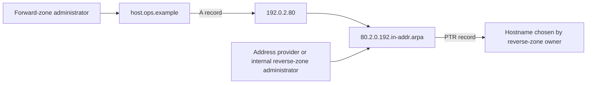

# Why Forward DNS Works but Reverse nslookup Fails

Author: [nawazdhandala](https://www.github.com/nawazdhandala)

Tags: DNS, Networking, Troubleshooting

Description: Trace failed PTR lookups through reverse-zone ownership, delegation, and cached negatives instead of changing an already working forward DNS record.

Your hostname resolves to the intended IP address, but looking up that address returns no hostname. The forward record is not necessarily wrong. Forward and reverse DNS use different records, often in zones managed by different teams or providers.

A forward lookup asks for an address associated with a name. A reverse lookup asks for a PTR record associated with an address-derived DNS name. Publishing the first does not automatically publish the second. The useful investigation is to find the reverse owner and determine whether its record is missing, unreachable, or hidden by an earlier cached response.

## Confirm which address is under investigation

Start with the actual address that matters to the failing workflow. A service can have several A or AAAA records, and a connection can pass through network address translation. The private server address, public service address, and outbound source address may be different.

For the example below, `host.ops.example.` resolves to `192.0.2.80`. Use your own approved name, address, and internal resolver in place of these documentation values:

```bash
nslookup -type=A host.ops.example. 192.0.2.53
nslookup -type=PTR 80.2.0.192.in-addr.arpa. 192.0.2.53
```

The first checks forward data. The second makes the reverse question explicit. For IPv4, reverse the address's four octets and append `in-addr.arpa.`. [RFC 1035](https://www.rfc-editor.org/rfc/rfc1035.html#section-3.5) defines that reverse namespace. Microsoft documents the [PTR query type](https://learn.microsoft.com/en-us/windows-server/administration/windows-commands/nslookup-set-type).

Keep the same resolver for this initial comparison. A forward answer from internal DNS and a reverse failure from a public resolver may simply describe different namespaces and policies.



The two administrators can be the same person, but DNS does not require that. Knowing where the forward zone is hosted does not establish authority to update the reverse zone.

## Make the reverse name accurately

IPv6 reverse names use individual hexadecimal digits, in reverse order, below `ip6.arpa.`. This is defined in [RFC 3596](https://www.rfc-editor.org/rfc/rfc3596.html#section-2.5). Do not reverse the colon-separated groups from a shortened IPv6 address by hand: omitted zeroes still belong in the reverse name.

With Python 3 installed, this local calculation produces the full reverse owner name without making a network request:

```bash
python3 - <<'PY'
import ipaddress
address = ipaddress.ip_address('2001:db8::80')
print(address.reverse_pointer + '.')
PY
```

Replace the example address before using the output in a PTR lookup. Python's [ipaddress reference](https://docs.python.org/3.13/library/ipaddress.html) documents `reverse_pointer` for both address families. Keeping the generated name in the incident notes helps eliminate a malformed query as the cause of the failure.

An IPv4 PTR record does not supply reverse data for an IPv6 address. If both families are operationally required, test both addresses separately.

## Distinguish a missing record from an unanswered query

Save the full PTR result, including response status and the server that answered. Use `-debug` when more record detail is needed:

```bash
nslookup -debug -type=PTR 80.2.0.192.in-addr.arpa. 192.0.2.53
```

The options follow [BIND 9.18.33's nslookup documentation](https://bind9.readthedocs.io/en/v9.18.33/manpages.html#nslookup-name-server-lookup-utility). A timeout does not show that the PTR is absent. It means you did not receive a usable response. SERVFAIL can indicate a failure while resolving the reverse name; REFUSED can indicate the selected server's policy.

NXDOMAIN and a successful answer without a PTR record also differ. The first reports a nonexistent name; the second can report an existing name without the requested record type. Negative answers can be cached, as described in [RFC 2308](https://www.rfc-editor.org/rfc/rfc2308.html). Adding a PTR at the authority therefore does not guarantee that every recursive resolver immediately returns it.

Before editing anything, classify the observed result. Otherwise, a connectivity problem can trigger an unnecessary record change, or a cached negative can be mistaken for a failed update.

## Find the reverse-zone owner

For a public address, begin with the organization that allocated or provides that address: the hosting provider, ISP, or address-management team. It may offer a reverse-DNS setting or delegate a reverse zone to you. For example, AWS exposes reverse-DNS configuration for Elastic IP addresses separately from ordinary hosted-zone records; see its [Elastic IP reverse-DNS guide](https://docs.aws.amazon.com/AWSEC2/latest/UserGuide/Using_Elastic_Addressing_Reverse_DNS.html).

Creating an `in-addr.arpa` zone in an unrelated DNS account does not make public resolvers discover it. The parent reverse namespace must direct queries to the servers that host it, or the address provider must publish the PTR itself.

For private address space, use the internal reverse-zone design. [RFC 6303](https://www.rfc-editor.org/rfc/rfc6303.html) describes locally served reverse zones for private and other special-use ranges. A public resolver is not the authority for your organization's private host inventory. An internal resolver may also answer negatively until the appropriate local reverse zone or forwarding path is configured.

Ask the owner for the exact reverse zone and authoritative endpoints. Do not assume every allocation maps to a conventional `/24` reverse zone.

## Inspect classless delegation when applicable

Small IPv4 allocations can use **classless reverse delegation**, which allows an organization to manage reverse data for fewer than 256 addresses. [RFC 2317](https://www.rfc-editor.org/rfc/rfc2317.html) describes a design using aliases in the parent reverse zone and a separately delegated child.

In such a setup, the original reverse owner may return a CNAME pointing into the delegated zone. Follow the actual target shown in the response. Do not invent a child-zone spelling from the subnet mask: providers can use different naming conventions.

Check both halves with the administrators involved. The parent needs the appropriate alias and delegation; the child needs the PTR at the target name. A correctly populated child zone cannot compensate for a parent alias pointing somewhere else. Likewise, the parent can be correct while the child is missing the record.

For a reverse authority supplied by the owner, this direct query is a useful control:

```bash
nslookup -debug -norecurse -type=PTR 80.2.0.192.in-addr.arpa. 192.0.2.10
```

Here `192.0.2.10` represents that reverse authority. Preserve any CNAME or referral rather than assuming it is the final PTR answer. Query the actual target's authority next if the response crosses a zone boundary.

## Request the repair with enough evidence

Give the responsible owner a precise record request: the address, full reverse owner name, intended hostname, expected visibility, and the observed failure. Include the working forward lookup, but do not present it as proof that the reverse delegation is correct.

If an existing PTR points to a generic provider hostname, confirm whether that is permitted by the service's requirements before replacing it. A reverse lookup does not need to reproduce every application alias that shares an address. Where forward-confirmed reverse DNS is required, check that the returned hostname resolves back to the original address as a separate condition.

After an approved change, verify the authority first and then the original recursive resolver. Account for earlier negative caching, and retest the workflow that needed the reverse name. Keep forward and reverse evidence together so the outcome establishes both the intended address and the reverse mapping that the relevant clients can actually discover.
