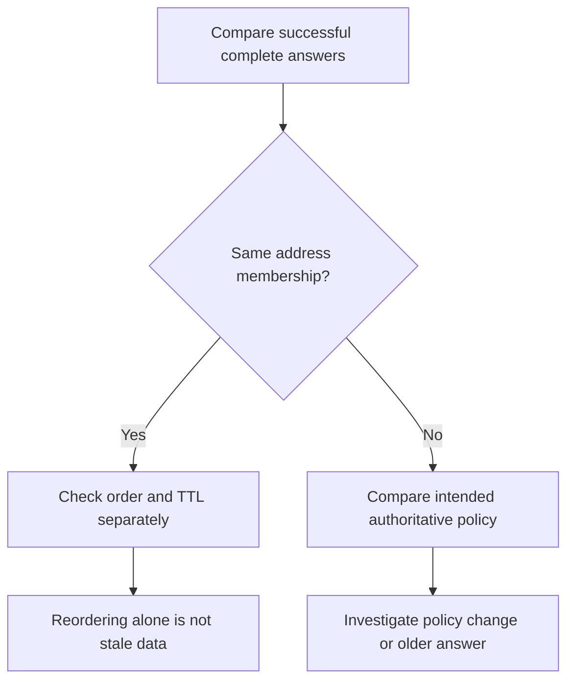

# Separate DNS Round-Robin Answers from Stale Cache with nslookup

Author: [nawazdhandala](https://www.github.com/nawazdhandala)

Tags: DNS, Networking, Troubleshooting

Description: Compare complete DNS address sets, answer order, and TTLs to distinguish normal rotation from old cached records and deliberate traffic-routing policies.

A hostname returns `192.0.2.20` first, then `192.0.2.21` first on the next lookup. Someone reports that DNS is inconsistent. Before flushing caches or removing a record, check whether both responses contain exactly the same addresses in a different order.

Changing order, changing membership, and returning an earlier cached version are three different observations. This guide builds a small evidence set that separates them. It uses read-only nslookup queries; it does not require changing DNS settings or clearing a shared resolver's cache.

## Compare sets before comparing positions

A resource record set, usually shortened to **RRset**, groups records with the same name, type, and class. For an ordinary IPv4 lookup, that might be the two A records for `web.ops.example.`. Their membership matters independently of how a tool prints them. [RFC 2181, section 5](https://www.rfc-editor.org/rfc/rfc2181.html#section-5) defines this grouping and its TTL consistency requirements.

Consider these illustrative responses, all for the same name and type:

| Sample | Addresses in displayed order | What changed? |
| --- | --- | --- |
| 1 | 192.0.2.20, 192.0.2.21 | Initial observation |
| 2 | 192.0.2.21, 192.0.2.20 | Order only |
| 3 | 192.0.2.20, 192.0.2.22 | Membership |
| 4 | 192.0.2.20 | Membership, or possibly an incomplete response |

Samples 1 and 2 are consistent with answer reordering. They do not demonstrate stale cache. Samples 3 and 4 need more context: a deployment, a routing policy, another DNS view, or a response problem could explain them.

BIND 9.18.33 supports random and cyclic RRset ordering. Its `cyclic` setting rotates records between queries, while random ordering need not follow a predictable sequence. See the [rrset-order reference](https://bind9.readthedocs.io/en/v9.18.33/reference.html#namedconf-statement-rrset-order). Observing two reversed answers cannot tell you which ordering algorithm produced them.

## Capture a small controlled sample

Choose one approved resolver, one exact hostname, and one record type. Replace the documentation address `192.0.2.53` and example name below with your own. The Bash loop requires nslookup and standard `date` and `sleep` utilities. It performs six queries, ten seconds apart:

```bash
resolver='192.0.2.53'
name='web.ops.example.'
for attempt in 1 2 3 4 5 6; do
  date -u '+%Y-%m-%dT%H:%M:%SZ'
  nslookup -debug -type=A "$name" "$resolver"
  if [ "$attempt" -lt 6 ]; then
    sleep 10
  fi
done
```

Save the full output in your incident notes. Each lookup should identify the chosen server and show the DNS question and answer details. The final dot keeps the name absolute. BIND syntax is documented in the [9.18.33 nslookup manual](https://bind9.readthedocs.io/en/v9.18.33/manpages.html#nslookup-name-server-lookup-utility).

On Windows, run the individual `nslookup -debug -type=A web.ops.example. 192.0.2.53` command several times and record timestamps separately; the Bash loop is not PowerShell syntax. Microsoft documents [debug mode](https://learn.microsoft.com/en-us/windows-server/administration/windows-commands/nslookup-set-debug) for inspecting the request and response.

Do not extract every line containing “Address” into a comparison list. The output also identifies the resolver itself. Debug output can contain aliases and additional records that are not members of the requested A RRset. Read the owner name and record type before recording an address.

For IPv6, repeat the experiment separately with `-type=AAAA`. Mixing IPv4 and IPv6 observations makes a family preference look like an address-set change.

## Record membership, TTL, and response completeness

For each sample, keep the displayed order in one column and a sorted, unique list of addresses in another. Sorting is an analysis step; it does not imply that clients will use addresses in sorted order. Also record the TTL, response status, alias chain, and any truncation indication.

TTL means **time to live**: how long the record may be retained under normal caching rules. A decreasing TTL is consistent with a cached copy aging. It is not a record revision number. Two identical sets with different TTLs may simply have been cached at different times.

If a response is truncated, obtain a complete response before treating a missing address as a membership change. A DNS error is also not an empty valid address set. Keep failures in the record rather than silently excluding them from the sample.



For a small incident, a handwritten table is often clearer than a parser tied to one operating system's nslookup formatting. Six samples are enough to reveal some patterns, but not enough to prove every possible answer or estimate traffic distribution.

## Check what the authority intends to publish

Obtain the authoritative server addresses and the relevant DNS view from the service owner. Query those endpoints directly without requesting recursion:

```bash
nslookup -debug -norecurse -type=A web.ops.example. 192.0.2.10
nslookup -debug -norecurse -type=A web.ops.example. 192.0.2.11
```

These addresses represent two authorities for the zone. Verify that the response is authoritative for the requested name; a referral is not the final answer. If the name is an alias, preserve its CNAME target and investigate that target's authority too.

A static zone that publishes both `.20` and `.21` supports the interpretation that their changing order is harmless. If all applicable authorities now publish `.20` and `.22`, a recursive answer retaining `.21` may be an earlier version. You still need the old lifetime and change time before calling it expired.

Dynamic DNS services can intentionally change membership. For example, Route 53 multivalue routing can return selected address sets and optionally use health checks. Its behavior includes returning unhealthy records when all candidates are unhealthy, so it is not a guarantee that every returned endpoint is working. Check the actual [routing policy](https://docs.aws.amazon.com/Route53/latest/DeveloperGuide/routing-policy-multivalue.html) instead of treating a single authoritative sample as a permanent list.

## Decide whether the older result is actually stale

Suppose the resolver cached `{.20, .21}` with a TTL of 300 seconds at 12:00. The authority replaces `.21` at 12:01. At 12:02, the resolver can still return the previous set with about 180 seconds remaining. Reordering that set does not change its age or membership.

If the old member persists beyond the expected cache lifetime, investigate refresh failures, forwarding paths, different views, and resolver policy. [RFC 8767](https://www.rfc-editor.org/rfc/rfc8767.html) describes deliberate serving of expired data to preserve availability when fresh answers cannot be obtained. A low TTL alone does not prove that mechanism was used.

Also remember that one resolver IP can represent multiple service instances. Anycast, described in [RFC 4786](https://www.rfc-editor.org/rfc/rfc4786.html), can route requests to different nodes. A TTL that jumps upward is therefore not sufficient evidence that one cache is malfunctioning. Use resolver-side evidence when the client observations cannot distinguish refresh from a different answering instance.

## Close the incident with the right conclusion

If only order changes and membership matches the intended policy, leave the records alone. If an old member remains within its original lifetime, plan around that remaining lifetime. If membership violates the intended policy after refresh, give the DNS owner the timestamps, complete sets, authority observations, and resolver address.

Finally, test the affected application through its normal connection path. DNS address rotation does not prove equal request distribution or application health: connection reuse and client address selection influence where traffic goes. The useful outcome is an explained set of DNS answers and a working service, not an identical first address on every lookup.
