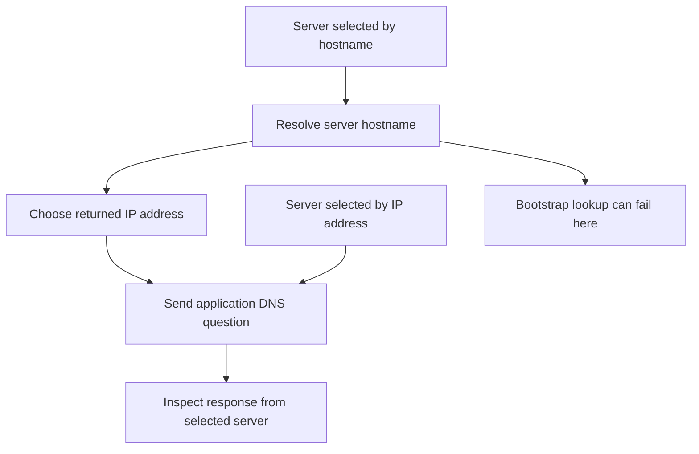

# Why nslookup Reaches a DNS Server by IP but Not by Name

Author: [nawazdhandala](https://www.github.com/nawazdhandala)

Tags: DNS, Networking, Troubleshooting

Description: Separate DNS server name resolution from server reachability, then check address records and delegation glue without changing working DNS settings.

You can query a DNS server at its IP address, but the same command fails when you substitute its hostname. That does not automatically mean the server is unhealthy. Before nslookup can send a question to a named server, it needs an address for that server. This preliminary lookup can fail even when the destination answers perfectly well.

There are two different bootstrap problems to distinguish: your computer finding the selected DNS server, and a recursive resolver finding an authoritative server through a delegation. Glue records solve the second problem in particular circumstances. They are not a universal repair for the first.

## Separate the two questions

Suppose your approved internal DNS server is `dns1.ops.example.` at `192.0.2.53`, and you want its answer for `app.ops.example.`. These are documentation names and addresses: replace them with your own authorized test targets before running anything.

```bash
nslookup -type=A app.ops.example. 192.0.2.53
nslookup -type=A app.ops.example. dns1.ops.example.
```

The first command provides the destination directly. The second needs to turn `dns1.ops.example.` into an address before sending the application query. Keep the application name and record type identical so you change only server selection. The trailing dots make the names absolute rather than candidates for suffix expansion.

These examples use syntax documented for Windows Server 2025 and BIND 9.18.33. See Microsoft's [nslookup reference](https://learn.microsoft.com/en-us/windows-server/administration/windows-commands/nslookup) and the [BIND manual](https://bind9.readthedocs.io/en/v9.18.33/manpages.html#nslookup-name-server-lookup-utility). Resolver selection details differ between implementations; record the command, operating system, and displayed server address rather than assuming an identical lookup path everywhere.



A successful first command proves that this address answered this question from this network at this time. It does not prove that the server hostname has correct records, that every returned address works, or that other clients use the same DNS view.

## Inspect the server's forward records

Use an independently known, approved resolver address to ask about the server hostname. In this example, `192.0.2.54` is that comparison resolver; it is not a recommendation to send private names to a public service.

```bash
nslookup -type=A dns1.ops.example. 192.0.2.54
nslookup -type=AAAA dns1.ops.example. 192.0.2.54
```

An A record supplies an IPv4 address; an AAAA record supplies an IPv6 address. Compare every returned address with the service inventory. A stale A record can send the named-server command to yesterday's machine. An unreachable AAAA address can expose an IPv6 path problem. Do not assume which address a particular implementation tries first.

Query the application directly against each returned address. If one works and another fails, investigate the failing destination and its route, listening service, and access policy. If none of the returned addresses is the working `192.0.2.53`, investigate the hostname's records and the DNS view that supplied them.

If the comparison resolver returns NXDOMAIN, the name is absent in that response's view. A timeout means no usable reply arrived; it does not establish that a record is missing. If querying `dns1.ops.example.` directly at `192.0.2.53` works while the comparison resolver cannot resolve it, the record may exist but be inaccessible through the client's normal resolution path. Look for missing internal forwarding or delegation before creating a duplicate record elsewhere.

A PTR record maps an address back to a name. Fixing a missing PTR may improve a server label in diagnostic output, but it does not create the forward A or AAAA record needed to select a server by hostname. DNS separates these record types, as explained in [RFC 1034](https://www.rfc-editor.org/rfc/rfc1034.html).

## Control Windows interactive server selection

Interactive nslookup can make the bootstrap dependency especially visible. On Windows, `server` resolves the new server through the current default server; `lserver` uses the initial server. Microsoft documents those distinct paths in [server](https://learn.microsoft.com/en-us/windows-server/administration/windows-commands/nslookup-server) and [lserver](https://learn.microsoft.com/en-us/windows-server/administration/windows-commands/nslookup-lserver).

Start a fresh Windows session with the known comparison resolver:

```text
nslookup - 192.0.2.54
set type=A
server dns1.ops.example.
app.ops.example.
exit
```

These are interactive input lines, not a script to paste into every shell. After `server`, inspect the reported server address before continuing. If server selection fails, stop and preserve the error; a subsequent application lookup might still use the previous server.

To remove the name dependency in a separate session, use `server 192.0.2.53`. This is a diagnostic selection inside nslookup, not a change to the computer's DNS configuration. The goal is to identify which resolver cannot supply the destination address, not to permanently bypass your organization's resolver policy.

## Recognize when glue is actually involved

A delegation tells a resolver which servers handle a child zone. Imagine the parent `example.` delegates `ops.example.` to `ns1.ops.example.`. The resolver needs the address of `ns1.ops.example.`, but that address belongs inside the very zone it is trying to reach.

The parent can include address records called **glue** with the referral, breaking that circular dependency. [RFC 9471](https://www.rfc-editor.org/rfc/rfc9471.html) describes in-domain glue and requires available glue to accompany these referrals; when size limits prevent inclusion, the response must indicate truncation.

This is different from a laptop failing to resolve the name of its chosen recursive resolver. A missing internal A record, wrong suffix, or wrong DNS view does not become a glue problem just because the machine is a DNS server.

For an authorized delegation investigation, obtain a parent authoritative server's address from your DNS inventory. With BIND nslookup, inspect its referral without requesting recursion:

```bash
nslookup -debug -norecurse -type=NS ops.example. 192.0.2.10
```

Here `192.0.2.10` represents the parent server, not the child server or a recursive cache. Inspect the authority and additional sections. The expected referral identifies the child nameservers, with applicable glue addresses in the additional section. A cached NS answer from an arbitrary recursive resolver is not equivalent evidence about the parent's delegation.

If the nameserver is outside the child zone, absence of its address in that response is not by itself proof of broken glue. Follow its separate address-resolution path. If a response is truncated, obtain the complete response before declaring records missing.

## Repair the layer the evidence identifies

| Finding | Appropriate next step |
| --- | --- |
| Server name returns the wrong address | Correct the authoritative forward record in the intended view |
| Correct address fails only from one network | Inspect routing, filtering, and listener reachability |
| Only one internal resolver cannot find the name | Review its forwarding, delegation, and cached response |
| Parent refers to an in-domain server with missing or stale glue | Coordinate the parent delegation update with its administrator or registrar |
| Parent glue and child address records disagree | Reconcile both copies with the intended server endpoints |

After the approved correction, repeat the same name-based and address-based queries from the original client network. Account for cached answers and their remaining lifetimes. Keep the chosen server address, returned records, and response status with the incident notes. A successful retry should demonstrate that the intended server was reached, not merely that some resolver returned an answer.
