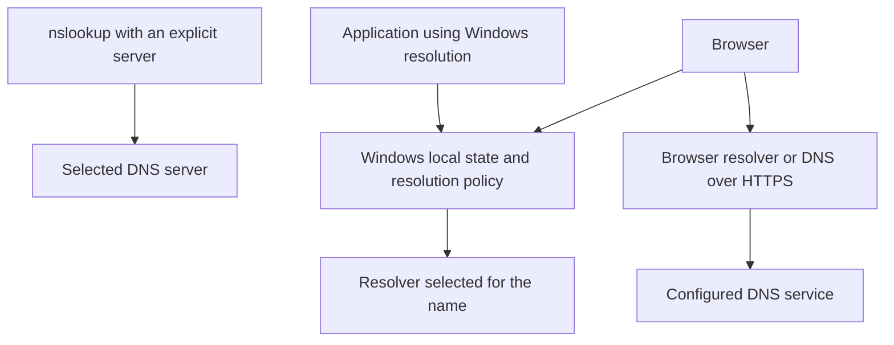

# Why nslookup Works While Browsers and ping Fail on Windows

Author: [nawazdhandala](https://www.github.com/nawazdhandala)

Tags: DNS, Networking, Troubleshooting

Description: Compare direct DNS queries with Windows resolution, cached records, VPN policies, and browser DNS settings to find why applications still cannot resolve a name.

A successful `nslookup` proves that a particular DNS query received an answer. It does not prove that every program on the computer will obtain that same answer. Windows may have a local override, a cached failure, or a rule directing a domain through a VPN. A browser can add another resolver path.

The useful question is therefore: where do the two paths first disagree? Work from a direct server query toward the failing application, preserving the evidence before clearing caches or changing policy. The PowerShell examples below follow the Windows Server 2025 DnsClient documentation; the browser discussion uses documented Microsoft Edge policies. They are source-verified examples, not results from a live Windows incident.

## Establish whether name resolution actually failed

Start with the exact error. If `ping` prints an IP address and then reports that requests timed out, it already resolved the name. Its Internet Control Message Protocol (ICMP) probes may be blocked, or the destination may be unavailable. That is a different problem from “could not find host.” Microsoft's [ping reference](https://learn.microsoft.com/en-us/windows-server/administration/windows-commands/ping) describes its connectivity test and IPv4/IPv6 selection.

Similarly, a browser certificate error, HTTP error, and DNS error are different stages of loading a page. Record the URL, error text, VPN state, and time. Do not replace a hostname with an IP address and treat a certificate mismatch as a DNS diagnosis.

For the remaining steps, use a known internal name and an approved DNS server. Replace `app.corp.example.` and `10.20.0.53` throughout. The trailing dot makes the diagnostic DNS name absolute; compare it with the exact name originally entered if the original was a short name.

## Understand the separate paths

The diagram shows diagnostic paths, not a promise that every browser or Windows version follows an identical internal sequence:



`nslookup` does not use the Windows client's DNS cache, as Microsoft's [DNS client troubleshooting guide](https://learn.microsoft.com/en-us/windows-server/networking/dns/troubleshoot/troubleshoot-dns-client) explains. A direct query is a useful reference precisely because it removes some of the application's local behavior from the test.

Do not make it the only acceptance test. The application still needs its own resolution path to work.

## Compare the direct answer with Windows resolution

Run these in PowerShell:

```powershell
nslookup -type=A app.corp.example. 10.20.0.53
Resolve-DnsName -Name app.corp.example. -Type A
```

The first asks the chosen server for an IPv4 address. The second performs a name-resolution query with the cmdlet's default behavior and no forced server. Record both results, including errors. Repeat with record type `AAAA` when investigating IPv6; an IPv4 answer alone does not establish what a dual-stack application received.

For a more controlled comparison, use:

```powershell
Resolve-DnsName -Name app.corp.example. -Type A -DnsOnly -NoHostsFile
Resolve-DnsName -Name app.corp.example. -Type A -DnsOnly -NoHostsFile -Server 10.20.0.53
```

`-DnsOnly` excludes LLMNR and NetBIOS fallback, two other name-resolution mechanisms. `-NoHostsFile` excludes the local Hosts file; `-Server` specifies the query destination. None of these switches means “erase all cached state.” The [Resolve-DnsName reference](https://learn.microsoft.com/en-us/powershell/module/dnsclient/resolve-dnsname?view=windowsserver2025-ps) documents these controls. Change one variable at a time and retain the ordinary lookup as your application-side comparison.

## Inspect local state before removing it

Read the local DNS cache:

```powershell
Get-DnsClientCache
Resolve-DnsName -Name app.corp.example. -Type A -CacheOnly
Get-Content -LiteralPath "$env:SystemRoot\System32\drivers\etc\hosts"
```

The first command displays cached entries. The second asks only the local cache for the specific record; a cache miss is not proof that the authoritative record is absent. The third reads the Hosts file without modifying it. These outputs can contain internal infrastructure names, so keep them in the appropriate incident record.

Look for an old address, a cached negative answer, or an intentional override whose purpose has been forgotten. Microsoft documents [Get-DnsClientCache](https://learn.microsoft.com/en-us/powershell/module/dnsclient/get-dnsclientcache?view=windowsserver2025-ps), and its [client troubleshooting examples](https://learn.microsoft.com/en-us/troubleshoot/windows-client/networking/troubleshoot-dns-client-resolution-issues) demonstrate how a Hosts entry can answer a lookup without a DNS packet being sent.

After saving the evidence and correcting any underlying configuration problem, an administrator can deliberately clear the local cache:

```powershell
Clear-DnsClientCache
```

This affects the computer's client cache, not the DNS server's cache or a browser's independent state. It also does not remove a Hosts override. The [cmdlet documentation](https://learn.microsoft.com/en-us/powershell/module/dnsclient/clear-dnsclientcache?view=windowsserver2025-ps) describes the local scope. Immediately repeat the ordinary lookup and application test; do not report a cache flush itself as the fix.

## Check the policy for the affected domain

The Name Resolution Policy Table, or NRPT, holds rules for particular namespaces. A namespace can be a DNS suffix such as `.corp.example`. A VPN may use such a rule to direct matching questions to an internal server.

Inspect effective policy and interface DNS configuration with the NRPT cmdlet and [Get-DnsClientServerAddress](https://learn.microsoft.com/en-us/powershell/module/dnsclient/get-dnsclientserveraddress?view=windowsserver2025-ps):

```powershell
Get-DnsClientNrptPolicy -Effective
Get-DnsClientServerAddress
```

Compare the affected name against the effective namespaces, server addresses, and security requirements. The [NRPT cmdlet](https://learn.microsoft.com/en-us/powershell/module/dnsclient/get-dnsclientnrptpolicy?view=windowsserver2025-ps) reports the policy currently in effect. Microsoft's [VPN name-resolution guide](https://learn.microsoft.com/en-us/windows/security/operating-system-security/network-security/vpn/vpn-name-resolution) explains namespace-specific behavior.

An interface's general DNS list is therefore not the whole picture. An explicit `nslookup` query to a healthy server can succeed while Windows directs the same domain through a different, unreachable VPN resolver. Microsoft specifically recommends `Resolve-DnsName` when checking NRPT because `nslookup` does not use the Windows DNS API involved in these rules. See the [VPNv2 configuration reference](https://learn.microsoft.com/en-us/windows/client-management/mdm/vpnv2-csp).

Repair the matching rule or its network path through the policy owner. Removing all NRPT rules would erase intended routing and conceal the original fault.

## Inspect the browser's DNS choices

DNS over HTTPS, abbreviated DoH, sends DNS exchanges through HTTPS. Browser DoH settings and Windows DoH settings are separate configuration surfaces. Do not infer browser behavior from a successful PowerShell query.

For managed Edge, inspect `edge://policy` and the browser's secure-DNS settings. Microsoft's [Edge configuration guide](https://learn.microsoft.com/en-us/deployedge/configure-microsoft-edge) explains checking applied policies. Pay particular attention to `DnsOverHttpsMode`:

| Mode | Documented behavior |
| --- | --- |
| `off` | DoH is disabled |
| `automatic` | Uses DoH when available and permits fallback on error |
| `secure` | Uses DoH and fails resolution on error rather than falling back |

These meanings come from the [Edge DoH policy](https://learn.microsoft.com/en-us/deployedge/microsoft-edge-policies/DnsOverHttpsMode). A private name sent to a service that lacks the internal DNS view can fail even though the corporate resolver knows it.

Do not confuse `BuiltInDnsClientEnabled` with selecting a new DNS server or turning DoH on. Microsoft documents it as choosing the resolver software stack; Edge always uses its built-in resolver for DoH. See the [built-in DNS client policy](https://learn.microsoft.com/en-us/deployedge/microsoft-edge-policies/BuiltInDnsClientEnabled). Record the actual applied policies instead of relying on assumed browser defaults.

## Verify the repaired path

Use the disagreement to choose the owner: local overrides and cache for endpoint support, namespace rules for the VPN team, browser policies for browser management, or inconsistent answers for DNS operations. Avoid changing all four at once.

Retest the same name with ordinary Windows resolution and the original application. Confirm both relevant address families and the VPN state that triggered the failure. Keep the direct-server result as a reference. The repair is complete when the application obtains the intended answer through its intended policy and reaches the service, not merely when `nslookup` prints an address.
