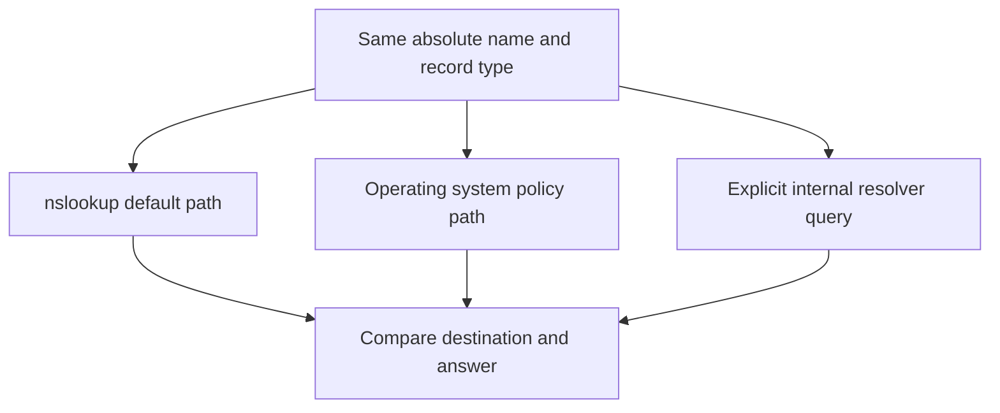

# Why nslookup Uses an Unexpected DNS Server on a VPN

Author: [nawazdhandala](https://www.github.com/nawazdhandala)

Tags: DNS, Networking, VPN, Troubleshooting

Description: Inspect adapter metrics, Windows name-resolution policy, and Linux per-link DNS routing to explain unexpected nslookup servers without guessing at fixes.

You connect a VPN, run nslookup, and see the home router instead of the company DNS server. Or Linux reports `127.0.0.53`, which is not any DNS server listed in the VPN profile. Neither observation, on its own, proves that application lookups are going to the wrong place.

The displayed server is the destination used by that particular lookup. It might be a local forwarding service, and the tool might use a different path from applications. The investigation needs three separate facts: which DNS server answered, which name-resolution policy applies, and whether the network can reach the intended resolver.

This guide uses Windows Server 2025 PowerShell references and Linux systems running systemd 257. Linux distributions without systemd-resolved need their own resolver-specific inspection. Replace example names, addresses, and interface names with approved values from your environment.

## Establish the expected result first

Write down which namespace the VPN is supposed to handle. For example, `corp.example.` might use company DNS while unrelated names use the ordinary network. That is **split DNS**: resolver selection depends on the name. It is different from deciding which interface carries ordinary IP traffic.

Use a fully qualified test name ending in a dot, such as `app.corp.example.`. This removes suffix expansion from the first comparison. If the real failure concerns a short name, preserve that original input for a second test after the absolute-name behavior is understood.

Record VPN state, time, interface, and returned addresses. Do not send internal names to a public resolver as a casual control. Choose a test name and destinations that your network policy permits.

## Compare automatic and explicit selection

Run these read-only lookups:

```text
nslookup -type=A app.corp.example.
nslookup -type=A app.corp.example. 192.0.2.53
```

The first uses the tool's default selection. The second explicitly selects the intended internal resolver, represented here by a documentation IP. Preserve both server-address lines and both answers. The [nslookup reference](https://learn.microsoft.com/en-us/windows-server/administration/windows-commands/nslookup) documents explicit server selection.

If the explicit query works, you have demonstrated reachability and an answer for that question. You have not repaired automatic selection. If it times out, inspect the VPN route and resolver access policy before changing priorities. Choosing a resolver and reaching that resolver are separate problems.



The three paths are controls for one another. A difference is useful evidence; it is not a reason to assume one tool's behavior describes every application.

## Inspect Windows adapters and metrics

On Windows, run these commands in PowerShell. They inspect configuration without changing it:

```powershell
Get-DnsClientServerAddress
Get-NetIPInterface
Get-DnsClientNrptPolicy -Effective
```

The first lists DNS addresses by interface. Match interface indexes and aliases with the second command's connection state, address family, and interface metric. A metric is a preference value used in interface and route selection; do not confuse it with the DNS server's response time. Check both IPv4 and IPv6 entries rather than assuming the VPN has identical settings for each family.

The official [DNS server address](https://learn.microsoft.com/en-us/powershell/module/dnsclient/get-dnsclientserveraddress?view=windowsserver2025-ps) and [IP interface](https://learn.microsoft.com/en-us/powershell/module/nettcpip/get-netipinterface?view=windowsserver2025-ps) references explain these inspection commands.

The third command displays the effective **Name Resolution Policy Table**, or NRPT. This table can associate particular namespaces with DNS handling rules. Inspect the matching namespace and its nameservers, not merely whether the output contains a VPN-related entry. The [-Effective option](https://learn.microsoft.com/en-us/powershell/module/dnsclient/get-dnsclientnrptpolicy?view=windowsserver2025-ps) helps examine the policy that applies.

Microsoft's [VPN name-resolution documentation](https://learn.microsoft.com/en-us/windows/security/operating-system-security/network-security/vpn/vpn-name-resolution) describes policy matching before interface-preference fallback. Consequently, lowering an adapter metric is not a general substitute for a correct namespace rule. It can also affect more traffic than the failing DNS lookup.

## Test the Windows policy path separately

Microsoft explicitly notes that nslookup does not use the Windows DNS API for NRPT testing and recommends Resolve-DnsName for that purpose in the [VPNv2 documentation](https://learn.microsoft.com/en-us/windows/client-management/mdm/vpnv2-csp).

Use this comparison without an explicit server:

```powershell
Resolve-DnsName -Name 'app.corp.example.' -Type A -DnsOnly -NoHostsFile
```

`-DnsOnly` excludes LLMNR and NetBIOS queries; `-NoHostsFile` excludes the Hosts file. These switches do not promise an empty DNS cache or prove that every application follows this path. See the [cmdlet reference](https://learn.microsoft.com/en-us/powershell/module/dnsclient/resolve-dnsname?view=windowsserver2025-ps).

If this lookup works while default nslookup uses an unsuitable resolver, you may have a diagnostic-path difference rather than a broken VPN namespace policy. If both fail but explicit internal DNS succeeds, compare the effective rule with the exact queried suffix and the connected VPN profile. Retest the affected application as a separate final step.

## Inspect Linux's local stub and per-link rules

On a systemd 257 host using systemd-resolved, inspect the current state:

```bash
resolvectl status
cat /etc/resolv.conf
resolvectl query --type=A app.corp.example.
```

The [resolvectl manual](https://www.freedesktop.org/software/systemd/man/257/resolvectl.html) documents status and typed queries. Look for the VPN link's DNS servers, routing domains, and default-route setting. The query output can identify the interface through which data was discovered. Keep that evidence alongside the default nslookup result.

`127.0.0.53` is systemd-resolved's local DNS stub, not the final upstream server. A conventional DNS tool can query the stub and let it apply routing rules. If `/etc/resolv.conf` instead exposes upstream addresses directly, tools reading that file can bypass that path; a flat server list cannot represent all per-link routing decisions.

For queries handled by systemd-resolved, the longest matching routing domain determines the applicable links. A route-only domain such as `~corp.example` directs matching queries without adding a search suffix. `~.` matches the DNS root and can cover otherwise unmatched names. Equal best matches may involve multiple links. These rules and resolver-file modes are described in the [systemd 257 service manual](https://www.freedesktop.org/software/systemd/man/257/systemd-resolved.service.html).

Do not overwrite `/etc/resolv.conf` merely to change the displayed address. First identify whether the VPN client, NetworkManager, systemd-networkd, or another configuration owner manages it. Otherwise, a manual edit can remove split DNS or disappear at the next connection.

## Repair the configuration owner, then repeat the comparison

| Observation | Likely investigation |
| --- | --- |
| Explicit internal query fails | VPN reachability, route, DNS listener, or access restrictions |
| Windows policy lookup works, nslookup differs | Tool path versus NRPT expectations |
| VPN adapter has no intended DNS addresses | Profile delivery or connection configuration |
| Linux stub query uses the wrong link | Routing-domain match and default-route settings |
| Linux direct lookup works but local policy fails | Per-link configuration and resolver integration |

These are investigation directions, not automatic diagnoses. Keep other factors, including cached responses and multiple active VPNs, in view. Compare configuration before and after a controlled reconnect when policy permits, since reconnecting can reveal a profile that was never applied or an old setting that remains active.

Make the correction in the managed VPN or network configuration, with the intended namespace behavior documented. Then repeat the default, policy-aware, and explicit-server tests from the same network. Confirm both the internal application and an approved unrelated lookup still behave as intended. Success means the correct resolution policy survives reconnects, not merely that nslookup prints a more familiar server address.
