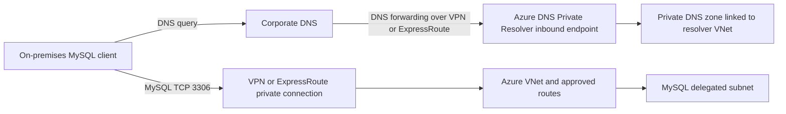

# Connect On-Premises Clients to Private Azure MySQL

Author: [nawazdhandala](https://www.github.com/nawazdhandala)

Tags: Azure, MySQL, Networking

Description: Connect an on-premises client to VNet-integrated Azure MySQL by validating VPN or ExpressRoute routes, hybrid DNS forwarding, and verified database login.

A working VPN tunnel does not automatically make a private Azure database usable. The client still needs a route to the database, a return route, and a way to resolve the database's private name. DNS queries and database connections may traverse different network devices, so each needs its own evidence.

This guide covers **Azure Database for MySQL Flexible Server deployed with private access through VNet integration**. The database occupies a delegated subnet in an Azure virtual network. It is distinct from MySQL Private Link, which uses a private endpoint. Microsoft's [MySQL private-networking guide](https://learn.microsoft.com/en-us/azure/mysql/flexible-server/concepts-networking-vnet) describes on-premises access through VPN or ExpressRoute and the DNS forwarding requirement.

The walkthrough assumes the gateway connection already exists. It helps you prove that an approved on-premises client can use it, without opening a public database endpoint as a workaround.

## Inventory the two paths

Record the database's full hostname, the actual private DNS zone associated with it, the delegated database subnet, and the on-premises client subnet. Also identify the DNS resolver used by that client and the Azure resolver or forwarder that should answer private-zone queries.



The DNS resolver and database can reside in different subnets. This is normal; each destination needs reachable routing and appropriate network rules.

Use the recorded resource identifiers when comparing configuration. Similar names across subscriptions or environments can lead to a perfectly healthy connection to the wrong network.

## Validate routes in both directions

For a site-to-site VPN, verify the tunnel and the configured or learned address prefixes on both sides. Overlapping address spaces need a deliberate network design; simply adding another route does not make two identically addressed networks unambiguous. Azure's [VPN Gateway configuration guide](https://learn.microsoft.com/en-us/azure/vpn-gateway/vpn-gateway-about-vpn-gateway-settings) explains its address-space requirements.

For ExpressRoute, confirm you are using the appropriate Azure private peering and that the required prefixes are exchanged. A circuit's provisioning status alone does not establish that the database subnet is reachable. See [ExpressRoute routing requirements](https://learn.microsoft.com/en-us/azure/expressroute/expressroute-routing).

If the database is in a spoke VNet behind a hub gateway, inspect the peering and gateway-transit configuration. Ordinary peering is not a substitute for the required transit settings. Microsoft's [VPN gateway transit guide](https://learn.microsoft.com/en-us/azure/vpn-gateway/vpn-gateway-peering-gateway-transit) describes that arrangement.

Finally, trace the return route toward the client's real source prefix. A firewall appliance on one direction and a different return route can make a connection fail even when the destination is reachable. Review subnet route tables and network controls along the selected path; Azure documents route selection in its [routing overview](https://learn.microsoft.com/en-us/azure/virtual-network/virtual-networks-udr-overview).

## Give corporate DNS a private answer

Linking a private zone to an Azure VNet does not publish its records to your corporate DNS servers. Provide a forwarding path for the relevant namespace.

One supported design uses **Azure DNS Private Resolver** with an inbound endpoint. Corporate DNS forwards the intended Azure namespace to that endpoint's private address. The resolver's VNet must have the necessary private-zone link. An outbound resolver endpoint serves the opposite direction, where Azure needs to resolve names through another DNS server; it is not the address to configure as an on-premises forwarding target. See [Private Resolver endpoints](https://learn.microsoft.com/en-us/azure/dns/private-resolver-endpoints-rulesets).

A managed resolver is not the only option. An Azure-hosted DNS forwarder can forward queries to Azure-provided DNS. The important boundary is that the Azure-side resolver has the correct private-zone visibility. Do not treat `168.63.129.16` as an ordinary DNS server to configure directly on an on-premises laptop. Microsoft's [virtual-network name-resolution guide](https://learn.microsoft.com/en-us/azure/virtual-network/virtual-networks-name-resolution-for-vms-and-role-instances) describes the Azure-hosted forwarding arrangement.

Avoid guessing the zone from a Private Link tutorial. This article concerns a VNet-integrated database, so inspect its actual zone and the aliases involved in resolving its normal server hostname. Microsoft's [hybrid DNS guide](https://learn.microsoft.com/en-us/azure/dns/private-resolver-hybrid-dns) provides the broader forwarding pattern.

Permit the required DNS traffic between the approved resolver systems, including UDP and TCP 53 where required by the design. Scope database access separately to the approved client sources and TCP 3306.

## Test the resolver chain from Windows

The following read-only examples use the Windows DnsClient and NetTCPIP PowerShell modules documented for Windows Server 2025. Replace the server name and the example resolver addresses with your real configuration:

```powershell
$dbName = 'SERVER_NAME.mysql.database.azure.com'
$corporateDns = '10.10.0.53'
$azureResolver = '10.20.0.4'

Resolve-DnsName -Name $dbName -Server $corporateDns -Type A -DnsOnly
Resolve-DnsName -Name $dbName -Server $azureResolver -Type A -DnsOnly
```

Both queries should ultimately identify the intended private database address. The second is a diagnostic comparison, not an instruction to change the workstation's DNS settings. It also requires that policy permit this client to query the Azure resolver directly. If direct queries are intentionally blocked, run that comparison from an authorized DNS diagnostic host instead.

If the Azure resolver succeeds but corporate DNS fails, inspect the corporate forwarding rule and the path from the corporate DNS server. If both fail, inspect resolver reachability and Azure zone visibility. The [Resolve-DnsName reference](https://learn.microsoft.com/en-us/powershell/module/dnsclient/resolve-dnsname?view=windowsserver2025-ps) documents the explicit resolver argument.

## Inspect the client route and database port

After resolving the name, copy its observed private address into this diagnostic command. The example address is only a placeholder:

```powershell
Find-NetRoute -RemoteIPAddress '10.30.1.4'
Test-NetConnection -ComputerName $dbName -Port 3306 -InformationLevel Detailed
```

`Find-NetRoute` reports the local source and route selected for that destination. It cannot show every route taken after the packet leaves the workstation. `Test-NetConnection` reports the selected remote address and whether the TCP connection succeeded. These commands are documented in the [route reference](https://learn.microsoft.com/en-us/powershell/module/nettcpip/find-netroute?view=windowsserver2025-ps) and [connection-test reference](https://learn.microsoft.com/en-us/powershell/module/nettcpip/test-netconnection?view=windowsserver2025-ps).

A successful DNS test with failed TCP narrows the issue to the database traffic path or destination availability. Compare the resolved address, selected interface, firewall records, and gateway routes at the same timestamp. Do not assume a resolver's reachability proves the database subnet's reachability.

## Finish with the real database client

Keep the normal database hostname in MySQL Workbench or the application driver. An observed IP is useful diagnostic evidence, but it is not a durable connection setting or a replacement for certificate hostname verification.

Use the approved CA trust configuration and keep TLS verification enabled over VPN or ExpressRoute. Then authenticate as the intended user and run an approved query. A TCP success does not prove encryption, identity, or SQL permissions. Follow Azure's [MySQL TLS instructions](https://learn.microsoft.com/en-us/azure/mysql/security/security-tls-how-to-connect).

Record the working resolver path and routes with the connection's owner. Include a test after a cold client start and, during a planned rehearsal, after the relevant network recovery event. That turns a one-time troubleshooting success into an operationally understood private connection.

The PowerShell examples were parsed locally and source-reviewed. No VPN, ExpressRoute, Azure DNS, or live MySQL connection was configured or tested.
