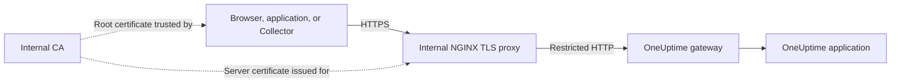

# How to Configure OneUptime HTTPS with an Internal Certificate Authority

Author: [nawazdhandala](https://www.github.com/nawazdhandala)

Tags: Air-Gapped, Monitoring, Observability

Description: Configure OneUptime behind an internal TLS proxy, distribute CA trust to browsers and telemetry clients, and renew certificates without disabling verification.

A certificate authority (CA) signs certificates that identify servers. Your internal CA lets OneUptime serve HTTPS without contacting a public certificate service. Three things must agree: the hostname clients use, the certificate the proxy presents, and the CA certificates each client trusts.

Here, NGINX handles TLS, the encryption behind HTTPS, then forwards requests to OneUptime. The CA issues certificates; it does not relay application traffic. Examples were checked against official sources and chart `17.0.0`, not tested in a live deployment.



## Choose the Name and Certificate Chain

Choose one stable internal DNS name, such as `oneuptime.example.internal`, and resolve it to the TLS proxy from operator workstations, applications, and collectors. Replace that example consistently throughout the configuration.

Request a server certificate from your organization's managed CA. Include `oneuptime.example.internal` as a DNS Subject Alternative Name (SAN), with server-authentication usage allowed by your certificate policy. A SAN lists the names the certificate covers. If clients intentionally connect using an IP address, that address needs an IP SAN. A DNS name resolving to an IP does not make the IP an equivalent certificate identity. Modern service-identity rules use SANs rather than relying on the certificate's common name. See [RFC 9525](https://www.rfc-editor.org/rfc/rfc9525.html).

Keep the roles distinct:

| File | Where it belongs |
| --- | --- |
| Server certificate and intermediate chain | TLS proxy, presented to clients |
| Server private key | TLS proxy's protected secret storage |
| Trusted root CA certificate | Approved browser, operating-system, and application trust stores |
| Root and issuing-CA private keys | CA infrastructure, never the proxy or client bundle |

A disposable lab CA can demonstrate certificate behavior in staging. Do not distribute its root into production trust stores. Production issuance needs your established identity checks, key protection, audit trail, and renewal ownership.

Prepare `oneuptime-fullchain.pem` with the server certificate (the leaf) first, followed by its intermediate CA certificates. These link the server certificate to the trusted root. Normally omit the root: clients obtain trust anchors through managed distribution. NGINX documents the required [certificate-chain ordering](https://nginx.org/en/docs/http/configuring_https_servers.html). Sending a root certificate does not make a client trust it.

## Configure OneUptime for the External HTTPS Address

For Helm release `oneuptime` in namespace `oneuptime`, the [17.0.0 chart](https://helm-chart.oneuptime.com/oneuptime-17.0.0.tgz) creates the gateway Service `oneuptime-nginx`. Merge this overlay into your existing approved values; retain release pins, storage, secrets, and offline image settings:

```yaml
host: oneuptime.example.internal
httpProtocol: https
ssl:
  provision: false
  skipVerification: false
trustedProxyHops: 2
nginx:
  service:
    type: ClusterIP
```

`host` contains no URL scheme. `httpProtocol` describes the client-facing address; it does not provision the external proxy. `ssl.provision: false` leaves automatic Let's Encrypt issuance disabled.

A proxy hop is one forwarding server. Two trusted hops fit this path: client → your NGINX proxy → OneUptime gateway → application. Recalculate for a different topology. Restrict direct access to the gateway so clients cannot bypass the trusted edge and supply their own forwarding headers.

The example uses an in-cluster proxy and the default cluster DNS suffix. Its backend hop is HTTP within the restricted cluster network. If policy requires encryption on that hop too, design and validate a separate authenticated upstream-TLS configuration; this example provides client-to-proxy HTTPS only.

## Terminate TLS in NGINX

Install the server key and chain through your secret-management process, with permissions allowing NGINX to read the key without exposing it to unrelated users. Place the following in an NGINX configuration included inside its `http` context. The Service must already resolve from the proxy. Replace the hostname, certificate paths, and backend address for your installation. With these files mounted, clients should reach the same OneUptime UI over HTTPS.

```nginx
map $http_upgrade $connection_upgrade {
    default upgrade;
    ''      close;
}

server {
    listen 443 ssl;
    server_name oneuptime.example.internal;

    ssl_certificate     /etc/nginx/tls/oneuptime-fullchain.pem;
    ssl_certificate_key /etc/nginx/tls/oneuptime.key;
    ssl_protocols TLSv1.2 TLSv1.3;

    # Match the documented OneUptime OTLP ingress body limit.
    client_max_body_size 4m;

    location / {
        proxy_pass http://oneuptime-nginx.oneuptime.svc.cluster.local:80;
        proxy_http_version 1.1;
        proxy_set_header Host $host;
        proxy_set_header X-Forwarded-Proto $scheme;
        proxy_set_header X-Forwarded-For $remote_addr;
        proxy_set_header Upgrade $http_upgrade;
        proxy_set_header Connection $connection_upgrade;
    }
}
```

The proxy preserves request paths, including `/otlp/v1/traces`. At this first trusted edge, replacing `X-Forwarded-For` prevents an arbitrary client value from becoming trusted history. WebSocket upgrade headers follow NGINX's [documented pattern](https://nginx.org/en/docs/http/websocket.html); forwarding behavior is described in its [proxy-module reference](https://nginx.org/en/docs/http/ngx_http_proxy_module.html).

The 4 MB body limit suits the documented OTLP route; evaluate other application uploads separately. Keep telemetry batches below the effective limit of every hop.

Run `nginx -t` inside the proxy environment after mounting the files. It checks syntax and referenced files without reloading the service. Only deploy or reload after it passes. See [NGINX command-line behavior](https://nginx.org/en/docs/switches.html).

## Distribute Trust to Every Client

Import the root through your managed device policy, checking its fingerprint through a trusted channel. Verify each browser's actual trust behavior; Mozilla documents [enterprise CA configuration](https://support.mozilla.org/en-US/kb/setting-certificate-authorities-firefox) for Firefox. A successful browser login does not prove that an application container trusts the same CA.

Mount the approved CA bundle into each exporting application or configure its runtime trust store. For an application already using an OpenTelemetry software development kit (SDK), these settings select the HTTPS destination and trusted CA. Use an SDK supporting these [OTLP exporter options](https://opentelemetry.io/docs/specs/otel/protocol/exporter/):

```bash
export OTEL_EXPORTER_OTLP_ENDPOINT='https://oneuptime.example.internal/otlp'
export OTEL_EXPORTER_OTLP_PROTOCOL='http/protobuf'
export OTEL_EXPORTER_OTLP_CERTIFICATE='/etc/pki/monitoring-roots.pem'
export OTEL_EXPORTER_OTLP_HEADERS="x-oneuptime-token=${ONEUPTIME_INGESTION_KEY}"
```

Mount the named CA file and supply `ONEUPTIME_INGESTION_KEY` through your secret mechanism before starting the application. Successful export should produce new telemetry in OneUptime. Check SDK-specific support and signal-specific overrides; setting these variables does not install instrumentation. The general HTTP endpoint gains signal paths such as `/v1/logs`; signal-specific endpoint settings instead need their complete paths.

The Collector forwards telemetry from applications. Add this exporter to its configuration, mount the CA file, supply the key, and reference `otlp_http/oneuptime` in each intended pipeline. Defining it alone does not enable export:

```yaml
exporters:
  otlp_http/oneuptime:
    endpoint: https://oneuptime.example.internal/otlp
    headers:
      x-oneuptime-token: ${env:ONEUPTIME_INGESTION_KEY}
    tls:
      ca_file: /etc/pki/monitoring-roots.pem
```

Current [HTTP exporter documentation](https://github.com/open-telemetry/opentelemetry-collector/blob/main/exporter/otlphttpexporter/README.md) uses `otlp_http`; `otlphttp` is a deprecated alias. Match the component name supported by your pinned Collector distribution. Its [TLS configuration](https://github.com/open-telemetry/opentelemetry-collector/blob/main/config/configtls/README.md) defines `ca_file` for server verification. This is an exporter fragment, not a complete Collector configuration.

OneUptime documents a limitation of its built-in gRPC ingress: it requires its own TLS termination and Let's Encrypt provisioning. For this internal-proxy deployment, use OTLP/HTTP at `/otlp`, with `x-oneuptime-token` authentication. This is a OneUptime ingress constraint, not a general inability of gRPC to use private CAs. See [air-gapped observability](https://oneuptime.com/enterprise/air-gapped/observability).

## Inspect Certificates Without Changing Them

With OpenSSL 3-compatible tooling, replace the sample hostname and file paths below. Inspect the public certificate, then connect from each client network. The first command prints identity and validity dates; the last should report successful verification. None creates certificates or prints private keys:

```bash
openssl x509 -in oneuptime-fullchain.pem -noout \
  -subject -issuer -dates -ext subjectAltName
openssl x509 -in oneuptime-fullchain.pem -noout -checkend 2592000

openssl s_client -connect oneuptime.example.internal:443 \
  -servername oneuptime.example.internal \
  -verify_hostname oneuptime.example.internal \
  -verify_return_error -CAfile monitoring-roots.pem </dev/null
```

The [expiry check](https://docs.openssl.org/3.0/man1/openssl-x509/) exits nonzero when the leaf expires within 30 days. It does not validate the entire chain. The [handshake check](https://docs.openssl.org/3.0/man1/openssl-s_client/) explicitly requests hostname verification and failure on verification errors. The `-servername` option selects the certificate using Server Name Indication (SNI); it does not itself verify the name.

Then verify fresh browser sign-in and newly exported telemetry. An unknown-issuer error suggests missing trust or intermediates; a hostname mismatch requires correcting the name or certificate. A telemetry authentication error after successful TLS is a separate ingestion-key problem. Keep verification enabled while resolving each cause.

## Renew with an Explicit Trust Overlap

For ordinary leaf renewal under the same CA, obtain the replacement early, check SANs, expiry, chain, and key pairing, and stage the certificate and key together. Run the configuration check, perform a controlled graceful reload, and verify the newly served certificate with a fresh connection. Retain the previous valid pair for operational rollback, unless it was compromised.

For CA rotation, distribute a bundle trusting both approved old and new roots before changing the server chain. Restart or reload clients according to their runtime's trust-loading behavior; do not assume replacing a mounted file updates every running process. Test browsers, SDKs, and collectors against the new chain before retiring old trust.

Remove the old root only after all dependent services have migrated and the overlap policy permits it. If policy requires checking whether a certificate was revoked, make that information available internally. Record ownership and alerts for leaf, intermediate, and root expiration so the next outage does not begin with a forgotten trust dependency.
