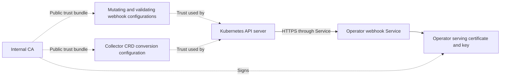

# Configure OpenTelemetry Operator Webhook Certificates with an Internal CA

Author: [nawazdhandala](https://www.github.com/nawazdhandala)

Tags: Air-Gapped, Monitoring, Observability

Description: Supply internal-CA certificates to the OpenTelemetry Operator, verify admission and conversion trust, and renew certificates without bypassing verification.

The OpenTelemetry Operator's webhook is an HTTPS server called by the Kubernetes API server. It can modify new pods to inject instrumentation and validate OpenTelemetry resources. If the API server cannot verify its certificate, requests can fail before an application starts.

This connection is separate from application-to-Collector telemetry and Collector-to-backend export. A Collector CA setting cannot repair webhook trust. Here, the Operator presents a serving certificate, while Kubernetes trusts the issuing certificate authority (CA) through webhook `caBundle` fields.



Mutating webhooks change requests; validating webhooks accept or reject them. A conversion webhook translates between versions of a custom resource. Each relevant configuration needs correct trust.

## Pin and Inspect the Supported Certificate Mode

This guide uses Helm chart **0.129.1**, whose application version is Operator **0.162.0**, as recorded in the [official chart index](https://open-telemetry.github.io/opentelemetry-helm-charts/index.yaml). Keep this pairing for the example; it does not assume another chart's values behave identically.

The [tagged values](https://github.com/open-telemetry/opentelemetry-helm-charts/blob/opentelemetry-operator-0.129.1/charts/opentelemetry-operator/values.yaml) support cert-manager issuance, Helm-generated self-signed certificates, and supplied certificate files. Disable both automatic modes for the supplied-file path. Although the comments call it a self-signed option, the [certificate helper](https://github.com/open-telemetry/opentelemetry-helm-charts/blob/opentelemetry-operator-0.129.1/charts/opentelemetry-operator/templates/_helpers.tpl) reads the supplied serving chain, key, and CA bundle; it does not require a self-signed leaf.

Use a protected working directory. Download and verify the pinned chart on the connected preparation side, then transfer it through your approved process. With Helm installed:

```bash
helm pull opentelemetry-operator --version 0.129.1 \
  --repo https://open-telemetry.github.io/opentelemetry-helm-charts \
  --untar
```

Mirror the Operator and any enabled helper, test, Collector, or instrumentation images separately. Certificate configuration does not rewrite registry references. Preserve your complete offline image and pull-credential values during installation or upgrade.

## Request the Correct Service Identity

The examples use namespace `opentelemetry-operator` and `fullnameOverride: otel-operator`. The rendered webhook Service is therefore `otel-operator-webhook`.

Ask your managed internal CA for a server-authentication certificate with these DNS Subject Alternative Names (SANs):

```text
otel-operator-webhook.opentelemetry-operator.svc
otel-operator-webhook.opentelemetry-operator.svc.cluster.local
```

SANs identify the server names covered by a certificate. Kubernetes requires the service identity `<service>.<namespace>.svc` when the webhook uses a service reference; see [admission webhook authentication](https://kubernetes.io/docs/reference/access-authn-authz/extensible-admission-controllers/). Adjust the optional full cluster name for your cluster's DNS suffix. A certificate for a public dashboard hostname is not a substitute.

Prepare three files: `server-fullchain.pem` containing the serving leaf followed by intermediate certificates; its matching `server.key`; and `ca.pem` containing approved trust anchors. Never copy a CA private key into the chart or cluster. Retain the issuance record, expiry, and owner responsible for renewal.

## Place Files Where This Chart Actually Reads Them

The chart uses Helm's `.Files.Get`. Paths are relative to the chart, not the shell's current directory. Files outside the chart, under `templates/`, or excluded by `.helmignore` are unavailable. See [Helm file access](https://helm.sh/docs/chart_template_guide/accessing_files/).

Place the approved files inside the unpacked chart. Replace `/secure/issued` with your protected source directory:

```bash
umask 077
mkdir -p opentelemetry-operator/pki
cp /secure/issued/server-fullchain.pem opentelemetry-operator/pki/
cp /secure/issued/server.key opentelemetry-operator/pki/
cp /secure/issued/ca.pem opentelemetry-operator/pki/
```

Do not pass PEM contents using `--set-file admissionWebhooks.certFile=...`: this value expects a chart-relative filename, not certificate text. Likewise, `secretName` names the Secret the chart uses; in this mode it is not a request to discover an arbitrary existing Secret's CA automatically.

The working chart and rendered output contain the serving private key. Protect them and Helm release storage as secret-bearing artifacts; do not commit or publish this customized chart.

Save the following as `certificate-values.yaml` outside the chart:

```yaml
fullnameOverride: otel-operator
admissionWebhooks:
  create: true
  failurePolicy: Fail
  pods:
    failurePolicy: Fail
  certManager:
    enabled: false
  autoGenerateCert:
    enabled: false
  certFile: pki/server-fullchain.pem
  keyFile: pki/server.key
  caFile: pki/ca.pem
crds:
  create: true
```

This intentionally sets pod admission to `Fail`, rather than the chart's default `Ignore`: matching pod creation fails if the webhook is unavailable. Review namespace selectors and availability requirements before production rollout. The chart retains `Ignore` for its two resource-deletion validation entries; this overlay does not change those hard-coded policies. Do not switch to fail-open to hide a broken certificate.

## Render and Inspect Every Trust Consumer

Render without contacting the cluster, adding your complete offline values:

```bash
helm template otel-operator ./opentelemetry-operator \
  --namespace opentelemetry-operator \
  --values offline-values.yaml --values certificate-values.yaml \
  > rendered.yaml
```

Inspect the following before deployment:

| Rendered object | Required result |
| --- | --- |
| Secret `otel-operator-controller-manager-service-cert` | Nonempty `tls.crt`, `tls.key`, and `ca.crt` matching the supplied files |
| Deployment `otel-operator` | Mounts that Secret at `/tmp/k8s-webhook-server/serving-certs` |
| Service `otel-operator-webhook` | Routes port 443 to the Operator webhook port |
| `otel-operator-mutation` | All three webhook entries have the expected service and CA bundle |
| `otel-operator-validation` | All four webhook entries have the expected service and CA bundle |
| CRD `opentelemetrycollectors.opentelemetry.io` | Conversion uses the same service at `/convert` and the expected CA bundle |

Base64 encoding in a Secret or `caBundle` is not encryption. Compare decoded bytes without printing private keys. Check that no competing cert-manager `Certificate` or `Issuer` is rendered. Local rendering with disposable certificates confirmed these objects and CA bindings for this chart; it did not test a live API server.

The chart templates its CRDs. Do not adopt or overwrite CRDs owned by another installation without an ownership and upgrade plan. If your platform manages CRDs separately, its owner must also update the conversion CA bundle. Kubernetes documents [conversion webhook configuration](https://kubernetes.io/docs/tasks/extend-kubernetes/custom-resources/custom-resource-definition-versioning/); updating only admission objects leaves a separate failure path.

Deploy the reviewed chart through your normal staging release process. Keep full values and image pins intact. Rendering alone does not validate admission availability, certificate loading, or control-plane network access.

## Verify Without Changing Cluster State

With OpenSSL 3-compatible tooling, inspect the public leaf and check whether it expires within 30 days:

```bash
openssl x509 -in opentelemetry-operator/pki/server-fullchain.pem \
  -noout -subject -issuer -dates -ext subjectAltName
openssl x509 -in opentelemetry-operator/pki/server-fullchain.pem \
  -noout -checkend 2592000
```

The [expiry check](https://docs.openssl.org/3.0/man1/openssl-x509/) exits nonzero when renewal is due within that window. It does not validate the whole chain. From an authorized diagnostic environment that can resolve and reach the webhook Service, test the actual TLS handshake. Copy only the public CA bundle to the indicated path in that environment, not the private key or customized chart:

```bash
openssl s_client \
  -connect otel-operator-webhook.opentelemetry-operator.svc:443 \
  -servername otel-operator-webhook.opentelemetry-operator.svc \
  -verify_hostname otel-operator-webhook.opentelemetry-operator.svc \
  -verify_return_error -CAfile opentelemetry-operator/pki/ca.pem </dev/null
```

[OpenSSL](https://docs.openssl.org/3.0/man1/openssl-s_client/) verifies the hostname and chain here; `-servername` alone only selects the server name. Expect successful verification. This checks reachability from the diagnostic environment, not necessarily from the API server.

Then rehearse actual admission and conversion with disposable resources in staging. Exercise pod injection, a valid Instrumentation or Collector change, and conversion between served Collector versions. Check expected mutations and validation behavior, not merely whether an API request returns success.

## Renew with Trust Overlap

For a leaf renewal under the same CA, issue a replacement with the same required SANs, verify its key pairing and chain, and stage the new leaf and key together. The chart's default Secret annotations use pre-install/pre-upgrade hooks and recreate the hook Secret before replacement. Account for that behavior in the maintenance plan; do not promise an interruption-free upgrade.

Confirm how your Operator reloads mounted certificates, and perform a controlled rollout if needed. Check the certificate actually served after renewal, rather than relying on the Secret's contents alone.

For a CA change, use three reviewed stages. First publish a `ca.pem` bundle trusting both old and new CAs while keeping the old serving certificate. Confirm that all admission entries and conversion trust contain the overlap. Next deploy the new leaf and key, retaining both trust anchors. Only remove the old CA after every serving replica uses the new chain and admission/conversion checks pass.

An unknown-authority error points to missing trust or intermediates; a hostname mismatch points to the SANs or service reference. Timeouts instead require checking endpoints, routing, firewall policy, and webhook health. Keep verification enabled while resolving the actual failure.
