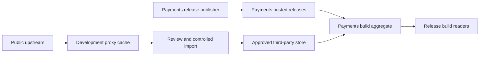

# Organize Artifact Repositories by Format, Team, and Trust

Author: [nawazdhandala](https://www.github.com/nawazdhandala)

Tags: Artifact Management, Artifact Repository, DevOps, Security

Description: Design hosted, proxy, and aggregate artifact repositories with explicit publishing targets, stable read endpoints, clear ownership, and enforceable trust boundaries.

An organization often starts with one package repository and adds another whenever a team asks. A year later, developers cannot tell which endpoint accepts releases, whether a production build can fetch a new public dependency, or who owns the cleanup policy. The names describe history rather than intent.

Organize around three decisions: what package protocol the client speaks, who may publish, and which sources a consumer is allowed to trust. Repository type helps implement those decisions, but it does not make them automatically.

## Translate the product names first

The major repository managers use related terms with product-specific details:

| Purpose | Nexus Repository terminology | Artifactory terminology |
| --- | --- | --- |
| Store artifacts your organization publishes | Hosted | Local |
| Fetch and cache artifacts from an upstream | Proxy | Remote |
| Provide an aggregate read endpoint | Group | Virtual |

Sonatype documents [hosted, proxy, and group types](https://help.sonatype.com/en/repository-types.html). JFrog documents [virtual aggregation](https://docs.jfrog.com/artifactory/docs/virtual-repositories) and [remote caching](https://docs.jfrog.com/artifactory/docs/remote-repositories). These are conceptual correspondences, not interchangeable API fields or identical permission behavior.

In particular, a caching proxy is not a complete mirror or a backup. Artifactory remote repositories fetch artifacts on demand. An empty new cache cannot make an offline build succeed merely because its upstream URL is configured.

## Separate package protocols before teams

A Maven client, npm client, and container runtime expect different metadata and resolution behavior. Make package format the first boundary. Avoid treating a folder full of unrelated files as though it were a universal package-manager endpoint.

Check the installed product's format/type support before choosing an aggregate. Sonatype publishes a [format support matrix](https://help.sonatype.com/en/formats.html), and support differs by repository type. Artifactory's usual virtual repository groups the same package type; its Generic exception can aggregate different types but does not maintain package metadata. That exception is not a substitute for working npm or Maven resolution.

For an organization with payments and search teams, begin with a small inventory:

| Repository | Owner | Writes | Read purpose |
| --- | --- | --- | --- |
| `npm-payments-release` | Payments release automation | Approved release jobs | Internal payments packages |
| `npm-search-release` | Search release automation | Approved release jobs | Internal search packages |
| `npm-public-cache` | Platform team | Upstream cache population | Development dependency discovery |
| `npm-reviewed-thirdparty` | Dependency review process | Controlled import process | Admitted external dependencies |
| `npm-payments-build` | Platform and payments jointly | No direct publishing in this design | Payments build input set |

Create corresponding Maven repositories only when there is a Maven workload. Do not multiply every combination of team, environment, region, and format before anyone needs it.

## Make trust visible in the membership graph

Suppose release builds must use only approved inputs. Their aggregate endpoint includes internal releases and reviewed third-party packages, but excludes the unrestricted public cache.



The review arrow represents a process you must implement: identify the package and exact version, verify integrity and provenance where available, apply policy, and record the admission decision. Naming a repository “approved” does none of those things. For metadata-bearing formats, use supported import or publication procedures rather than copying arbitrary blob-store files.

Do not add the development proxy to the release aggregate just because one build fails. That changes the permitted source set for every consumer of the endpoint. Diagnose the missing approved dependency and review the membership change as a policy change.

Repository ordering also does not replace namespace ownership. An internal package missing from its expected location must not silently resolve from an untrusted public source. Apply format-appropriate namespace routing and upstream exclusions, then test that missing private coordinates fail closed.

## Keep publishing destinations explicit

Give developers a stable read endpoint, but make release automation name its intended hosted/local destination. Some products support deployment through a virtual repository with a configured target; that capability still requires an explicit policy about where writes land. This design avoids that ambiguity by publishing directly.

Separate read, publish, overwrite, delete, and repository-administration permissions. A build reader should not gain publishing rights simply because its aggregate contains a repository that CI writes to. Test effective access using the real identities; do not infer it from how repositories are grouped in the UI.

Team boundaries matter when ownership or access differs. Two teams with identical retention, access, and release rules may share storage behind controlled namespaces. Separate repositories are useful when permission, retention, immutability, legal, or recovery requirements genuinely differ. They are less useful when they only duplicate a team name in another dashboard.

## Record and check the intended layout

The following `layout.json` is a small **organization inventory**, not a Nexus or Artifactory configuration payload. `hosted`, `proxy`, and `group` are normalized names used only by this example. It describes one npm release read path and its publish destination.

```json
{
  "repositories": [
    {"name":"npm-payments-release","format":"npm","kind":"hosted","trust":"approved"},
    {"name":"npm-public-cache","format":"npm","kind":"proxy","trust":"external"},
    {"name":"npm-reviewed-thirdparty","format":"npm","kind":"hosted","trust":"approved"},
    {"name":"npm-payments-build","format":"npm","kind":"group","trust":"approved",
     "members":["npm-payments-release","npm-reviewed-thirdparty"]}
  ],
  "publish_target":"npm-payments-release"
}
```

Save this Python 3 program as `check_layout.py`. It checks the relationships that are easy to break during a layout edit. Nested aggregates are intentionally excluded by this organization's example policy to keep review simple; this is not a claim that products cannot support them.

```python
import json
import sys

def check(data):
    repos = data["repositories"]
    by_name = {r["name"]: r for r in repos}
    if len(by_name) != len(repos):
        raise ValueError("duplicate repository name")
    for repo in repos:
        if repo["kind"] not in {"hosted", "proxy", "group"}:
            raise ValueError("unknown repository kind")
        if repo["kind"] != "group":
            continue
        if not repo.get("members"):
            raise ValueError("empty read group")
        for name in repo["members"]:
            member = by_name[name]
            if member["kind"] == "group":
                raise ValueError("nested groups excluded by this policy")
            if member["format"] != repo["format"]:
                raise ValueError("mixed package formats")
            if repo["trust"] == "approved" and member["trust"] != "approved":
                raise ValueError("unapproved member in approved read group")
    if by_name[data["publish_target"]]["kind"] != "hosted":
        raise ValueError("publish target must be hosted/local")

if __name__ == "__main__":
    with open(sys.argv[1]) as source:
        check(json.load(source))
    print("Layout policy checks passed")
```

Run `python3 check_layout.py layout.json`. The supplied inventory passes. Adding `npm-public-cache` to the approved group fails. The checker was locally tested against valid input and eight negative cases, including duplicate names, unknown references, mixed formats, and a proxy publish target. It is a relationship check, not a complete schema validator, permission audit, or proof that repository contents are approved.

## Migrate clients with evidence

Inventory current read and write URLs before changing them. Choose one representative build per format, preserve its lockfile and expected artifact digests, and test the proposed read endpoint with a clean client cache. Otherwise, an old local download can conceal missing repository content.

Test both permitted and forbidden behavior: approved resolution succeeds, publishing reaches the intended destination, release readers cannot reach development-only content, and missing private packages do not fall back publicly. Include an upstream outage test to distinguish cached availability from uncached dependencies.

Finally assign an owner for each endpoint, membership change, retention policy, and recovery procedure. The code here did not deploy either repository product or exercise real access rules. Treat the inventory as a reviewable design, then verify its translation against your installed version and actual client identities before migrating the remaining builds.
